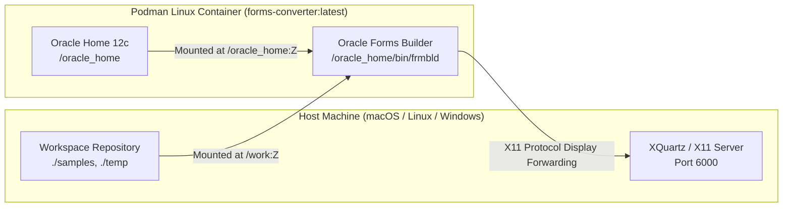

# Running Native Oracle Forms Builder GUI (frmbld)

This guide documents how to launch and run the official, visual **Oracle Forms Builder 12c (`frmbld`)** application from the containerized Linux installation on macOS, Linux, and Windows.

---

## 1. Overview & Purpose

The containerized Oracle installation in `tools/podman-converter/` serves two distinct purposes:

1. **Batch Conversion Pipeline (`frmf2xml.sh`)**: Headless conversion of binary `.fmb`, `.mmb`, and `.olb` files into canonical XML.
2. **Interactive Native Forms Builder GUI (`frmbld`)**: The full official visual designer and IDE, enabling you to inspect forms, canvases, layout hierarchies, triggers, and properties exactly as Oracle designed them.

Running the native GUI provides the **ultimate ground-truth reference** when evaluating layout rendering, font metrics, coordinate scaling, and trigger execution against our pure-native Rust viewer (`oracle-forms-viewer`).



---

## 2. Prerequisites (Host Setup)

### macOS Setup (XQuartz)

Oracle Forms Builder is an X11/Motif application. On macOS, **XQuartz** is required to render its graphical window:

1. **Install XQuartz** via Homebrew (or download from [xquartz.org](https://www.xquartz.org)):
   ```bash
   brew install --cask xquartz
   ```

2. **Enable Network Client Connections (One-Time Setup)**:
   - Open XQuartz: `open -a XQuartz`
   - Open Settings: press `Cmd + ,` or navigate to **XQuartz > Settings...**
   - Click the **Security** tab.
   - Check **"Allow connections from network clients"**.
   - **Important:** Quit XQuartz completely (`Cmd + Q`) and relaunch it for this change to take effect.

3. **Grant Host Display Authorization**:
   Run this in your terminal before launching the container:
   ```bash
   xhost + 127.0.0.1
   xhost + host.containers.internal
   ```

### Linux Setup
On native Linux (X11 / Xorg), display authorization is straightforward:
```bash
xhost +local:
```

### Windows Setup (WSL2 / Podman Desktop)
- On **Windows 11 with WSL2**, WSLg handles X11 GUI forwarding automatically via `DISPLAY=:0`.
- On **Windows 10**, install an X11 server like **VcXsrv** (select "Disable access control" during startup).

---

## 3. Launching Oracle Forms Builder

### Option A: Using the Automated Python Runner (Recommended)

A convenience launcher script is provided at `tools/podman-converter/run_forms_builder.py`. It automatically verifies X11, starts XQuartz if needed, authorizes the display, mounts the repository to `/work`, sets up `FORMS_PATH`, and launches `frmbld`:

```bash
python3 tools/podman-converter/run_forms_builder.py
```

You can also pass a file path directly to open it on startup:
```bash
python3 tools/podman-converter/run_forms_builder.py /work/samples/simple_module.fmb
```

---

### Option B: Direct Podman Command

If you prefer to run Podman directly without the script:

```bash
# 1. Authorize X11 connection on host
xhost + 127.0.0.1 host.containers.internal

# 2. Launch Forms Builder inside the container
podman run --rm -it \
  --platform linux/amd64 \
  -e DISPLAY="host.containers.internal:0" \
  -e ORACLE_HOME="/oracle_home" \
  -e JAVA_HOME="/usr/lib/jvm/jre-1.8.0-openjdk" \
  -e LD_LIBRARY_PATH="/oracle_home/lib:/usr/lib/jvm/jre-1.8.0-openjdk/lib/amd64/server:/usr/lib/jvm/jre-1.8.0-openjdk/lib/amd64" \
  -e FORMS_BUILDER_CLASSPATH="/oracle_home/jlib/frmbld.jar:/oracle_home/jlib/importer.jar:/oracle_home/jlib/debugger.jar:/oracle_home/jlib/utj.jar:/oracle_home/oracle_common/jlib/ewt3.jar:/oracle_home/oracle_common/modules/oracle.bali.share/share.jar:/oracle_home/jlib/dfc.jar:/oracle_home/oracle_common/modules/oracle.help/ohj.jar:/oracle_home/oracle_common/modules/oracle.help/help-share.jar:/oracle_home/oracle_common/modules/oracle.help/oracle_ice.jar:/oracle_home/oracle_common/modules/oracle.bali.jewt/jewt4.jar:/oracle_home/forms/java/frmwebutil.jar:/oracle_home/forms/java/frmall.jar" \
  -e FORMS_PATH="/work:/work/samples:/work/temp/example-fmb:/work/temp/example-fmb/internal-testing" \
  -v "$(pwd)/tools/podman-converter/oracle_home:/oracle_home:Z" \
  -v "$(pwd):/work:Z" \
  forms-converter:latest \
  /oracle_home/bin/frmbld
```

*(On Linux, replace `host.containers.internal:0` with `${DISPLAY:-:0}`)*.

---

## 4. Navigating Inside Forms Builder

Once Forms Builder starts, the classic Oracle Forms IDE interface appears on your desktop:

### 1. Opening a Form
- Click **File > Open** (or press `Ctrl + O`).
- In the file dialog, double-click the **`work/`** directory (this is your project root).
- Navigate to:
  - `work/samples/` for public test forms (`simple_module.fmb`, `object_library.olb`).
  - `work/temp/example-fmb/` for your internal test modules (`rccm0000.fmb`).

### 2. Viewing the Visual 2D Canvas Layout
- In the **Object Navigator** tree, expand your loaded module (e.g. `RCCM0000`).
- Expand the **Canvases** node.
- Double-click the canvas icon (e.g. `CRCCMAINMENU`), or right-click and choose **Layout Editor** (`F2`).
- The native 2D layout editor displays with full vector rendering, fonts, coordinate grids, and frame groupings.

### 3. Inspecting Triggers and PL/SQL
- In the Object Navigator, expand **Triggers** (at the module, block, or item level) or **Program Units**.
- Double-click any trigger icon or press `F11` to open the integrated **PL/SQL Editor**.

### 4. Property Inspector
- Select any block, item, canvas, window, or trigger and press `F4` (or right-click > **Property Palette**).
- Inspect properties such as `X Position`, `Y Position`, `Width`, `Height`, `Bevel`, `Canvas Name`, and `Property Class`.

---

## 5. Resolving Dependencies (`FORMS_PATH`)

Complex Forms often reference:
- **Attached Libraries** (`.pll` files, e.g. `juslib.pll`, `itslib.pll`)
- **Object Libraries** (`.olb` files)
- **Subclassed Property Classes**

When Forms Builder opens a module, it searches the directories listed in the `FORMS_PATH` environment variable. The launcher script pre-configures `FORMS_PATH` with:
- `/work` (project root)
- `/work/samples` (shared fixtures)
- `/work/temp/example-fmb` (local client libraries and modules)

If your form depends on libraries in a different folder, add that folder to the `FORMS_PATH` environment variable in `run_forms_builder.py` or pass it via `-e FORMS_PATH="...:$FORMS_PATH"`.

---

## 6. Troubleshooting

| Symptom | Cause | Solution |
|---|---|---|
| **`FRM-91111: Internal Error: Cannot open display`** | XQuartz is not running, or network connections are disallowed. | 1. Open XQuartz.<br/>2. In **Settings > Security**, check **"Allow connections from network clients"**.<br/>3. Quit XQuartz (`Cmd + Q`) and restart it.<br/>4. Run `xhost + 127.0.0.1` and `xhost + host.containers.internal`. |
| **`podman: command not found`** | Podman is not installed or not in PATH. | Install via Homebrew: `brew install podman` |
| **`Error: cannot connect to the Podman socket`** | Podman machine VM is not running. | Run `podman machine start` |
| **Fonts look small or low-resolution** | High-DPI / Retina display scaling in XQuartz. | In XQuartz Settings > **Output**, check or uncheck **"Enable full screen mode"** or adjust display scaling via `xrandr`. |
| **Missing Attached Library error on Open** | The referenced `.pll` or `.olb` is not in `FORMS_PATH`. | Place the dependent `.pll` / `.olb` files into `temp/example-fmb/` so `FORMS_PATH` discovers them automatically. |
