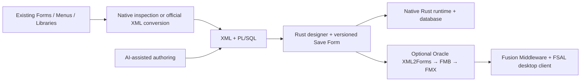
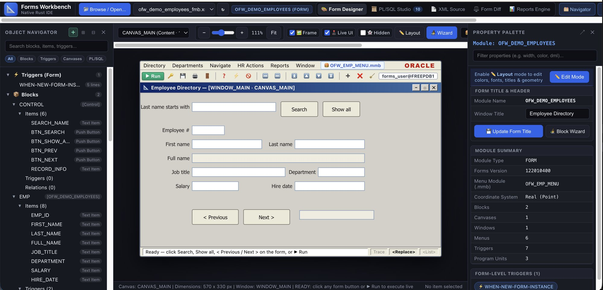
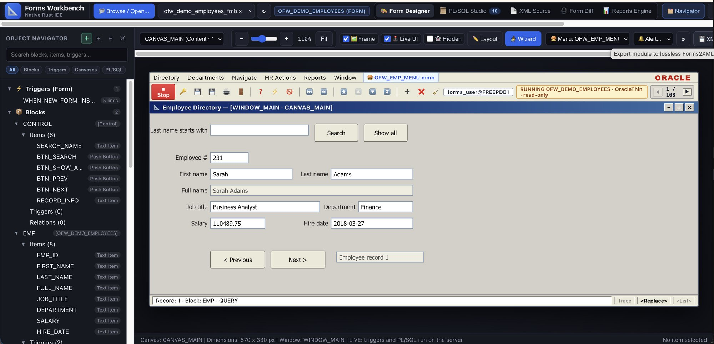
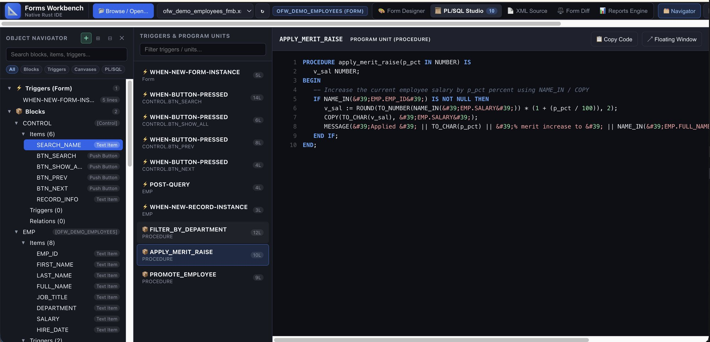
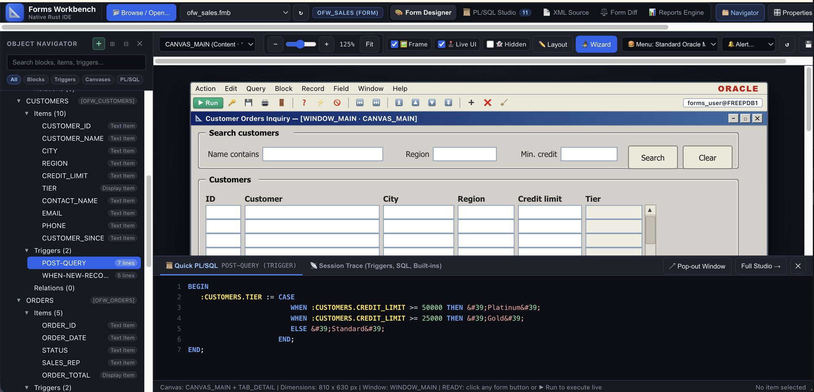
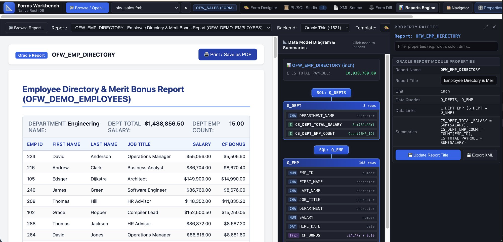

# Oracle Forms Workbench

A native Rust development workbench for **Oracle Forms & Reports**: open existing artifacts, convert them to XML, design and modify forms, run them against a database, and compile and view the updated forms in **Oracle Fusion Middleware**. XML and PL/SQL also make the workflow accessible to AI coding agents.

**The milestone: a working form-authoring loop across two runtimes.** Forms designed or edited as XML can be previewed and executed by the Rust runtime, then converted to FMB, compiled to FMX, and launched in the real Oracle Forms 14c client through the optional reference environment. Employee Directory, Orders, and Sales have exercised this pipeline; detailed evidence and remaining gaps are in the [implementation status](docs/plans/10-NEXT-PHASE-SESSION-PROMPT.md).

The native workbench requires **no JVM, Node.js, Oracle Forms installation, or Oracle Client libraries**. Official Oracle conversion, compilation, and desktop execution use a separate, optional toolchain.

## From an existing application to an updated running form

1. **Open and understand.** Browse samples or upload artifacts. Inspect the object navigator, form canvas, properties, XML, triggers, program units, menus, libraries, and report definitions. Use official converters when a fuller XML representation is needed than direct binary extraction provides.
2. **Create or modify.** Use the Data Block & Layout Wizard to create a named form or add/replace a block, discover database table columns, and generate form or tabular layouts. Edit supported geometry, labels, colors, and properties in Layout mode. Author XML and PL/SQL directly with your editor or an AI coding agent.
3. **Save the definition.** **Save Form** writes a new `samples/<module>_edited_<n>_fmb.xml`. Original source files are preserved. **Save Record** is a separate database action during runtime.
4. **Run in Rust.** Start a native session using Oracle Thin, SQLite, or Mock. Exercise supported PL/SQL triggers, navigation, queries, validation, master-detail behavior, and record operations. Sessions start read-only; database writes require explicit opt-in.
5. **Publish to the local Oracle reference environment.** Choose **Preview in Oracle → Save & launch in Oracle**. The workbench saves current edits, stages XML, converts it to FMB, compiles FMX, makes it available to the configured local Forms server, and launches the Oracle desktop client through FSAL. The dialog shows setup checks, compilation credentials, progress, and diagnostics.
6. **Compare and iterate.** Compare a baseline with multiple forms or uploaded versions in Form Diff, review structural and layout changes, and compare the Rust preview with the real Oracle window.



## Capabilities and formats

| Area | Available workflow |
|---|---|
| Forms (`.fmb`, Forms2XML `.xml`) | Direct binary extraction or XML parsing; SVG preview, property/layout editing, wizard authoring, versioned XML saves, native execution, and optional Oracle compilation/launch. |
| Menus (`.mmb`, menu XML) | Inspect extracted structure and PL/SQL; attach menu modules to forms; official XML conversion. A dedicated standalone menu canvas remains outstanding. |
| Object libraries (`.olb`, object-library XML) | Native extraction/inspection and modeled previews; official XML conversion. Editing coverage depends on the extracted model. |
| PL/SQL libraries (`.pld`, `.pll`) | Native PLD parsing and source inspection; supported library routines in native sessions. Official tooling handles PLL/PLD conversion. |
| Reports (report XML, `.rdf`, `.rpt`) | Official binary-to-XML conversion, native XML data-model inspection, parameterized execution, HTML report preview, themes, and browser print/PDF. Native export covers the modeled data definition, rather than the full Oracle paper layout. |
| Form Diff | Baseline versus multiple targets/uploads, scoped trigger and model changes, and geometry comparison at a shared scale. CLI supports pairwise diffs. |
| PL/SQL Studio | Source browsing, split view, code analysis, and runtime diagnostics for the implemented PL/SQL subset. |
| Database access | Pure-native Oracle Thin, embedded SQLite, and explicit Mock backend. An optional SQL*Plus testbed driver is also available. |

Direct binary parsing uses ROS 60050 extraction heuristics; it cannot reconstruct every Oracle property or layout. Prefer official XML exports when fidelity matters. Native execution interprets the supported form model and PL/SQL subset; it does not produce Oracle executables.

## Quickstart: native design and execution

From the repository root, with Rust and Cargo installed:

```bash
cargo run -p oracle-forms-server
```

Open **[http://127.0.0.1:7070](http://127.0.0.1:7070)**. Use **Browse / Open** to select `ofw_demo_employees_fmb.xml`, `orders_fmb.xml`, or your own artifact. Enter **Layout** mode to edit, or open **Wizard** to generate a form/block. Click **Save Form** to retain a new XML version.

To exercise the form, click **Run**, choose a backend, and use **Connect & Run**. SQLite and Mock support offline work. Oracle Thin connects directly to your database; the local reference database uses `localhost:1521/FREEPDB1`. Supply your database credentials in the login dialog. Database-connected compilation in the Oracle preview dialog has separate credential fields.

For server configuration, environment credential opt-in, custom ports, and runtime details, see [HOW-TO-RUN.md](HOW-TO-RUN.md).

## Compile and view the edited form in Oracle

The **Preview in Oracle** button launches the current saved form through the configured local Oracle Forms 14c environment. It opens a Java desktop window **on the computer running the Rust server**. The advanced option for opening an already compiled FMX is separate from publishing current edits.

This optional path needs Python 3, Podman, a provisioned and running Forms 14c/WebLogic installation, host Java 17+, the FSAL launcher JAR, and access to any referenced database schema, menus, or libraries. Oracle installers must be supplied separately. The dialog includes a dependency checklist and setup/startup instructions; it does not install the stack automatically. See the [Oracle automation plugin](plugins/oracle-forms/README.md) and [Forms & Reports testing guide](docs/FORMS-AND-REPORTS-14C-TESTING-GUIDE.md).

Use database-connected compilation for PL/SQL that references schema objects. Offline compilation is an explicit option and can fail on unresolved database objects. A successful compile or launch establishes a pipeline result; visual and behavioral comparison is still required.

The same pipeline can be driven from the terminal once the reference environment is configured:

```bash
# Check the configured containers, servlet, and database
python3 plugins/oracle-forms/.apm/skills/setting-up-oracle-testbed/scripts/health_check.py

# Convert a binary form to Oracle XML using the reference converter
python3 plugins/oracle-forms/.apm/skills/converting-oracle-artifacts/scripts/convert_fmb.py samples/simple_module.fmb

# Convert XML, compile with a supplied database logon, and launch interactive FSAL
# Set OFW_PREVIEW_DB_LOGON in your environment; do not store it in project files.
python3 plugins/oracle-forms/.apm/skills/compiling-and-running-oracle-forms/scripts/run_form.py \
  samples/ofw_sales_fmb.xml --compile-from-env --interactive
```

## AI-assisted authoring

Forms can be authored as reviewable **XML and PL/SQL files**, allowing an AI coding agent to create a new form or modify an existing one using the repository's models, samples, CLI, and [Oracle automation skills](plugins/oracle-forms/README.md). The Rust UI provides the visual editing and execution loop, and the optional Oracle stack validates conversion, compilation, and actual Oracle rendering. This workflow uses your coding agent; an embedded chat or AI generation service is not required or currently provided by the UI.

For example, ask a coding agent:

> Create a sales-entry form as Forms XML using the existing samples and my schema. Add order and line blocks, labels, navigation buttons, and the required PL/SQL triggers. Preserve the source form, save a new XML artifact, inspect the changes, and explain unsupported behavior. Validate it in the native runtime, then use the configured Oracle reference environment to compile and preview it.

Provide the real schema and intended behavior, review generated SQL/PL/SQL, and validate both runtimes. The wizard discovers columns; neither it nor successful compilation guarantees that generated business logic is correct. [AGENTS.md](AGENTS.md) describes the authoring, preservation, credential, and verification rules for agents.

## CLI toolkit

```bash
# Inspect the modeled artifact as JSON for human or agent tooling
cargo run -p oracle-forms-cli -- inspect samples/orders_fmb.xml --json

# Inspect a binary artifact (prefers sibling XML when present)
cargo run -p oracle-forms-cli -- inspect samples/simple_module.fmb

# Extract PL/SQL sidecars
cargo run -p oracle-forms-cli -- dump-sql samples/orders_fmb.xml -o ./extracted-sql

# Compare two form definitions
cargo run -p oracle-forms-cli -- diff samples/orders_fmb.xml samples/claims_fmb.xml --json

# Query directly using Oracle Thin; set OFW_DB_USER / OFW_DB_PASSWORD first
cargo run -p oracle-forms-cli -- query samples/test_db_fmb.xml --backend oracle-thin
cargo run -p oracle-forms-cli -- query samples/orders_fmb.xml --backend mock

# Inspect and render a report with the native engine
cargo run -p oracle-forms-cli -- report inspect samples/ofw_employee_directory_report.xml
cargo run -p oracle-forms-cli -- report run samples/ofw_employee_directory_report.xml --backend mock -o ./report.html
```

`export-xml` is also available for model-based XML export. It can omit unmodeled Oracle content; use the UI's original-XML patch path or official converters when preservation matters.

## Screenshots

These show representative workbench and reference-runtime views; toolbar details may differ from the current UI.

### Form Designer with Custom Menu (.mmb)

Object navigator, canvas with in-form navigation, attached `OFW_EMP_MENU.mmb`, and property palette.



### Live Run against Oracle 23ai

Run the form with supported triggers and PL/SQL over a live database session.



### PL/SQL Studio and Split Drawer





### Reports Engine

HTML5 report preview with data model diagram and report property sheet.



### Live Forms 14c Desktop Execution (FSAL + Oracle 23ai Database)

Run compiled forms (`.fmx`) natively on macOS and Windows via Forms Standalone Launcher (FSAL) backed by Oracle WebLogic 14c and Oracle Database 23ai Free.


---

## Architecture and repository layout

```text
├── Cargo.toml                # Virtual workspace root
├── crates/                   # Pure Rust multi-crate workspace
│   ├── oracle-forms-core/    # Canonical AST models, sidecars, geometry
│   ├── oracle-forms-xml/     # quick-xml streaming parser (XML & PLD)
│   ├── oracle-forms-binary/  # ROS 60050 stream & heuristic binary extractor
│   ├── oracle-forms-db/      # Direct DB query engine (Oracle 23ai, SQLite, Mock)
│   ├── oracle-forms-plsql/   # PL/SQL lexer, parser, AST, and code analysis
│   ├── oracle-forms-runtime/ # Form sessions, interpreter, reports evaluation/rendering
│   ├── oracle-forms-cli/     # Inspect, export, diff, query, and reports CLI
│   └── oracle-forms-server/  # Axum APIs, editing/saving, sessions, optional Oracle bridge
├── ui/                       # Vanilla HTML/CSS/JS frontend
├── samples/                  # Shared fixtures and versioned XML form saves
│
├── plugins/oracle-forms/     # APM Skills & Automation for Oracle Forms & Reports 14c
│   ├── .apm/skills/
│   │   ├── setting-up-oracle-testbed/       # Automated Podman 23ai & Forms 14c setup
│   │   ├── converting-oracle-artifacts/     # Forms2XML, XML2Forms, PLL, and Reports converters
│   │   └── compiling-and-running-oracle-forms/ # Headless compiler & live desktop FSAL runner
│   └── README.md
│
├── oracle-reference-stack/   # Optional Oracle 12c/14c reference stack and Free DB configuration
│
├── docs/                     # Architectural specifications & blueprints
│   ├── NATIVE-RUST-WORKBENCH-ARCHITECTURE.md # Active system architecture & implementation status
│   ├── DEPENDENCIES.md                       # System dependencies & Software Bill of Materials (SBOM)
│   ├── rust-workbench-architecture.mmd       # Rust workspace architecture diagram
│   ├── PODMAN-CONVERTER-SETUP-AND-HISTORY.md # Official Oracle 12c container setup
│   ├── podman-architecture.mmd               # Container architecture diagram
│   └── plans/                                # Comprehensive engineering roadmap & RFCs
│
├── temp/                     # [GITIGNORED] Local work files, test binaries, legacy POC
│
├── architecture.md           # System architecture, data pipelines, & crate boundaries
├── AGENTS.md                 # Operational guidelines and constraints for AI agents
└── HOW-TO-RUN.md             # Step-by-step instructions to run the server and CLI
```

## Preservation and current limits

Save Form writes new XML versions rather than overwriting the source XML or binary. Item edits can patch the original XML while retaining unmodeled content (`patchedOriginal`); newly authored forms, structural regeneration, and binary-derived exports may use a potentially lossy model summary (`summary`). The Oracle launcher stages its own copy and logs compatibility adjustments before conversion. Generated FMB/FMX staging files remain under ignored `temp/`.

Remaining work includes exact Oracle font/theme/zoom/DPI parity, persistence of UI-only font edits, broader built-in and dependency coverage, complex tab/overlay behavior, a dedicated menu inspector, and full report layout round trips. See the [roadmap](docs/plans/06-IMPLEMENTATION-ROADMAP-AND-MILESTONES.md) and [continuation status](docs/plans/10-NEXT-PHASE-SESSION-PROMPT.md) for completed, partial, and unverified work.

## Development checks

Run from the repository root:

```bash
cargo check
cargo test
node --test tests/ui_*.test.cjs
python3 tests/test_reference_pipeline.py
```

Node is only used here for frontend regression tests; the native application has no Node build or runtime requirement. Reference-pipeline unit tests are separate from live Oracle compilation and runtime checks.

## Key Documentation Links

- **[How to Run Native Viewer & CLI](HOW-TO-RUN.md)**: Server configuration, custom ports, CLI commands, and desktop FSAL runner.
- **[Oracle Forms APM Plugin](plugins/oracle-forms/README.md)**: APM skills for setup, conversion, compilation, and live desktop execution.
- **[Native Rust Workbench Architecture](docs/NATIVE-RUST-WORKBENCH-ARCHITECTURE.md)**: Active system architecture, delivered capabilities, and technical roadmap.
- **[System Dependencies & SBOM](docs/DEPENDENCIES.md)**: Complete dependency audit for Rust workspace, Podman container, and host systems.
- **[Running Official Forms Builder GUI](ORACLE-FORMS-BUILDER-GUI.md)**: Launching native Oracle Forms Builder (`frmbld`) on macOS/Linux via X11 for visual ground-truth comparison.
- **[Forms & Reports 14c Testing Guide](docs/FORMS-AND-REPORTS-14C-TESTING-GUIDE.md)**: Full verification blueprint for Forms 14c, Reports Server, FSAL live execution, and 23ai Database integration.
- **[System Architecture](architecture.md)**: Data pipelines, crate contracts, coordinate math, and sequence diagrams.
- **[Agent Guidelines](AGENTS.md)**: Rules and invariants for automated coding agents.
- **[Official Oracle 12c Toolchain](docs/PODMAN-CONVERTER-SETUP-AND-HISTORY.md)**: Podman Rosetta 2 setup for certified baseline XML generation.

---

## License

This project is dual-licensed under [MIT](LICENSE-MIT) or [Apache-2.0](LICENSE-APACHE).
