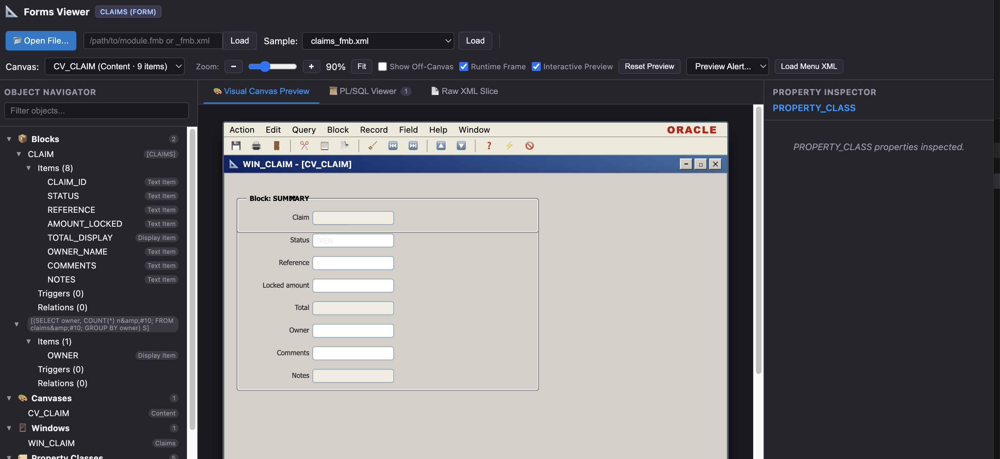
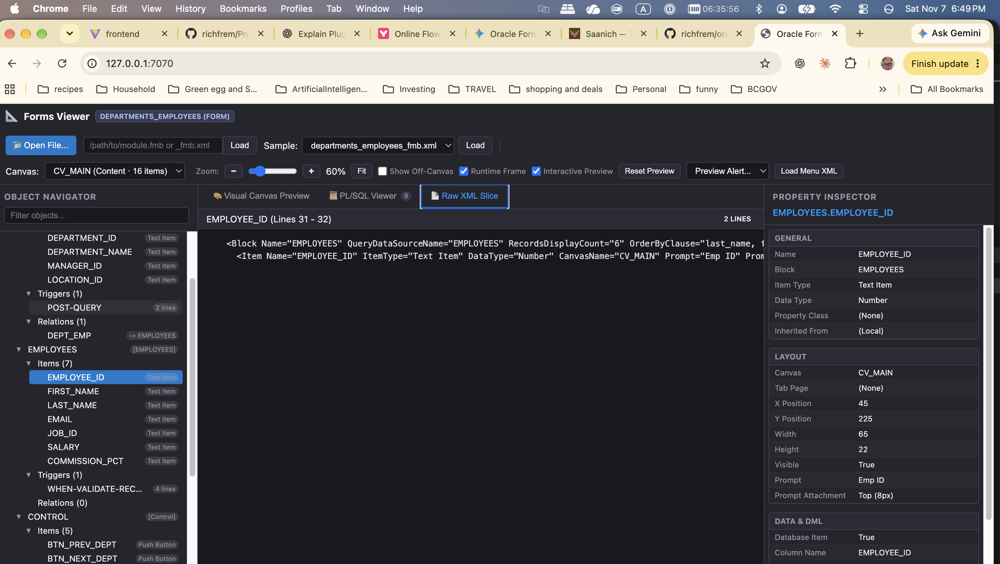
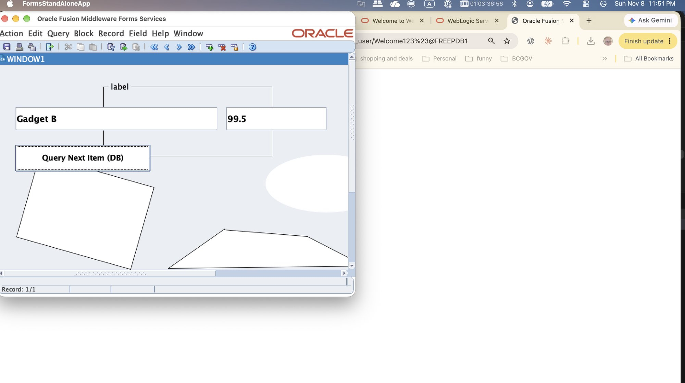

# Oracle Forms Research & Native Viewer

A comprehensive research project, reverse-engineering engine, and pure-native Rust toolchain for inspecting, visualizing, and migrating legacy **Oracle Forms** applications (`.fmb`, `.mmb`, `.olb`, Forms2XML exports, and `.pld` libraries).

Zero JVM, zero Node.js, and zero Oracle runtime software required for day-to-day operation.

---

## Screenshots

### Interactive Form Preview

Preview a claims form alongside the object navigator
and property inspector. Interactive Preview supports local edits without database
connections or PL/SQL execution.



### XML and Property Inspection

Select a form item to inspect its source XML, layout coordinates, data type, and
database-related properties.



### Live Forms 14c Desktop Execution (FSAL + Oracle 23ai Database)

Run compiled forms (`.fmx`) natively on macOS and Windows via Forms Standalone Launcher (FSAL) backed by Oracle WebLogic 14c and Oracle Database 23ai Free.



---

## Repository Structure

```text
├── oracle-forms-viewer/      # [Primary Deliverable] Pure Rust workspace (CLI + Web Viewer)
│   ├── crates/
│   │   ├── oracle-forms-core/    # Canonical AST models, sidecars, geometry
│   │   ├── oracle-forms-xml/     # quick-xml streaming parser (XML & PLD)
│   │   ├── oracle-forms-binary/  # ROS 60050 stream & heuristic binary extractor
│   │   ├── oracle-forms-cli/     # Standalone CLI (inspect & dump-sql)
│   │   └── oracle-forms-server/  # Axum web server with embedded UI assets
│   ├── ui/                       # Vanilla HTML/CSS/JS frontend
│   └── samples/                  # Curated redistributable sample forms
│
├── plugins/oracle-forms/     # APM Skills & Automation for Oracle Forms & Reports 14c
│   ├── .apm/skills/
│   │   ├── setting-up-oracle-testbed/       # Automated Podman 23ai & Forms 14c setup
│   │   ├── converting-oracle-artifacts/     # Forms2XML, XML2Forms, PLL, and Reports converters
│   │   └── compiling-and-running-oracle-forms/ # Headless compiler & live desktop FSAL runner
│   └── README.md
│
├── docs/                     # Architectural specifications & blueprints
│   ├── NATIVE-RUST-VIEWER-ARCHITECTURE.md        # Active system architecture & implementation status
│   ├── DEPENDENCIES.md                           # System dependencies & Software Bill of Materials (SBOM)
│   ├── rust-viewer-architecture.mmd              # Rust workspace architecture diagram
│   ├── PODMAN-CONVERTER-SETUP-AND-HISTORY.md     # Official Oracle 12c container setup
│   └── podman-architecture.mmd                   # Container architecture diagram
│
├── samples/                  # Test corpus (claims, orders, simple_module, utils.pld, test_db)
├── tools/                    # Official Oracle 12c & 14c Podman converter + 23ai DB (Track 1 ground truth)
├── temp/                     # [GITIGNORED] Local work files, test binaries, legacy POC
│
├── architecture.md           # System architecture, data pipelines, & crate boundaries
├── AGENTS.md                 # Operational guidelines and constraints for AI agents
└── HOW-TO-RUN.md             # Step-by-step instructions to run the server and CLI
```

---

## Quickstart

### 1. Launch the Native Web Viewer (Port 7070)

```bash
cd oracle-forms-viewer
cargo run -p oracle-forms-server
```

Open **[http://127.0.0.1:7070](http://127.0.0.1:7070)** in your browser.

- Select any preloaded sample (`orders_fmb.xml`, `claims_fmb.xml`, `simple_module.fmb`).
- Or drag & drop your own `.fmb` or `.xml` file to view its 2D canvas, object hierarchy, and PL/SQL triggers.

### 2. Inspect Forms from the Command Line

```bash
cd oracle-forms-viewer

# Inspect an XML module export
cargo run -p oracle-forms-cli -- inspect samples/orders_fmb.xml

# Inspect a raw binary .FMB directly (ROS 60050 stream decoding)
cargo run -p oracle-forms-cli -- inspect samples/simple_module.fmb

# Dump all PL/SQL triggers and program units as .sql files
cargo run -p oracle-forms-cli -- dump-sql samples/orders_fmb.xml -o ./extracted-sql
```

### 3. Run the Automated Test Suite

```bash
cd oracle-forms-viewer
cargo test
```

### 4. Run Forms Live via Desktop FSAL (Oracle 14c + 23ai DB)

```bash
# Health-check the testbed:
python3 plugins/oracle-forms/.apm/skills/setting-up-oracle-testbed/scripts/health_check.py

# Convert, compile, and launch any form immediately in a desktop window:
python3 plugins/oracle-forms/.apm/skills/compiling-and-running-oracle-forms/scripts/run_form.py samples/test_db.fmb
```

---

## Key Documentation Links

- **[How to Run Native Viewer & CLI](HOW-TO-RUN.md)**: Server configuration, custom ports, CLI commands, and desktop FSAL runner.
- **[Oracle Forms APM Plugin](plugins/oracle-forms/README.md)**: APM skills for setup, conversion, compilation, and live desktop execution.
- **[Native Rust Viewer Architecture](docs/NATIVE-RUST-VIEWER-ARCHITECTURE.md)**: Active system architecture, delivered capabilities, and technical roadmap.
- **[System Dependencies & SBOM](docs/DEPENDENCIES.md)**: Complete dependency audit for Rust workspace, Podman container, and host systems.
- **[Running Official Forms Builder GUI](ORACLE-FORMS-BUILDER-GUI.md)**: Launching native Oracle Forms Builder (`frmbld`) on macOS/Linux via X11 for visual ground-truth comparison.
- **[Forms & Reports 14c Testing Guide](docs/FORMS-AND-REPORTS-14C-TESTING-GUIDE.md)**: Full verification blueprint for Forms 14c, Reports Server, FSAL live execution, and 23ai Database integration.
- **[System Architecture](architecture.md)**: Data pipelines, crate contracts, coordinate math, and sequence diagrams.
- **[Agent Guidelines](AGENTS.md)**: Rules and invariants for automated coding agents.
- **[Official Oracle 12c Toolchain](docs/PODMAN-CONVERTER-SETUP-AND-HISTORY.md)**: Podman Rosetta 2 setup for certified baseline XML generation.

---

## License

The native `oracle-forms-viewer` workspace is dual-licensed under [MIT](oracle-forms-viewer/LICENSE-MIT) or [Apache-2.0](oracle-forms-viewer/LICENSE-APACHE).
