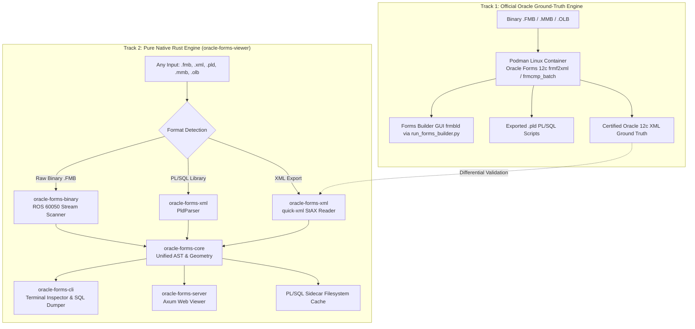
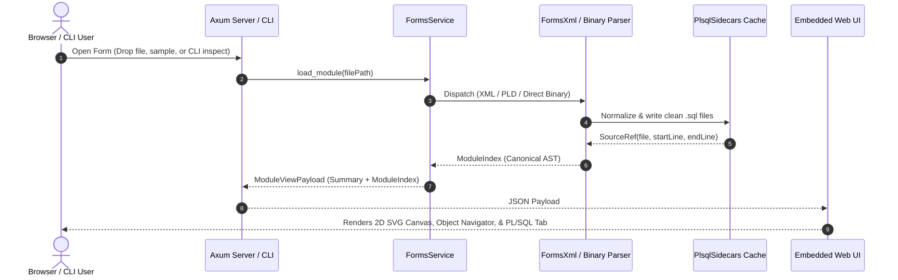

# System Architecture: Oracle Forms Research & Native Viewer

---

## 1. High-Level System Overview

The system provides a complete, modern, cross-platform pipeline for inspecting, visualizing, and extracting legacy Oracle Forms applications without requiring Windows machines or proprietary Oracle client licenses.

It operates on a **two-track strategy**:



---

## 2. The Rust Multi-Crate Workspace

The core deliverable is housed in `oracle-forms-viewer/`, partitioned into 5 modular crates:

```text
oracle-forms-viewer/
├── Cargo.toml                            # Virtual workspace root
├── crates/
│   ├── oracle-forms-core/                # Shared domain models, sidecars, geometry
│   ├── oracle-forms-xml/                 # Streaming quick-xml parser (Forms XML & PLD)
│   ├── oracle-forms-binary/              # ROS 60050 stream & heuristic binary extractor
│   ├── oracle-forms-cli/                 # Standalone CLI (inspect & dump-sql)
│   └── oracle-forms-server/              # Axum HTTP server with embedded UI assets
├── ui/                                   # Embedded web frontend (HTML/CSS/JS/SVG)
└── samples/                              # Test corpus (XML, PLD, and binary FMB)
```

### Crate Breakdown

| Crate | Responsibility | Dependencies |
|---|---|---|
| **`oracle-forms-core`** | Defines canonical AST structures (`ModuleIndex`, `BlockInfo`, `ItemInfo`, `CanvasInfo`, `TriggerInfo`, `ProgramUnitInfo`), Serde camelCase serialization matching web contracts, coordinate scaling math (milli-unit scaling `0.0378`), PL/SQL sidecar filesystem writer with collision deduplication (`~2`, `~3`), and conditional entity unescaping. | `serde`, `serde_json`, `sha2`, `thiserror`, `regex` |
| **`oracle-forms-xml`** | High-performance streaming XML reader using `quick-xml`. Translates byte offsets to line ranges via precomputed newline indexes. Handles Oracle 12c and earlier Forms2XML schemas without building heavy DOM trees. Also includes `PldParser` for `.pld` text libraries. | `oracle-forms-core`, `quick-xml`, `regex`, `thiserror` |
| **`oracle-forms-binary`** | Direct ROS 60050 byte-stream parser. Dissects binary headers (`ROS.60050`), extracts uncompressed PL/SQL triggers and program units, discovers blocks and items via bind variable patterns (`:BLOCK.ITEM`), extracts SQL queries for record groups, and computes collision-free dynamic masonry multi-column preview layouts. | `oracle-forms-core`, `regex`, `thiserror` |
| **`oracle-forms-cli`** | Command-line binary providing `inspect` (summaries or full AST JSON) and `dump-sql` (dumps all extracted PL/SQL blocks directly into `.sql` files). | `oracle-forms-core`, `oracle-forms-xml`, `oracle-forms-binary`, `clap`, `tokio` |
| **`oracle-forms-server`** | Standalone web server built on `axum`. Embeds `ui/` assets directly into the binary via `rust-embed`. Provides REST endpoints for sample discovery, file opening (multipart or path), source retrieval, and XML slicing. | `oracle-forms-core`, `oracle-forms-xml`, `oracle-forms-binary`, `axum`, `tokio`, `tower-http`, `rust-embed`, `tracing` |

---

## 3. Data Pipeline & Ingestion Flow



---

## 4. Web UI Architecture (Zero External CDNs)

The frontend embedded in `oracle-forms-server` uses vanilla JavaScript, CSS, and SVG:

- **SVG Canvas Renderer**: Automatically selects the most populated canvas (e.g. `CRCCMAINMENU`), scales coordinates based on the module's `<Coordinate>` configuration (`Centimeter`, `Point`, `Pixel`), and draws buttons, input fields, checkboxes, frames, and tab pages.
- **Off-Canvas Hotkey Isolation**: Items without an explicit canvas association (`CanvasName=""`) are recognized as off-canvas logic/hotkeys and isolated from the visual viewport.
- **Property Class Chain Resolution**: Resolves inherited properties across multi-level class chains (up to 10 hops, cycle-safe) to display effective widths, heights, prompts, and database DML settings.
- **Embedded Asset Distribution**: Bundled via `rust-embed` at compile time into the single executable, ensuring zero runtime dependencies on Node.js, NPM, or external CDNs.

---

## 5. Track 1 Container Architecture (`tools/podman-converter`)

For baseline validation against certified Oracle output:

- **Base Image**: Oracle Linux 8 slim (`linux/amd64`).
- **Runtime**: OpenJDK 1.8.0, Motif (`libXm.so.4`), libXp, X11 libraries, shadow-utils.
- **Execution**: Emulated via Rosetta 2 on Apple Silicon macOS and native on Linux.
- **Mounted Oracle Home**: Mounts official Oracle Forms 12.2.1.4.0 (`/oracle_home`).
- **Tooling Suite**:
  - `convert_fmb.py`: Invokes native `frmf2xml.sh` to produce certified Oracle XML exports (`.fmb`, `.mmb`, `.olb`).
  - `convert_pll.py`: Invokes native `frmcmp_batch` to export PL/SQL libraries (`.pll`) into `.pld` scripts or compile `.pld` into `.pll`.
  - `convert_rpt.py`: Invokes `rwconverter.sh` for Oracle Reports conversion (`.rdf`, `.rpt`, `.rex`).
  - `run_forms_builder.py`: Launches the interactive Oracle Forms Builder IDE (`frmbld`) on desktop via X11 / XQuartz display routing.
