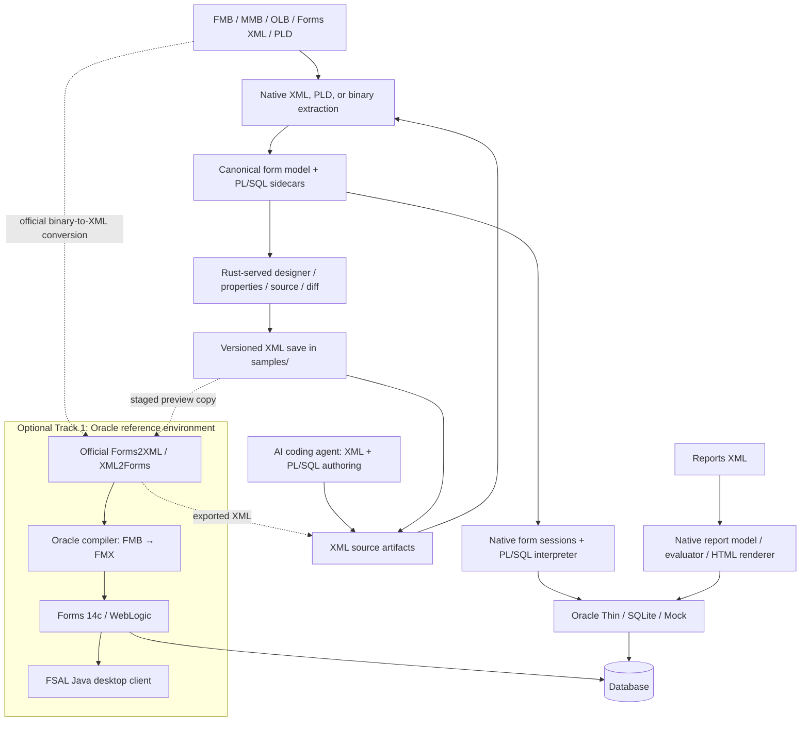

# System Architecture: Oracle Forms Workbench

## Purpose and delivered workflow

Oracle Forms Workbench connects legacy artifact inspection, XML and PL/SQL authoring, visual form editing, and execution in two environments: a native Rust runtime and an optional Oracle Fusion Middleware reference stack. The application is an authoring workbench as well as a reverse-engineering tool.

The delivered form workflow is **open or create → inspect/edit → save the form XML → run in Rust → convert/compile → launch the updated form in Oracle**. Coding agents can create and modify XML/PLSQL artifacts using the same parsers, CLI, samples, and reference automation. The UI does not currently embed an AI generation service.

Employee Directory, Orders, and Sales have exercised the XML-to-Oracle pipeline. This establishes the development workflow; it does not establish exhaustive Oracle compatibility or pixel-identical rendering. Live evidence and remaining work are recorded in the [continuation status](docs/plans/10-NEXT-PHASE-SESSION-PROMPT.md) and [roadmap](docs/plans/06-IMPLEMENTATION-ROADMAP-AND-MILESTONES.md).

## Two execution environments



**Track 2, the native workbench**, runs without Oracle Forms, Oracle Client libraries, a JVM, or a Node build/runtime. Its browser frontend uses HTML, CSS, JavaScript, and SVG bundled into the Rust server. Native form execution interprets models and supported PL/SQL rather than compiling Oracle executables.

**Track 1, the optional reference environment**, uses Oracle tools in Podman containers for conversion, compilation, and actual Oracle execution. Python automation and host Java/FSAL are explicit optional dependencies. The server bridge invokes this tooling only for requested reference actions; it is not a prerequisite for native parsing or editing. The optional SQL*Plus testbed database driver also belongs to this integration boundary.

The Track 1 stack has been validated on two hosts. On macOS, Podman runs in a machine VM with Rosetta 2 for the `linux/amd64` images. On Windows 11, everything runs inside an Ubuntu WSL2 distribution on x86-64, with no emulation: Podman and the containers, Python, Java 21, the FSAL launcher (with WSLg for its window), and the Rust server itself, so the Windows host runs almost the same code path as macOS and Linux. The browser stays on Windows and reaches the server at `127.0.0.1:7070`. A native Windows build of the Rust server (reaching the containers through `wsl.exe`, needing Visual Studio and C++) was tried first and was a red herring; do not use it. See [windows-podman-status-log.md](plugins/oracle-forms/.apm/skills/setting-up-oracle-testbed/references/windows-podman-status-log.md) for the Windows boundary.

### Repository map: where things are

| Path | What it is |
|---|---|
| `crates/` | The Rust workspace (App 1): `oracle-forms-core` (model, diff, report types), `-xml` (Forms XML, PLD and report-XML reader/writer/patcher), `-binary` (direct ROS 60050 `.fmb`/`.mmb`/`.olb` extraction), `-db` (Oracle Thin, SQLite, Mock drivers, SQL generator), `-plsql` (lexer, parser, analysis), `-runtime` (form sessions, PL/SQL interpreter, triggers, report evaluator and renderer), `-cli`, `-server` (Axum web app: `routes.rs`, `service.rs`, `oracle_preview.rs`, `runtime_sessions.rs`, `security.rs`) |
| `ui/` | The browser frontend served by the Rust app: vanilla `index.html`, `app.js`, `preview.js`, `runtime.js`, `styles.css`. Embedded in the server binary |
| `samples/` | Fixtures and the one saved XML per form (`samples/<form>_fmb.xml`, updated in place); `.fmb`, `.mmb`, `.olb`, `.rdf`, `.pld`, `.sql` |
| `tests/` | Rust conformance tests (`xml_conformance_tests.rs`, `binary_recovery_tests.rs`), Python runner tests (`test_reference_pipeline.py`), and the frontend tests (`ui_*.test.cjs`) |
| `oracle-reference-stack/` | App 2: `Containerfile.14c`, `compose.yaml`, `sql/seed_test_schema.sql`, `apply_forms14c_config.sh` and `forms14c-config/`, `installer-templates/`; git-ignored: `installer/`, `oracle_home_14c/` |
| `plugins/oracle-forms/.apm/skills/` | The agent skills that drive App 2: `setting-up-oracle-testbed`, `converting-oracle-artifacts` (`convert_fmb.py`, `convert_pll.py`, `convert_rpt.py`, `converter_runtime.py`, `test_conversions.py`), `compiling-and-running-oracle-forms` (`compile_form.py`, `run_form.py`, `launch_fsal.py`), `testing-forms-parity`, `comparing-forms-features` **Setup how-to for a clean clone, both platforms: `setting-up-oracle-testbed/references/` (index: `index.md`; start: `clean-clone-checklist.md`).** |
| `docs/` | `plans/` (roadmap, the continuation status `10-NEXT-PHASE-SESSION-PROMPT.md`, `UI-REVIEW-BACKLOG.md`) and `screenshots/`. Setup how-to is not here: it lives in the setup skill's `references/` |
| `start_testbed.py`, `start-next.md` | Starts the containers and the app; the next-session task list |
| `.agent/rules/` | Mandatory agent rules (see `AGENTS.md`) |
| `temp/`, `context/` | Git-ignored scratch space and session context; never commit |

**The Forms XML schema.** `plugins/oracle-forms/.apm/skills/compiling-and-running-oracle-forms/assets/forms-14c.xsd` (168,694 bytes, Oracle Forms 14.1.2, target namespace `http://xmlns.oracle.com/Forms`) was extracted from the 14c Oracle Home on the Mac setup and is committed; an identical copy sits in `plugins/oracle-forms/.apm/skills/converting-oracle-artifacts/assets/forms-14c.xsd` (there is no copy in `docs/`). No code read it before 2026-11-14 (plan 10 says `run_form.py` maps names "against docs/forms-14c.xsd", but the script contains no reference to the file). It is now used by `plugins/oracle-forms/.apm/skills/compiling-and-running-oracle-forms/scripts/validate_forms_xml.py` (`--version 14c|auto|<name>`, `--schema FILE`), which validates form, menu, and object-library XML against it and report XML against `assets/reports.dtd`, before XML to FMB. 14c has no `getformsxmlschema.sh`; the generator is the Java class `oracle.forms.util.xmltools.SchemaGenerator`, run by `converting-oracle-artifacts/scripts/extract_forms_schema.py` (**not yet verified**). The schema is an asset (script input) in both skills' `assets/`; the explanations are in `references/xml-validation.md` and `references/forms-xml-schema.md`. The owner's 12c Forms schema is in `plugins/oracle-forms/.apm/skills/compiling-and-running-oracle-forms/assets/12c/forms.xsd` (not yet wired as a version for `validate_forms_xml.py`).

### Where the Oracle Home lives (a setting)

The host folder behind `/oracle_home_14c` defaults to `oracle-reference-stack/oracle_home_14c` and is set by `OFW_ORACLE_HOME` (`.env`). On Windows the default is on the slow Windows drive (`/mnt/c`), where WebLogic took 15 to 44 minutes to boot, so on Windows install it on Ubuntu's own disk from the start; never into the repo folder and never with Windows Explorer (it loses execute permissions and symbolic links). `oracle-reference-stack/provision_oracle_home.sh` creates, copies, verifies (fingerprint and timed file walk), and backs it up; moving it needs a recreated `forms-server-14c` container (new mount) but no image rebuild. Why, protocol, and tests: `plugins/oracle-forms/.apm/skills/setting-up-oracle-testbed/references/oracle-home-location.md`. **Scripted, not yet run.**

### Starting and checking the stack: `start_testbed.py`

`start_testbed.py` (repo root) is the single entry point on every platform; on Windows run `python3 start_testbed.py` from the Ubuntu WSL shell. It starts the existing containers (never creating or replacing them) and the Rust app, confirms each one (the database by its ready log line since this start and port 1521; Forms by the RUNNING line and the servlet on port 7001; the Rust app by its home page), and prints a summary table with timings. `--status` is read-only; after a reboot or `wsl --shutdown` it reports "Podman runtime directory missing", which the script itself fixes (it asks for the WSL sudo password, so the user runs it). Options, how to read the output, and the confirmation rules: `plugins/oracle-forms/.apm/skills/setting-up-oracle-testbed/references/starting-the-stack.md`.

### Hosting at a glance

| Component | Windows 11 | macOS |
|---|---|---|
| **Rust workbench** (web app, port 7070) | **Hosted in WSL2** (the Ubuntu distro; the browser stays on Windows) | **Native**, on the Mac |
| **Oracle Fusion Middleware** (WebLogic and Forms 14c) | In **Podman** containers (Podman runs inside WSL2) | In **Podman** containers (Podman machine VM) |
| **Oracle Database Free** | In a **Podman** container (Podman runs inside WSL2) | In a **Podman** container (Podman machine VM) |
| **AI coding agent** (Claude Code and similar) | Run it **from the Ubuntu WSL shell**, in the repo root (`/mnt/c/.../oracle-forms-workbench`); setup in `windows-podman-setup.md` section 14 | Native, in the repo root |

Fusion Middleware and the database are always in Podman on both platforms, never installed on the host. Only the Rust app differs: hosted in WSL on Windows, native on macOS.

**Windows: two WSL distros, only one is used.** `wsl -l -v` lists `Ubuntu` (running) and `podman-machine-default` (stopped). Podman 4.9.3 in `Ubuntu` runs the containers. `podman-machine-default` is the virtual machine that Podman for Windows (`podman.exe` 5.7.0, 2 GiB, created before this project) made for itself; it is unused. The PowerShell `podman` talks to that machine and does not see our containers. Run `podman` only in the Ubuntu shell. Do not start `podman-machine-default`: it would share the WSL memory pool and has nothing we need. Removing it (`podman machine rm`) would free its 100 GiB disk but is the owner's decision.

### Where Oracle Fusion Middleware runs, and where its state lives

Oracle Fusion Middleware (WebLogic and Forms 14.1.2) always runs in **Podman containers**, never installed on the host. Only the Podman host differs:

| Host | Where Podman runs | Where the Rust app, Python and Java run |
|---|---|---|
| macOS (Apple Silicon) | A Podman machine VM with Rosetta 2 for `linux/amd64` | On the Mac |
| Windows 11 (x86-64) | **Inside the Ubuntu WSL2 distro** (Podman 4.9, no emulation) | **Inside the same WSL2 distro** |
| Linux | Native Podman | On the host |

Everything below is the same on all hosts:

| Piece | Defined in | What it is |
|---|---|---|
| Image `forms-converter-14c:latest` | `oracle-reference-stack/Containerfile.14c` | Oracle Linux 8 slim, Oracle JDK 17, X11/Motif, `libnsl`/`libnsl2`/`libaio`, build tools. **No Oracle software inside it.** User `oracle` (UID 1000) |
| Container `forms-server-14c` | `oracle-reference-stack/compose.yaml` | Runs `startWebLogic.sh`; ports 7001 (AdminServer, Forms servlet) and 9001; network `oracle-net` |
| Container `oracle23ai-lite` | `compose.yaml` | Oracle Database Free; port 1521; network alias `oracle-db-23ai` |
| Throwaway `podman run --rm` containers | the skill scripts | Conversions (Forms2XML, XML2Forms, `rwconverter`), compiles (`frmcmp_batch`), domain creation, installs; they use the same image and mounts |
| **Oracle Home, on the host** | `oracle-reference-stack/oracle_home_14c/` (git-ignored, about 5.4 GB) | Mounted at `/oracle_home_14c` in every container. The installed Forms and Reports 14c, the WebLogic domain `user_projects/domains/base_domain`, and **all persistent configuration** |
| The repo | the repository root | Mounted at `/work` in every container |
| Installers | `oracle-reference-stack/installer/` (git-ignored) | The two eDelivery zips and the JDK tarball; used only to build and install |

**What persists outside the containers:** everything under `oracle_home_14c/`. That includes `bin/setUserOverrides.sh`, `servers/AdminServer/security/boot.properties`, `config/fmwconfig/tnsnames.ora`, the `instances/forms1` symlink, the `frmweb` libraries and `libfrmjapi.so.0` in `lib/`, and the compiled `.fmx` and `.mmx` in `forms/`. The image and containers hold no configuration, so rebuilding the image or recreating a container loses nothing, as long as `oracle_home_14c/` is kept. `apply_forms14c_config.sh` re-applies the post-install configuration to a fresh Oracle Home (written from verified manual steps; not yet run on a clean Oracle Home). The database's data lives in the `oracle23ai-lite` container's own storage.

**How the Rust app reaches it:** the app never starts Fusion Middleware. `start_testbed.py` or `podman start` starts the containers. For Preview in Oracle, the app runs `run_form.py`, which uses `podman run`/`podman exec` against these containers and `launch_fsal.py` to open the form through `http://127.0.0.1:7001/forms/frmservlet`. The container tools run inside the containers; the Oracle scripts under `$ORACLE_HOME/bin` are templates, so the skills call the Java classes and binaries directly. Credentials come from the git-ignored `.env`. Known issue: `compose.yaml` still has a literal `ORACLE_PWD`, which should come from `.env`; not changed yet.

### The two apps and how they fit together

| | **App 1: the Rust workbench (Track 2)** | **App 2: the Oracle reference stack (Track 1)** |
|---|---|---|
| What it is | A web app: `oracle-forms-server` (Axum) serves the browser UI at `http://127.0.0.1:7070` and parses, edits, saves and runs forms natively | Oracle Forms 14c on WebLogic (`forms-server-14c`, port 7001) and Oracle Database Free (`oracle23ai-lite`, port 1521), in Podman containers |
| Needs Oracle software? | No: no Oracle Client, no JVM, no Node | Yes: the installed Oracle Home and the Oracle installers |
| Runs | On the host (macOS, Linux) or inside WSL2 (Windows), started with `cargo run -p oracle-forms-server` | In Podman (macOS machine VM, or inside WSL2 on Windows), started with `podman start` or `python3 start_testbed.py` |
| Works alone? | Yes: inspect, design, save and run forms natively | Yes: the Oracle tools and FSAL work without the Rust app |

**The connection between them** is one-way: the Rust app calls the Oracle stack only when you ask for a reference action. Preview in Oracle sends the saved form XML to `run_form.py`, which runs Oracle's XML2Forms and `frmcmp_batch` in throwaway containers and opens the form through the Forms servlet at `127.0.0.1:7001` with the FSAL Java client. The Rust app can also query the database on port 1521 directly (Oracle Thin driver, credentials `OFW_DB_USER`/`OFW_DB_PASSWORD` from `.env`). The Oracle stack never calls the Rust app. The shared meeting points are the repo (mounted at `/work` and holding `samples/<form>_fmb.xml`), the Podman network `oracle-net`, and the git-ignored `.env`.

### How each part is installed and run, by platform

**Oracle Fusion Middleware (App 2).** The procedure is the same on every host: put the Linux x86-64 installers in `oracle-reference-stack/installer/`; build `forms-converter-14c` from `Containerfile.14c`; run the two silent installs (Infrastructure, then Forms and Reports) in throwaway containers into `oracle_home_14c/`; create the WebLogic domain with `create_forms_domain.py` (run through `wlst.sh` in a container); apply the post-install configuration (`apply_forms14c_config.sh`); start `forms-server-14c`. Only the Podman setup differs:

| | macOS (Apple Silicon) | Windows 11 |
|---|---|---|
| Podman | `brew install podman`, then a Podman machine with Rosetta 2 (`podman machine init`/`start`) | `sudo apt-get install -y podman` inside the Ubuntu WSL2 distro |
| Extra host setup | Rosetta 2, XQuartz (for `frmbld`) | `[automount] options = "metadata,..."` in `/etc/wsl.conf`; recreate `/run/user/<uid>` with sudo after every `wsl --shutdown`; WSLg gives the display |
| Container user for writes to the repo drive | `oracle` works | `--user root` (the Windows drive maps container root to your user) |
| Full runbook | `plugins/oracle-forms/.apm/skills/setting-up-oracle-testbed/references/podman-setup-guide.md` | `.../references/windows-podman-setup.md` (every error and fix in `windows-wsl-change-log.md`) |

**The Rust workbench (App 1).** Install Rust with `rustup` (`curl --proto '=https' --tlsv1.2 -sSf https://sh.rustup.rs | sh`), then run from the repo root with `cargo run -p oracle-forms-server`; open `http://127.0.0.1:7070` in the browser. `python3 start_testbed.py` starts the containers and the app together.

| | macOS and Linux | Windows 11 |
|---|---|---|
| Where Rust is installed and run | On the host | **Inside the same Ubuntu WSL2 distro as Podman**, not on Windows (the native Windows build with Visual Studio was a red herring) |
| Build output | `target/` in the repo | `export CARGO_TARGET_DIR=$HOME/ofw-target` (WSL's own disk; `/mnt/c` is slow) |
| Extra packages | none beyond a C compiler | `build-essential` in Ubuntu |
| Browser | on the host | on Windows, reaching `127.0.0.1:7070` |
| Verified | Steps are in `plugins/oracle-forms/.apm/skills/setting-up-oracle-testbed/references/rust-workbench-setup.md`; **not re-run in the Windows sessions** | Verified: `cargo check`, `cargo test` (120 passed), app serving, Preview in Oracle |

Details: `plugins/oracle-forms/.apm/skills/setting-up-oracle-testbed/references/rust-workbench-setup.md` (install and run), `HOW-TO-RUN.md` sections 1 and 2, and `DEPENDENCIES.md` section 3 and `plugins/oracle-forms/.apm/skills/setting-up-oracle-testbed/references/dependencies.md` (the Oracle stack part).

## Rust workspace boundaries

The root Cargo workspace contains eight crates:

| Crate | Responsibility |
|---|---|
| `oracle-forms-core` | Canonical `ModuleIndex` and report models, blocks/items/canvases/windows, source references, sidecars, property/geometry support, and structural diffs. |
| `oracle-forms-xml` | Streaming Forms XML and report XML parsing, PLD parsing, modeled XML writing, and original-XML item patching. Accepts supported legacy and Oracle attribute aliases. |
| `oracle-forms-binary` | ROS 60050 binary extraction, PL/SQL and metadata discovery, and inferred model/layout information. Extraction is heuristic. |
| `oracle-forms-db` | SQL generation and bound values, table description, and database drivers: native Oracle Thin, SQLite, Mock, and optional testbed SQL*Plus. |
| `oracle-forms-plsql` | PL/SQL lexer/parser, AST, symbols, call graphs, references, and executability analysis. |
| `oracle-forms-runtime` | PL/SQL interpretation, built-ins, trigger hierarchy, form sessions, record buffers, validation, master-detail behavior, and report evaluation/HTML rendering. |
| `oracle-forms-cli` | `inspect`, `dump-sql`, `query`, `diff`, `export-xml`, and report inspection/execution. |
| `oracle-forms-server` | Axum routes, module services/cache, embedded UI, model edits/saves, runtime sessions, reports, and optional Oracle preview job orchestration. |

`core` supplies shared models. Parsers and database drivers consume those models; `runtime` combines database execution and PL/SQL interpretation. Server and CLI compose these capabilities. Oracle installation details remain in the reference bridge and automation, outside the native parsing/runtime contract.

| Location | Contents |
|---|---|
| `ui/` | Vanilla frontend, SVG renderer, designer, runtime controls, PL/SQL Studio, XML source, Form Diff, and Reports Engine. |
| `samples/` | Shared sample artifacts, test fixtures, and non-overwriting XML form versions saved by the UI. |
| `plugins/oracle-forms/.apm/skills/` | Optional testbed setup, conversion, compilation/FSAL, parity, and feature-comparison automation for humans and agents. |
| `oracle-reference-stack/` | Container definitions, reference configuration, and locally provisioned Oracle homes/installers. |
| `tests/` | Frontend regression and reference-runner tests; Rust tests also live in their crates. |
| `temp/` and `context/` | Ignored local artifacts and session material. Never stage or commit their contents. |

## Artifact ingestion and representation

Forms XML and PLD text are parsed into the canonical model. Binary FMB/MMB/OLB input can use a sibling XML export where available; direct binary extraction is the fallback. The model carries extracted PL/SQL and sidecar source references for source browsing and analysis. Inferred binary geometry and missing-coordinate layouts are useful previews, not proof of original layout fidelity.

Menus can be inspected and attached to forms; object libraries expose modeled content. Their inspection support must not be equated with complete visual editing or a dedicated standalone designer. PLL libraries use official export to PLD for native parsing. Reports use their own XML definition, query, parameter, grouping, and rendering pipeline; official `rwconverter` tooling handles binary report conversion.

Opening, saving, or compiling an artifact does not make every Oracle property, trigger, or external dependency supported. Source coverage, native executability, Oracle compilation, and visual comparison are distinct results.

## Designer and persistence

The UI has separate workspace views and a responsive command area. The form designer combines an object navigator, SVG canvas, property palette, layout tools, and the Data Block & Layout Wizard. The wizard can create a named form or add/replace a block, discover actual Oracle/SQLite table columns, and generate form/tabular layouts.

The renderer resolves coordinate units and inherited properties, handles selected canvases/tab pages and overlays, and supports multi-record views. `resolveAutoLayout` supplies fallback positions for missing coordinates. Save/Preview materializes supported inferred geometry and button captions through item patches before saving, so exported forms retain the layout shown in Rust. Inferred block outlines are designer guides rather than authored Oracle graphics. Exact font, point, theme, and DPI parity remains incomplete; UI-only font edits are not currently persisted in the Rust item model.

### Two different saves

- **Save Form** updates the form's one XML file, `samples/<lowercase_module>_fmb.xml`, using `POST /api/forms/save`. The write goes to a temporary file that is renamed over the target, so an interrupted save cannot leave a half-written form. If only the lossy model summary is available and the file already exists, a numbered `samples/<lowercase_module>_edited_<n>_fmb.xml` is written instead, so a complete XML is never replaced by a partial one. Binary FMB sources are never modified.
- **Save Record** belongs to an active native runtime session and commits record changes to the selected database when writes are enabled. It does not save form design.

The export mode is part of the response and user-visible result:

| Mode | Preservation contract |
|---|---|
| `patchedOriginal` | Applies supported item changes to original XML while retaining its other content, including unknown nodes/properties. This is not a general lossless structural editor. |
| `summary` | Regenerates XML from the modeled AST, for example after structural regeneration or binary ingestion. Unmodeled Oracle content may be omitted. |

Model synchronization and durable XML save are separate operations. A successful browser edit alone does not establish a successful server save. Failed persistence must remain visible and retryable. The native save path does not write Oracle FMB/FMX binaries.

## Native runtime and database operations

`POST /api/sessions` creates a `FormSession` with a selected backend and explicit connection configuration. Startup triggers execute against the model. Subsequent UI events drive item edits, buttons, navigation, queries, validation, alerts, master-detail handling, and supported record operations through the session API.

The PL/SQL runtime implements a subset of Oracle Forms behavior. Unsupported operations must be reported rather than silently accepted. Database configuration errors must not be hidden by switching to Mock. Blank data can be correct when the source has no startup query trigger; layout rendering and query execution are separate concerns.

Native Oracle Thin communicates directly with the database; the reference Free database normally exposes `localhost:1521/FREEPDB1`. SQLite and explicit Mock support offline development. Native sessions are read-only by default. DML and commits require the user's write opt-in. Database username/password entry for native Run is separate from Oracle compilation credentials and the FSAL runtime Logon prompt.

The server is a local development tool, bound to loopback by default with Host and cross-origin checks. Environment credentials for UI database operations require explicit `OFW_SERVER_ENV_CREDENTIALS` opt-in. See [HOW-TO-RUN.md](HOW-TO-RUN.md) for configuration.

## Publishing current edits to Oracle Fusion Middleware

The **Preview in Oracle** dialog implements the local reference publication workflow. It checks dependencies, explains setup/startup, collects compile settings, and shows status and diagnostics. Opening an already compiled FMX is a separate advanced action; it does not deploy current browser edits.

```mermaid
sequenceDiagram
    actor User
    participant UI as Browser designer
    participant Server as Rust server
    participant Runner as Optional Python runner
    participant Oracle as Oracle converter/compiler
    participant Client as FSAL desktop client
    User->>UI: Preview in Oracle / Save & launch
    UI->>Server: Persist layout and synchronize model
    UI->>Server: POST oracle-preview with compile mode/credentials
    Server->>Server: Save new XML version; stage ignored job copy
    Server->>Runner: Start run_form.py with staged XML
    Runner->>Runner: Prepare compatibility copy if needed; log adjustments
    Runner->>Oracle: XML2Forms → FMB → compile FMX
    Oracle-->>Runner: Compiler result / diagnostics
    Runner->>Client: Launch current FMX through configured Forms servlet
    Client-->>User: Native Oracle Logon and running form
    UI->>Server: Poll job status and diagnostics
```

The bridge uses fixed repository tooling and isolated `temp/oracle-preview/<job>/` staging so Oracle converters cannot replace source binaries. Known hand-authored fixture compatibility adjustments are applied to a separate `oracle_compatible/` copy and logged. They include supported version/attribute aliases and explicit defaults for missing geometry metadata. Arbitrary XML migration is not guaranteed; conflicting aliases and remaining Oracle schema errors must surface.

Database-connected compilation is the default UI choice and requires a username/password. Offline compilation requires explicit selection and can fail when PL/SQL references database objects. Compile credentials travel through the child environment and compiler stdin rather than host command-line arguments; they must not be retained in saved artifacts, browser storage, or displayed logs. FSAL then uses a separate interactive Logon dialog.

Readiness probes check Python, Java 17+, Podman, the Forms container, the servlet, the FSAL JAR, and the launcher script. The local database container is also reported. These checks do not install software, start containers, validate schema privileges, or certify compiler/visual success. The Java window opens on the Rust server's host, not a remote browser user's computer.

Validation status for the readiness probes: on Windows with the Rust server running inside WSL, all required probes pass once the Forms servlet is up, and the Preview launch has been run end to end. The native Windows build detects `python` and reaches Podman through `wsl.exe`; that path passed the same probes.

The current local development reference path uses the AdminServer Forms servlet on port **7001** with `config=standaloneapp`. Managed-server port **9001** is available when configured/running, and must not be assumed active. FSAL connects to the Forms service, which connects to the database. This is development publication to the configured reference environment, rather than a general production deployment manager.

## Reference automation and dependencies

| Tool | Role |
|---|---|
| `converting-oracle-artifacts/scripts/convert_fmb.py` | Official Forms2XML export for binary modules through the configured converter. |
| `converting-oracle-artifacts/scripts/convert_pll.py` | PLL/PLD library conversion. |
| `converting-oracle-artifacts/scripts/convert_rpt.py` | Oracle Reports conversion with `rwconverter`. |
| `compiling-and-running-oracle-forms/scripts/run_form.py` | XML/FMB/FMX workflow: prepare, convert if necessary, compile if necessary, and launch FSAL. |
| `compiling-and-running-oracle-forms/scripts/compile_form.py` | Headless form compilation using the Oracle compiler. |
| `compiling-and-running-oracle-forms/scripts/launch_fsal.py` | Launch an existing compiled form through the configured Forms service. |
| `setting-up-oracle-testbed/scripts/health_check.py` | Container, servlet, and database checks. |
| `compiling-and-running-oracle-forms/scripts/validate_forms_xml.py` | Validates Forms, menu, library, and report XML against Oracle's schema before conversion. |
| `converting-oracle-artifacts/scripts/test_conversions.py`, `extract_forms_schema.py` | Runs every conversion path and prints a table; re-extracts the Forms XML schema from the install. |
| `oracle-reference-stack/provision_oracle_home.sh`, `apply_forms14c_config.sh` | Create, copy, verify, and back up the Oracle Home; apply the post-install configuration. |
| `testing-forms-parity/` and `comparing-forms-features/` | Differential checks and feature/compatibility analysis; results apply to the exercised cases. |

Tool paths in this table are relative to `plugins/oracle-forms/.apm/skills/`. The reference stack separates Forms 12c conversion/Builder tooling from Forms 14c Infrastructure, Forms/Reports, and WebLogic. Oracle homes and installers are locally provisioned; vendor software is not bundled with the native workbench. Forms containers use the configured Linux x86_64 environment, while the Free database configuration supports the appropriate host architecture. Consult the [plugin](plugins/oracle-forms/README.md), [setup guides](plugins/oracle-forms/.apm/skills/setting-up-oracle-testbed/references/clean-clone-checklist.md), and [testing guide](plugins/oracle-forms/.apm/skills/setting-up-oracle-testbed/references/forms-and-reports-testing-guide.md) for installation-specific steps.

## Reports, diff, and AI authoring

Reports XML is parsed into query/parameter/group/summary models. The evaluator binds supplied/default parameters and executes using the chosen database backend; the renderer produces HTML previews with print/PDF through the browser. Report data-definition export does not preserve every Oracle paper-layout property or unparsed formula. Oracle Reports conversion is distinct from the form FMB/FMX publication flow.

Form Diff compares one baseline with multiple targets or uploaded snapshots in the UI; the CLI compares two files. It reports scoped triggers, properties, modeled structural changes, and geometry views at a shared scale. Unknown source content outside the model is not covered by every comparison.

AI-assisted authoring uses XML, PL/SQL, CLI JSON inspection, extracted source, and the same native/reference tools. Generated artifacts remain reviewable and versionable. AI authors must preserve original files, use actual schema information, distinguish supported behavior from assumptions, and validate business logic in addition to compilation. No independent AI backend is needed for this workflow.

## API landmarks and verification

| Concern | Routes |
|---|---|
| Open/inspect | `/api/samples`, `/api/files/browse`, `/api/open-sample/{name}`, `/api/open-file`, `/api/module/{module_name}/source`, `/api/module/{module_name}/xml` |
| Author/save | `/api/forms/new`, `/api/forms/module/{module_name}/item`, `/sync`, `/attach-menu`, `/api/forms/export-xml`, `/api/forms/save` (short suffixes share the module prefix) |
| Database | `/api/db/test`, `/api/db/describe`, `/api/forms/query-block` |
| Native sessions | `/api/sessions`, `/api/sessions/{id}`, `/api/sessions/{id}/events`, `/api/sessions/{id}/alert` |
| Oracle preview | `/api/forms/oracle-preview`, `/api/forms/oracle-preview/{id}`, `/api/forms/oracle-preview/readiness` |
| Diff/reports | `/api/forms/diff`, `/api/reports`, `/api/reports/run`, `/api/reports/{name}/definition`, `/api/reports/{name}/html` |

Run `cargo check` and `cargo test` from the repository root after changes. Frontend behavior is covered by `node --test tests/ui_*.test.cjs`; reference-runner unit tests use `python3 tests/test_reference_pipeline.py`. Node is an optional test tool, not an application dependency. Live Oracle conversion, compilation, logon, visual comparison, and behavior verification provide separate evidence beyond unit tests.

Remaining work includes exact font/theme/DPI parity and font persistence, wider Oracle built-in/dependency coverage, complete report layout preservation, complex tab/overlay cases, and broader golden runtime traces. The [roadmap](docs/plans/06-IMPLEMENTATION-ROADMAP-AND-MILESTONES.md) and [continuation status](docs/plans/10-NEXT-PHASE-SESSION-PROMPT.md) track these limits; successful compilation alone must never close them.
