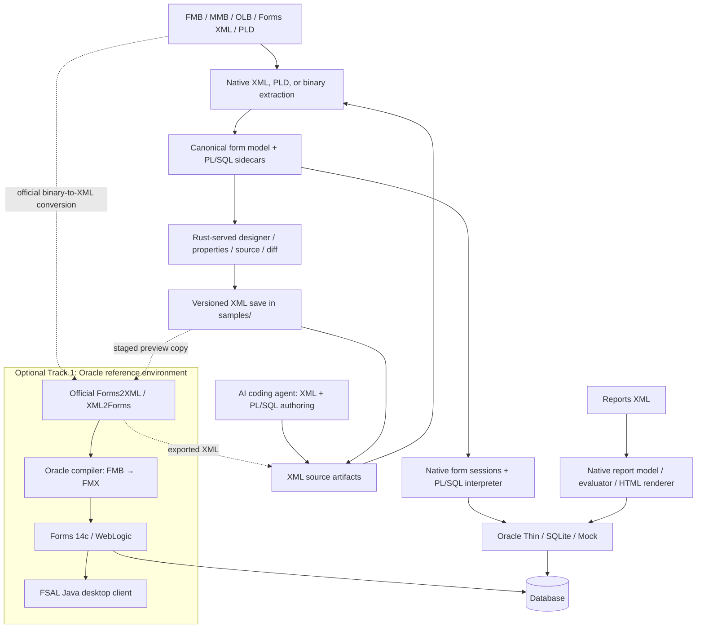

# System Architecture: Oracle Forms Workbench

## Purpose and delivered workflow

Oracle Forms Workbench connects legacy artifact inspection, XML and PL/SQL authoring, visual form editing, and execution in two environments: a native Rust runtime and an optional Oracle Fusion Middleware reference stack. The application is an authoring workbench as well as a reverse-engineering tool.

The delivered form workflow is **open or create → inspect/edit → save versioned XML → run in Rust → convert/compile → launch the updated form in Oracle**. Coding agents can create and modify XML/PLSQL artifacts using the same parsers, CLI, samples, and reference automation. The UI does not currently embed an AI generation service.

Employee Directory, Orders, and Sales have exercised the XML-to-Oracle pipeline. This establishes the development workflow; it does not establish exhaustive Oracle compatibility or pixel-identical rendering. Live evidence and remaining work are recorded in the [continuation status](docs/plans/10-NEXT-PHASE-SESSION-PROMPT.md) and [roadmap](docs/plans/06-IMPLEMENTATION-ROADMAP-AND-MILESTONES.md).

## Two execution environments



**Track 2, the native workbench**, runs without Oracle Forms, Oracle Client libraries, a JVM, or a Node build/runtime. Its browser frontend uses HTML, CSS, JavaScript, and SVG bundled into the Rust server. Native form execution interprets models and supported PL/SQL rather than compiling Oracle executables.

**Track 1, the optional reference environment**, uses Oracle tools in Podman containers for conversion, compilation, and actual Oracle execution. Python automation and host Java/FSAL are explicit optional dependencies. The server bridge invokes this tooling only for requested reference actions; it is not a prerequisite for native parsing or editing. The optional SQL*Plus testbed database driver also belongs to this integration boundary.

The Track 1 stack has been validated on two hosts. On macOS, Podman runs in a machine VM with Rosetta 2 for the `linux/amd64` images. On Windows 11, Podman runs inside an Ubuntu WSL2 distribution on x86-64, with no emulation. Host Java and the FSAL launcher run on the same host as the Rust server (Windows: the launcher runs inside WSL, with WSLg for the window). See [docs/WINDOWS-PODMAN-SETUP.md](docs/WINDOWS-PODMAN-SETUP.md) for the Windows boundary.

## Rust workspace boundaries

The root Cargo workspace contains eight crates:

| Crate | Responsibility |
|---|---|
| `oracle-forms-core` | Canonical `ModuleIndex` and report models, blocks/items/canvases/windows, source references, sidecars, property/geometry support, and structural diffs. |
| `oracle-forms-xml` | Streaming Forms XML and report XML parsing, PLD parsing, modeled XML writing, and original-XML item patching. Accepts supported legacy and Oracle attribute aliases. |
| `oracle-forms-binary` | ROS 60050 binary extraction, PL/SQL and metadata discovery, and inferred model/layout information. Extraction is heuristic. |
| `oracle-forms-db` | SQL generation and bound values, table description, and database drivers: native Oracle Thin, SQLite, Mock, and optional testbed SQL*Plus. |
| `oracle-forms-plsql` | PL/SQL lexer/parser, AST, symbols, call graphs, references, and executability analysis. |
| `oracle-forms-runtime` | PL/SQL interpretation, built-ins, trigger hierarchy, form sessions, record buffers, validation, master-detail behavior, and report evaluation/HTML rendering. |
| `oracle-forms-cli` | `inspect`, `dump-sql`, `query`, `diff`, `export-xml`, and report inspection/execution. |
| `oracle-forms-server` | Axum routes, module services/cache, embedded UI, model edits/saves, runtime sessions, reports, and optional Oracle preview job orchestration. |

`core` supplies shared models. Parsers and database drivers consume those models; `runtime` combines database execution and PL/SQL interpretation. Server and CLI compose these capabilities. Oracle installation details remain in the reference bridge and automation, outside the native parsing/runtime contract.

| Location | Contents |
|---|---|
| `ui/` | Vanilla frontend, SVG renderer, designer, runtime controls, PL/SQL Studio, XML source, Form Diff, and Reports Engine. |
| `samples/` | Shared sample artifacts, test fixtures, and non-overwriting XML form versions saved by the UI. |
| `plugins/oracle-forms/.apm/skills/` | Optional testbed setup, conversion, compilation/FSAL, parity, and feature-comparison automation for humans and agents. |
| `oracle-reference-stack/` | Container definitions, reference configuration, and locally provisioned Oracle homes/installers. |
| `tests/` | Frontend regression and reference-runner tests; Rust tests also live in their crates. |
| `temp/` and `context/` | Ignored local artifacts and session material. Never stage or commit their contents. |

## Artifact ingestion and representation

Forms XML and PLD text are parsed into the canonical model. Binary FMB/MMB/OLB input can use a sibling XML export where available; direct binary extraction is the fallback. The model carries extracted PL/SQL and sidecar source references for source browsing and analysis. Inferred binary geometry and missing-coordinate layouts are useful previews, not proof of original layout fidelity.

Menus can be inspected and attached to forms; object libraries expose modeled content. Their inspection support must not be equated with complete visual editing or a dedicated standalone designer. PLL libraries use official export to PLD for native parsing. Reports use their own XML definition, query, parameter, grouping, and rendering pipeline; official `rwconverter` tooling handles binary report conversion.

Opening, saving, or compiling an artifact does not make every Oracle property, trigger, or external dependency supported. Source coverage, native executability, Oracle compilation, and visual comparison are distinct results.

## Designer and persistence

The UI has separate workspace views and a responsive command area. The form designer combines an object navigator, SVG canvas, property palette, layout tools, and the Data Block & Layout Wizard. The wizard can create a named form or add/replace a block, discover actual Oracle/SQLite table columns, and generate form/tabular layouts.

The renderer resolves coordinate units and inherited properties, handles selected canvases/tab pages and overlays, and supports multi-record views. `resolveAutoLayout` supplies fallback positions for missing coordinates. Save/Preview materializes supported inferred geometry and button captions through item patches before saving, so exported forms retain the layout shown in Rust. Inferred block outlines are designer guides rather than authored Oracle graphics. Exact font, point, theme, and DPI parity remains incomplete; UI-only font edits are not currently persisted in the Rust item model.

### Two different saves

- **Save Form** writes a new XML definition using `POST /api/forms/save`. Files are named `samples/<lowercase_module>_edited_<n>_fmb.xml`, created without overwriting an existing version, and synchronized to disk. Source FMB/XML files are preserved.
- **Save Record** belongs to an active native runtime session and commits record changes to the selected database when writes are enabled. It does not save form design.

The export mode is part of the response and user-visible result:

| Mode | Preservation contract |
|---|---|
| `patchedOriginal` | Applies supported item changes to original XML while retaining its other content, including unknown nodes/properties. This is not a general lossless structural editor. |
| `summary` | Regenerates XML from the modeled AST, for example after structural regeneration or binary ingestion. Unmodeled Oracle content may be omitted. |

Model synchronization and durable XML save are separate operations. A successful browser edit alone does not establish a successful server save. Failed persistence must remain visible and retryable. The native save path does not write Oracle FMB/FMX binaries.

## Native runtime and database operations

`POST /api/sessions` creates a `FormSession` with a selected backend and explicit connection configuration. Startup triggers execute against the model. Subsequent UI events drive item edits, buttons, navigation, queries, validation, alerts, master-detail handling, and supported record operations through the session API.

The PL/SQL runtime implements a subset of Oracle Forms behavior. Unsupported operations must be reported rather than silently accepted. Database configuration errors must not be hidden by switching to Mock. Blank data can be correct when the source has no startup query trigger; layout rendering and query execution are separate concerns.

Native Oracle Thin communicates directly with the database; the reference Free database normally exposes `localhost:1521/FREEPDB1`. SQLite and explicit Mock support offline development. Native sessions are read-only by default. DML and commits require the user's write opt-in. Database username/password entry for native Run is separate from Oracle compilation credentials and the FSAL runtime Logon prompt.

The server is a local development tool, bound to loopback by default with Host and cross-origin checks. Environment credentials for UI database operations require explicit `OFW_SERVER_ENV_CREDENTIALS` opt-in. See [HOW-TO-RUN.md](HOW-TO-RUN.md) for configuration.

## Publishing current edits to Oracle Fusion Middleware

The **Preview in Oracle** dialog implements the local reference publication workflow. It checks dependencies, explains setup/startup, collects compile settings, and shows status and diagnostics. Opening an already compiled FMX is a separate advanced action; it does not deploy current browser edits.

```mermaid
sequenceDiagram
    actor User
    participant UI as Browser designer
    participant Server as Rust server
    participant Runner as Optional Python runner
    participant Oracle as Oracle converter/compiler
    participant Client as FSAL desktop client
    User->>UI: Preview in Oracle / Save & launch
    UI->>Server: Persist layout and synchronize model
    UI->>Server: POST oracle-preview with compile mode/credentials
    Server->>Server: Save new XML version; stage ignored job copy
    Server->>Runner: Start run_form.py with staged XML
    Runner->>Runner: Prepare compatibility copy if needed; log adjustments
    Runner->>Oracle: XML2Forms → FMB → compile FMX
    Oracle-->>Runner: Compiler result / diagnostics
    Runner->>Client: Launch current FMX through configured Forms servlet
    Client-->>User: Native Oracle Logon and running form
    UI->>Server: Poll job status and diagnostics
```

The bridge uses fixed repository tooling and isolated `temp/oracle-preview/<job>/` staging so Oracle converters cannot replace source binaries. Known hand-authored fixture compatibility adjustments are applied to a separate `oracle_compatible/` copy and logged. They include supported version/attribute aliases and explicit defaults for missing geometry metadata. Arbitrary XML migration is not guaranteed; conflicting aliases and remaining Oracle schema errors must surface.

Database-connected compilation is the default UI choice and requires a username/password. Offline compilation requires explicit selection and can fail when PL/SQL references database objects. Compile credentials travel through the child environment and compiler stdin rather than host command-line arguments; they must not be retained in saved artifacts, browser storage, or displayed logs. FSAL then uses a separate interactive Logon dialog.

Readiness probes check Python, Java 17+, Podman, the Forms container, the servlet, the FSAL JAR, and the launcher script. The local database container is also reported. These checks do not install software, start containers, validate schema privileges, or certify compiler/visual success. The Java window opens on the Rust server's host, not a remote browser user's computer.

Validation status for the readiness probes: the Windows path has been run manually (container start, servlet check, FSAL launch of a sample form). The automated probes listed above have not yet been run on Windows, so their Windows results are unverified.

The current local development reference path uses the AdminServer Forms servlet on port **7001** with `config=standaloneapp`. Managed-server port **9001** is available when configured/running, and must not be assumed active. FSAL connects to the Forms service, which connects to the database. This is development publication to the configured reference environment, rather than a general production deployment manager.

## Reference automation and dependencies

| Tool | Role |
|---|---|
| `converting-oracle-artifacts/scripts/convert_fmb.py` | Official Forms2XML export for binary modules through the configured converter. |
| `converting-oracle-artifacts/scripts/convert_pll.py` | PLL/PLD library conversion. |
| `converting-oracle-artifacts/scripts/convert_rpt.py` | Oracle Reports conversion with `rwconverter`. |
| `compiling-and-running-oracle-forms/scripts/run_form.py` | XML/FMB/FMX workflow: prepare, convert if necessary, compile if necessary, and launch FSAL. |
| `compiling-and-running-oracle-forms/scripts/compile_form.py` | Headless form compilation using the Oracle compiler. |
| `compiling-and-running-oracle-forms/scripts/launch_fsal.py` | Launch an existing compiled form through the configured Forms service. |
| `setting-up-oracle-testbed/scripts/health_check.py` | Container, servlet, and database checks. |
| `testing-forms-parity/` and `comparing-forms-features/` | Differential checks and feature/compatibility analysis; results apply to the exercised cases. |

Tool paths in this table are relative to `plugins/oracle-forms/.apm/skills/`. The reference stack separates Forms 12c conversion/Builder tooling from Forms 14c Infrastructure, Forms/Reports, and WebLogic. Oracle homes and installers are locally provisioned; vendor software is not bundled with the native workbench. Forms containers use the configured Linux x86_64 environment, while the Free database configuration supports the appropriate host architecture. Consult the [plugin](plugins/oracle-forms/README.md), [reference setup history](docs/PODMAN-CONVERTER-SETUP-AND-HISTORY.md), and [testing guide](docs/FORMS-AND-REPORTS-14C-TESTING-GUIDE.md) for installation-specific steps.

## Reports, diff, and AI authoring

Reports XML is parsed into query/parameter/group/summary models. The evaluator binds supplied/default parameters and executes using the chosen database backend; the renderer produces HTML previews with print/PDF through the browser. Report data-definition export does not preserve every Oracle paper-layout property or unparsed formula. Oracle Reports conversion is distinct from the form FMB/FMX publication flow.

Form Diff compares one baseline with multiple targets or uploaded snapshots in the UI; the CLI compares two files. It reports scoped triggers, properties, modeled structural changes, and geometry views at a shared scale. Unknown source content outside the model is not covered by every comparison.

AI-assisted authoring uses XML, PL/SQL, CLI JSON inspection, extracted source, and the same native/reference tools. Generated artifacts remain reviewable and versionable. AI authors must preserve original files, use actual schema information, distinguish supported behavior from assumptions, and validate business logic in addition to compilation. No independent AI backend is needed for this workflow.

## API landmarks and verification

| Concern | Routes |
|---|---|
| Open/inspect | `/api/samples`, `/api/files/browse`, `/api/open-sample/{name}`, `/api/open-file`, `/api/module/{module_name}/source`, `/api/module/{module_name}/xml` |
| Author/save | `/api/forms/new`, `/api/forms/module/{module_name}/item`, `/sync`, `/attach-menu`, `/api/forms/export-xml`, `/api/forms/save` (short suffixes share the module prefix) |
| Database | `/api/db/test`, `/api/db/describe`, `/api/forms/query-block` |
| Native sessions | `/api/sessions`, `/api/sessions/{id}`, `/api/sessions/{id}/events`, `/api/sessions/{id}/alert` |
| Oracle preview | `/api/forms/oracle-preview`, `/api/forms/oracle-preview/{id}`, `/api/forms/oracle-preview/readiness` |
| Diff/reports | `/api/forms/diff`, `/api/reports`, `/api/reports/run`, `/api/reports/{name}/definition`, `/api/reports/{name}/html` |

Run `cargo check` and `cargo test` from the repository root after changes. Frontend behavior is covered by `node --test tests/ui_*.test.cjs`; reference-runner unit tests use `python3 tests/test_reference_pipeline.py`. Node is an optional test tool, not an application dependency. Live Oracle conversion, compilation, logon, visual comparison, and behavior verification provide separate evidence beyond unit tests.

Remaining work includes exact font/theme/DPI parity and font persistence, wider Oracle built-in/dependency coverage, complete report layout preservation, complex tab/overlay cases, and broader golden runtime traces. The [roadmap](docs/plans/06-IMPLEMENTATION-ROADMAP-AND-MILESTONES.md) and [continuation status](docs/plans/10-NEXT-PHASE-SESSION-PROMPT.md) track these limits; successful compilation alone must never close them.
