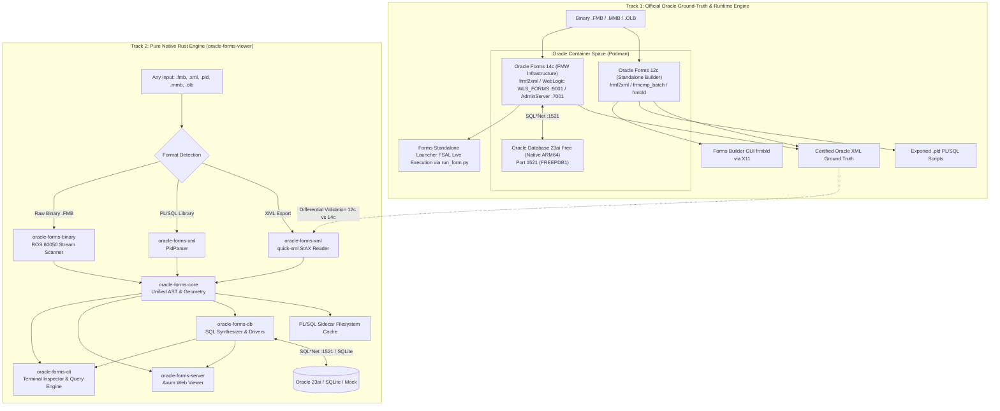
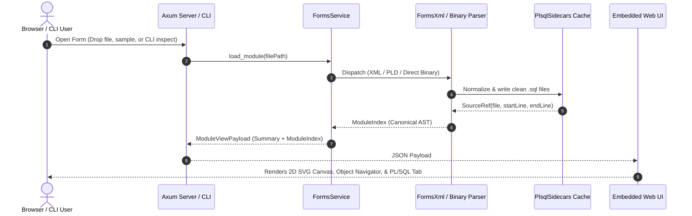

# System Architecture: Oracle Forms Workbench

---

## 1. High-Level System Overview

The system provides a complete, modern, cross-platform pipeline for inspecting, visualizing, querying, and extracting legacy Oracle Forms applications without requiring Windows machines or proprietary Oracle client licenses.

It operates on a **two-track strategy**:



---

## 2. The Rust Multi-Crate Workspace

The core deliverable is housed in `oracle-forms-viewer/`, partitioned into 6 modular crates:

```text
oracle-forms-viewer/
├── Cargo.toml                            # Virtual workspace root
├── crates/
│   ├── oracle-forms-core/                # Shared domain models, sidecars, geometry
│   ├── oracle-forms-xml/                 # Streaming quick-xml parser (Forms XML & PLD)
│   ├── oracle-forms-binary/              # ROS 60050 stream & heuristic binary extractor
│   ├── oracle-forms-db/                  # Direct DB query engine (Oracle 23ai, SQLite, Mock)
│   ├── oracle-forms-cli/                 # Standalone CLI (inspect, dump-sql, query)
│   └── oracle-forms-server/              # Axum HTTP server with embedded UI assets
├── ui/                                   # Embedded web frontend (HTML/CSS/JS/SVG)
└── samples/                              # Test corpus (XML, PLD, and binary FMB)
```

### Crate Breakdown

| Crate | Responsibility | Dependencies |
|---|---|---|
| **`oracle-forms-core`** | Defines canonical AST structures (`ModuleIndex`, `BlockInfo`, `ItemInfo`, `CanvasInfo`, `TriggerInfo`, `ProgramUnitInfo`), Serde camelCase serialization matching web contracts, coordinate scaling math (milli-unit scaling `0.0378`), PL/SQL sidecar filesystem writer with collision deduplication (`~2`, `~3`), and conditional entity unescaping. | `serde`, `serde_json`, `sha2`, `thiserror`, `regex` |
| **`oracle-forms-xml`** | High-performance streaming XML reader using `quick-xml`. Translates byte offsets to line ranges via precomputed newline indexes. Handles Oracle 12c and earlier Forms2XML schemas without building heavy DOM trees. Also includes `PldParser` for `.pld` text libraries. | `oracle-forms-core`, `quick-xml`, `regex`, `thiserror` |
| **`oracle-forms-binary`** | Direct ROS 60050 byte-stream parser. Dissects binary headers (`ROS.60050`), extracts uncompressed PL/SQL triggers and program units, discovers blocks and items via bind variable patterns (`:BLOCK.ITEM`), extracts SQL queries for record groups, and computes collision-free dynamic masonry multi-column preview layouts. | `oracle-forms-core`, `regex`, `thiserror` |
| **`oracle-forms-db`** | Direct database query execution engine. Form block-to-SQL synthesizer (`SqlGenerator`) mapping WHERE clauses, items, and pagination. Asynchronous `DatabaseDriver` trait with drivers for Oracle 23ai Free (`:1521/FREEPDB1`), embedded SQLite with pre-seeded datasets, and offline Mock fallback. | `oracle-forms-core`, `tokio`, `rusqlite`, `async-trait`, `tracing` |
| **`oracle-forms-cli`** | Command-line binary providing `inspect` (summaries or full AST JSON), `dump-sql` (dumps all extracted PL/SQL blocks directly into `.sql` files), and `query` (executes block queries against Oracle 23ai, SQLite, or Mock). | `oracle-forms-core`, `oracle-forms-xml`, `oracle-forms-binary`, `oracle-forms-db`, `clap`, `tokio` |
| **`oracle-forms-server`** | Standalone web server built on `axum`. Embeds `ui/` assets directly into the binary via `rust-embed`. Provides REST endpoints for sample discovery, file opening (multipart or path), source retrieval, XML slicing, and block querying (`/api/forms/query-block`, `/api/db/test`). | `oracle-forms-core`, `oracle-forms-xml`, `oracle-forms-binary`, `oracle-forms-db`, `axum`, `tokio`, `tower-http`, `rust-embed`, `tracing` |

---

## 3. Data Pipeline & Ingestion Flow



---

## 4. Web UI Architecture (Zero External CDNs)

The frontend embedded in `oracle-forms-server` uses vanilla JavaScript, CSS, and SVG:

- **SVG Canvas Renderer**: Automatically selects the most populated canvas (e.g. `CRCCMAINMENU`), scales coordinates based on the module's `<Coordinate>` configuration (`Centimeter`, `Point`, `Pixel`), and draws buttons, input fields, checkboxes, frames, and tab pages.
- **Off-Canvas Hotkey Isolation**: Items without an explicit canvas association (`CanvasName=""`) are recognized as off-canvas logic/hotkeys and isolated from the visual viewport.
- **Property Class Chain Resolution**: Resolves inherited properties across multi-level class chains (up to 10 hops, cycle-safe) to display effective widths, heights, prompts, and database DML settings.
- **Embedded Asset Distribution**: Bundled via `rust-embed` at compile time into the single executable, ensuring zero runtime dependencies on Node.js, NPM, or external CDNs.

---

## 5. Track 1 Container Architecture (`tools/podman-converter`)

The Track 1 environment provides the official Oracle runtime, ground-truth XML exports, Reports conversion, and Forms Builder visual verification without requiring a Windows VM or remote server.

### Dual Oracle Home Coexistence (12c & 14c)
To avoid version coupling, the environment supports running both **Oracle Forms 12c** and **Oracle Forms 14c** side by side:

| Attribute | Oracle Forms 12c (`forms-12c-converter`) | Oracle Forms 14c (`forms-14c-server`) |
|---|---|---|
| **Architecture** | `linux/amd64` (Rosetta 2 emulation) | `linux/amd64` (Rosetta 2 emulation) |
| **Java Runtime** | OpenJDK 1.8.0 Headless | OpenJDK 17 Devel (`java-17-openjdk`) |
| **Target Directory** | `tools/podman-converter/oracle_home` | `tools/podman-converter/oracle_home_14c` |
| **Scope** | Lightweight Standalone Forms Builder (~3.5 GB) | Full FMW Infrastructure + Forms & Reports Deployment |
| **Primary Use** | Ultra-fast batch XML/PLD conversion & `frmbld` GUI | Live WebLogic Forms Runtime (`WLS_FORMS`), AdminServer & Reports |
| **Ports** | None (X11 display only) | `7001` (AdminServer), `9001` (`WLS_FORMS`) |

### Tooling Suite (Packaged in APM Plugin `plugins/oracle-forms/`)
- `run_form.py`: Unified end-to-end converter, compiler, and desktop FSAL launcher.
- `compile_form.py`: Invokes official `frmcmp_batch` in headless mode to produce runnable `.fmx` binaries.
- `launch_fsal.py`: Launches live forms on desktop via Forms Standalone Launcher (FSAL) connecting to WebLogic 14c.
- `convert_fmb.py`: Invokes official `frmf2xml.sh` to produce certified Oracle XML exports (`.fmb`, `.mmb`, `.olb`) or convert XML back to FMB.
- `convert_pll.py`: Invokes official `frmcmp_batch` to export PL/SQL libraries (`.pll`) into `.pld` scripts or compile `.pld` into `.pll`.
- `convert_rpt.py`: Invokes `rwconverter.sh` for Oracle Reports conversion (`.rdf`, `.rpt`, `.rex`).
- `health_check.py`: Automated 3-stage validation for containers, WebLogic servlet, and 23ai SQL query.

---

## 6. Database Tier: Oracle Database 23ai Free (Native ARM64)

For end-to-end execution of live forms with real database blocks, queries, LOVs, and commits:

- **Image**: `container-registry.oracle.com/database/free:latest-lite` (or `latest`).
- **Architecture**: **Native ARM64 (`aarch64`)**. Because Oracle publishes native ARM64 container images for Apple Silicon, the database executes natively without Rosetta 2 translation overhead, providing near-bare-metal I/O and SQL performance.
- **Networking**: Maps `1521:1521` on the host, accessible to the host macOS, the native Rust viewer, and the Forms 14c container via the shared `oracle-net` bridge or `host.containers.internal:1521`.
- **Default Database Service**: `FREEPDB1` (Pluggable Database) with administrative credentials configured via `ORACLE_PWD`.

---

## 7. Live Form Execution via Forms Standalone Launcher (FSAL)

Rather than legacy browser NPAPI plugins or Internet Explorer, live form testing operates through Oracle's **Forms Standalone Launcher (FSAL)**:

1. A form (`.fmb`) is compiled into runtime format (`.fmx`) using `frmcmp_batch.sh`.
2. The form is deployed to the Forms 14c managed server (`WLS_FORMS:9001`).
3. The native client launcher (`java -jar fsal.jar -url http://localhost:9001/forms/frmservlet?form=module.fmx`) runs directly on the macOS desktop.
4. The client communicates with `WLS_FORMS`, which connects via SQL*Net to the native Oracle Database 23ai Free instance on port 1521, proving full operational parity against our static Rust viewer models.
