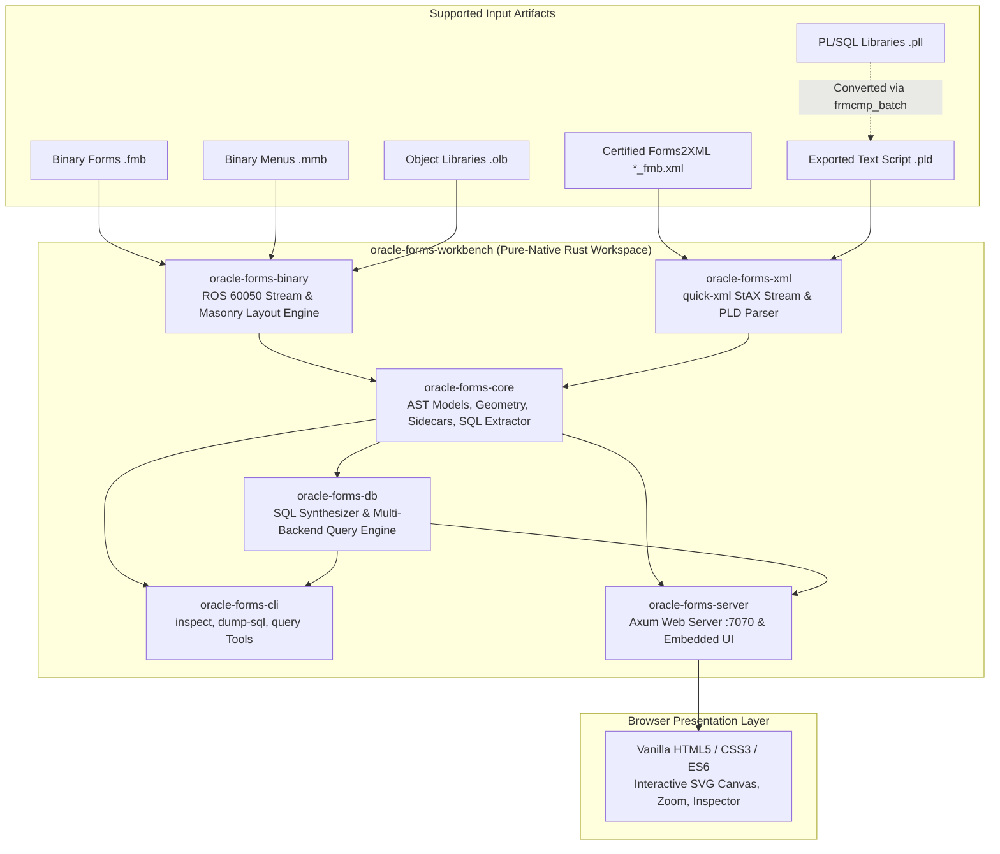

# Native Rust Forms Workbench: System Architecture & Implementation Status

**Document Version:** 3.0 (Oracle Forms Workbench Architecture)  
**Status:** Active Implemented System Architecture & Technical Roadmap  
**Workspace:** Repository Root (Pure-Native Rust Cargo Multi-Crate Workspace)

---

## 1. Executive Summary

The Oracle Forms Workbench is a **pure-native, standalone Rust application** that parses, inspects, extracts, queries live databases, and visually renders legacy Oracle Forms (`.fmb`, `.mmb`, `.olb`, Forms2XML exports, `.pld`). 

It completely replaces the legacy Kotlin/JVM proof-of-concept. The system operates with **zero JVM dependencies, zero Node.js runtime/build dependencies, and zero Oracle runtime client libraries**.



*(A detailed, styled version of this diagram is maintained in [docs/rust-workbench-architecture.mmd](rust-workbench-architecture.mmd)).*

---

## 2. What Was Built (Implemented Architecture)

The active Rust implementation resides directly at the root of the repository and is divided into 6 focused crates:

```text
├── Cargo.toml                  # Virtual workspace manifest
├── crates/
│   ├── oracle-forms-core/      # Shared AST domain model, sidecars, geometry, SQL extraction
│   ├── oracle-forms-xml/       # High-performance quick-xml streaming parser & PLD parser
│   ├── oracle-forms-binary/    # Direct ROS 60050 stream reader & dynamic masonry layout engine
│   ├── oracle-forms-db/        # Direct DB query engine (Oracle 23ai, SQLite, Mock)
│   ├── oracle-forms-cli/       # Standalone CLI binary ('inspect', 'dump-sql', 'query')
│   └── oracle-forms-server/    # Axum HTTP service with embedded browser assets
├── ui/                         # Vanilla HTML5, CSS3, and ES6 client (0 Node / 0 npm)
└── samples/                    # Curated, redistributable test fixtures
```

### 2.1 Crate Capabilities & Responsibilities

| Crate | Responsibilities & Implemented Features |
| :--- | :--- |
| **`oracle-forms-core`** | • Core AST models (`ModuleIndex`, `FormBlock`, `FormItem`, `FormCanvas`, `FormTrigger`, `ProgramUnit`, `VisualAttribute`, `RecordGroup`, `Relation`).<br/>• Source coordinate normalization, physical-to-pixel scaling, and canvas viewports.<br/>• PL/SQL sidecar extraction with line-span tracking and SQL statement isolation.<br/>• Zero platform-specific dependencies; compiles on macOS, Linux, and Windows. |
| **`oracle-forms-xml`** | • Zero-copy, streaming `quick-xml` event reader matching Oracle Forms2XML StAX specifications.<br/>• Robust ownership tracking: builds blocks, items, triggers, and canvases hierarchically.<br/>• Conditional XML entity decoding for embedded PL/SQL bodies.<br/>• Line-by-line `.pld` script parser extracting package specs, package bodies, and standalone procedures. |
| **`oracle-forms-binary`** | • Direct binary reader parsing ROS 60050 files without Oracle SDKs or Windows DLLs.<br/>• Heuristic string-table recovery and pattern-based trigger/block boundary detection.<br/>• **Dynamic Multi-Column Masonry Layout Engine**: Automatically organizes blocks into independent column cursors, eliminating item and block collision distortions.<br/>• Intelligent coordinate synthesis for forms lacking explicit coordinate blocks. |
| **`oracle-forms-cli`** | • `inspect <file>`: Prints module summaries, block counts, item tallies, trigger listings, and visual canvas layouts to stdout.<br/>• `dump-sql <file> -o <dir>`: Extracts all embedded SQL queries and PL/SQL program units into separate `.sql` and `.pls` files.<br/>• Automatic sibling `<stem>_<ext>.xml` resolution for ground-truth verification. |
| **`oracle-forms-server`** | • Ultra-low-latency Axum HTTP microserver serving on `http://127.0.0.1:7070`.<br/>• Assets embedded directly into binary at compile time via `rust-embed` (single standalone binary).<br/>• REST API endpoints: `/api/samples`, `/api/modules/sample`, `/api/modules/open`, `/api/modules/upload`.<br/>• Sibling XML auto-detection: when a binary `.fmb` is opened, automatically loads companion certified XML if present. |

### 2.2 Frontend Presentation Layer (`ui/`)
- **No Node.js / No Webpack / No npm**: Clean vanilla ES6 JavaScript, responsive CSS, and semantic HTML5.
- **Interactive SVG Canvas**: Accurately renders prompts, text fields, checkboxes, buttons, radio groups, and graphics frames. Supports pan, zoom, and fit-to-screen.
- **Hierarchy Tree & Inspector**: Tree navigation of forms, canvases, blocks, and items with property inspection.
- **PL/SQL Code Viewer**: Syntax-highlighted code editor for triggers, program units, and packages.

---

## 3. Comparison: Implemented vs. What Should Be Built

The table below contrasts **what has been implemented today** against **the future enhancement roadmap**:

| Architectural Area | What Was Built (Current Implementation) | What Should Be Built (Future Roadmap) |
| :--- | :--- | :--- |
| **XML & PLD Parsing** | **Fully Implemented**. High-performance streaming parser for Forms2XML exports (`.xml`) and Procedure Builder scripts (`.pld`). | Add support for Oracle Reports XML definitions (`_rdf.xml`). |
| **Binary FMB Decoding** | **Heuristic Stream Recovery & Sibling XML Linking**. Extracts names, triggers, program units, and binds directly from ROS 60050 binaries; links sibling certified XML when present. | **Phase 4: Structural ROS 60050 Reverse-Engineering**. Decode native ROS record chunk framing, binary object ID tables, and typed property tags to eliminate heuristic recovery entirely. |
| **Layout & Geometry** | **Masonry Multi-Column Engine**. Dynamic cursor positioning calculates block heights, button steps, and column assignments with zero visual block overlapping. | Multi-canvas tab page switching and stacked canvas z-ordering directly mirroring Oracle Forms Runtime. |
| **Cross-Module Inheritance** | **Intra-Module Resolution**. Resolves local property classes, canvas visual attributes, and block relations within the active module. | **Inter-Module Subclassing Engine**. Deeply resolve subclassed parents across separate `.olb` (Object Libraries) and template `.fmb` files (e.g. `itslib`, `clsvats`). |
| **Delivery & Packaging** | **Standalone CLI & Local Axum Server**. Portable single-binary executables with embedded assets running on loopback port 7070. | **Tauri Desktop App**. Optional self-contained native desktop wrapper (`.dmg`, `.exe`, `.deb`) with native file picker dialogs and zero local port binding. |
| **Tooling & Containers** | **Podman Bridge & APM Plugin**. Python CLI tools (`run_form.py`, `compile_form.py`, `launch_fsal.py`, `convert_fmb.py`, `health_check.py`) managing on-demand containerized Oracle 14c/12c utilities and native desktop FSAL. | Web-based noVNC interface for Forms Builder GUI (Option B) for zero-prerequisite browser usage without XQuartz. |

---

## 4. Phase Roadmap & Milestones

### Phase 1: Native Baseline & Multi-Crate Architecture — [COMPLETED]
- [x] Rust workspace scaffolding (`oracle-forms-core`, `oracle-forms-xml`, `oracle-forms-binary`, `oracle-forms-cli`, `oracle-forms-server`).
- [x] Zero-JVM, zero-Node architecture established.
- [x] Fast `quick-xml` streaming parser and `.pld` script parser.
- [x] Axum web server embedding vanilla UI assets.
- [x] Automated test suite verifying XML conformance, PLD parsing, and binary recovery.

### Phase 2: Layout Precision & Sibling Linking — [COMPLETED]
- [x] Masonry multi-column layout engine eliminating vertical block collisions.
- [x] Automatic sibling `<stem>_<ext>.xml` resolution in both CLI and web server.
- [x] Public sample list sanitation ensuring proprietary forms remain unexposed.
- [x] Containerized tooling & APM plugin (`run_form.py`, `compile_form.py`, `launch_fsal.py`, `convert_fmb.py`, `health_check.py`).

### Phase 3: Comprehensive Cross-Module Inheritance — [NEXT]
- [ ] Implement an inter-module resolver capable of loading external `.olb` and template `.fmb` files to hydrate subclassed visual attributes, alerts, and object groups.
- [ ] Support search paths (`FORMS_PATH`) across directories to automatically locate referenced parent modules.

### Phase 4: Structural ROS 60050 Research & Decoding — [PLANNED RESEARCH]
- [ ] Reverse-engineer byte-level ROS record framing, chunk lengths, and record types.
- [ ] Map property ID dictionaries to binary ROS property tables.
- [ ] Replace heuristic text scanning with native structural object decoding for standalone `.fmb` binaries without companion XML.

### Phase 5: Self-Contained Desktop Distribution — [FUTURE]
- [ ] Tauri v2 integration wrapping `oracle-forms-server` core for distribution as native macOS `.dmg`, Windows `.msi`, and Linux `.AppImage`.
