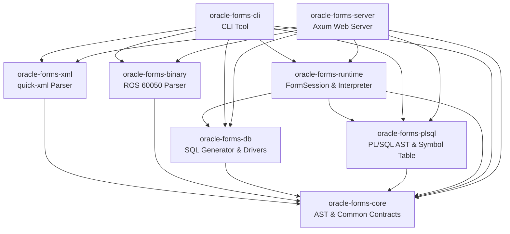

# 02: Core Architecture & Multi-Crate Workspace Redesign

---

## 1. Workspace Structural Organization

To elevate `oracle-forms-workbench` into a comprehensive developer and analyst platform while maintaining strict **Zero-JVM, Zero-Oracle-Runtime** invariants in the core, the workspace is partitioned into focused, modular crates:

```text
oracle-forms-workbench/
├── Cargo.toml                     # Workspace root manifest
├── crates/
│   ├── oracle-forms-core/         # Canonical AST models, coordinate math, validation sidecars
│   ├── oracle-forms-xml/          # quick-xml streaming parser (Forms2XML & PLD)
│   ├── oracle-forms-binary/       # Direct binary ROS 60050 stream decoder
│   ├── oracle-forms-db/           # Database driver abstraction & BoundSql generator
│   ├── oracle-forms-plsql/        # [NEW] PL/SQL parser, symbol table & static analysis
│   ├── oracle-forms-runtime/      # [NEW] FormSession, record buffers, event dispatcher, interpreter
│   ├── oracle-forms-cli/          # Command-line tools (inspect, query, dump-sql, analyze)
│   └── oracle-forms-server/       # Axum async HTTP server, session state, and embedded UI
├── ui/                            # Modern HTML5 / SVG / CSS3 client application
└── samples/                       # Redistributable test forms and conformance corpus
```

---

## 2. Inter-Crate Dependency Graph



---

## 3. Crate Responsibilities & Specifications

### 3.1 `oracle-forms-core` (Canonical AST & Domain Models)
- **Role**: The single source of truth for all Oracle Forms definitions.
- **Invariants**: Zero external IO, zero network, zero database dependencies.
- **Key Types**:
  - `ModuleIndex`: Root container for canvases, windows, blocks, triggers, LOVs, alerts, and program units.
  - `BlockInfo`: Data block metadata, `query_data_source_name`, `where_clause`, `order_by_clause`, `records_to_display`, `key_mode`.
  - `ItemInfo`: Item types (Text, Button, Checkbox, Radio, List), coordinates, data types (`CHAR`, `NUMBER`, `DATE`), format masks, default values.
  - `CoordinateSystem`: Real (Inches, Centimeters), Points, Pixels, Characters grid scaling algorithms.
  - `TriggerInfo`: Trigger events, PL/SQL code string, scope (Form, Block, Item), execution hierarchy.

### 3.2 `oracle-forms-db` (Database Connectivity & SQL Synthesis)
- **Role**: Database driver abstraction and automated SQL statement generation.
- **Key Components**:
  - `DatabaseDriver` Trait: Asynchronous trait taking `&BoundSql` with parameter bindings.
  - `SqlGenerator`: Generates dialect-specific SQL:
    - Oracle dialect: selects `ROWID` as first column, maps `:BLOCK.ITEM` binds, supports `FETCH FIRST N ROWS ONLY`.
    - SQLite dialect: translates types, generates `LIMIT N`.
  - Drivers:
    - **`TestbedSqlplusDriver`**: Bridges queries to the local Podman testbed container (`oracle23ai-lite`) using `sqlplus -s /nolog` over standard input.
    - **`SqliteDriver`**: In-memory and file-backed SQLite via `rusqlite` for instant offline testing and CI.
    - **`MockDriver`**: Deterministic offline fixture driver.
    - **`OciDriver` (Optional)**: Feature-gated behind `oracle-oci` for users with Oracle Instant Client installed.

### 3.3 `oracle-forms-plsql` (PL/SQL Front-End & Code Intelligence)
- **Role**: Forms-specific PL/SQL parsing, AST modeling, and static analysis.
- **Key Components**:
  - `PlsqlParser`: Hand-written recursive-descent parser with resilient error recovery.
  - `SymbolTable`: Resolves identifiers across Form Program Units, attached `.pll` libraries, and `.mmb` menus.
  - Static Analyzers: Call graph, event trigger map, item read/write cross-reference, and executability coverage report.

### 3.4 `oracle-forms-runtime` (State Machine, Buffers & Interpreter)
- **Role**: Emulates in-memory multi-record buffers and executes client-side Forms events.
- **Key Components**:
  - `FormSession`: Encapsulates an active running form instance.
  - `RecordBuffer`: Block record grid managing transitions across `NEW`, `INSERT`, `QUERY`, `CHANGED` (with pending-delete tracking).
  - `NavigationEngine`: Enforces Form $\to$ Block $\to$ Record $\to$ Item traversal rules with `WHEN-VALIDATE-ITEM`.
  - `EventDispatcher`: Dispatches events according to the `Execution Hierarchy` (`Override`, `Before`, `After`).
  - `PlsqlInterpreter`: Resumable tree-walking interpreter supporting Tier-1 built-ins and async suspension for interactive prompts (`SHOW_ALERT`).

### 3.5 `oracle-forms-cli` (Command-Line Tool)
- **Role**: Swiss-army knife for automation, inspection, and CI pipelines.
- **Subcommands**: `inspect`, `dump-sql`, `query`, `analyze`.

### 3.6 `oracle-forms-server` (Axum Web Server & UI Host)
- **Role**: Serves the workbench web application and session REST endpoints.
- **Key Components**:
  - REST API: Session lifecycle, event dispatch, block querying, and code analysis endpoints.
  - Embedded UI: Serves precompiled HTML5/SVG/CSS3 assets embedded via `rust-embed`.
  - Server safety: Default bind to `127.0.0.1`; warns if bound to public interfaces.

---

## 4. Cargo Feature Flag Strategy

In accordance with ADR 07, dependencies that require proprietary client software are strictly feature-gated:

```toml
[features]
default = ["sqlite"]

# Database features
sqlite      = ["dep:rusqlite"]       # Embedded SQLite (pure-native, default)
oracle-oci  = ["dep:oracle"]         # Optional: OCI driver requiring Oracle Instant Client
```
