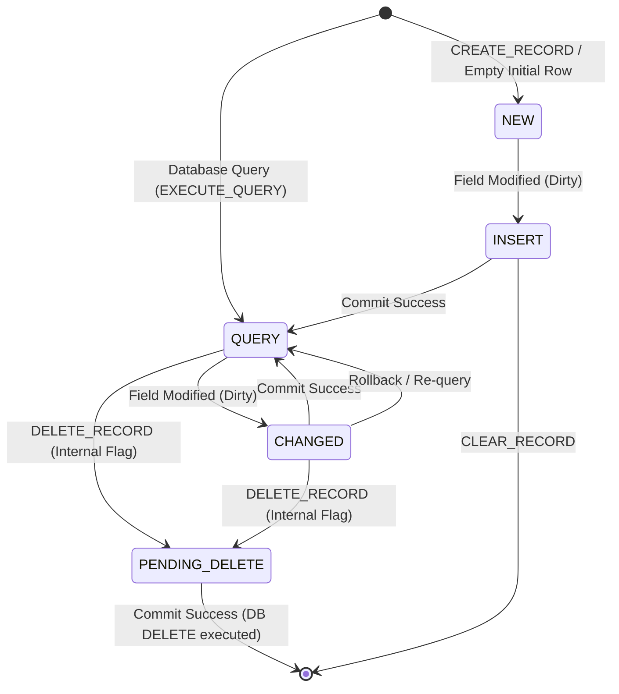
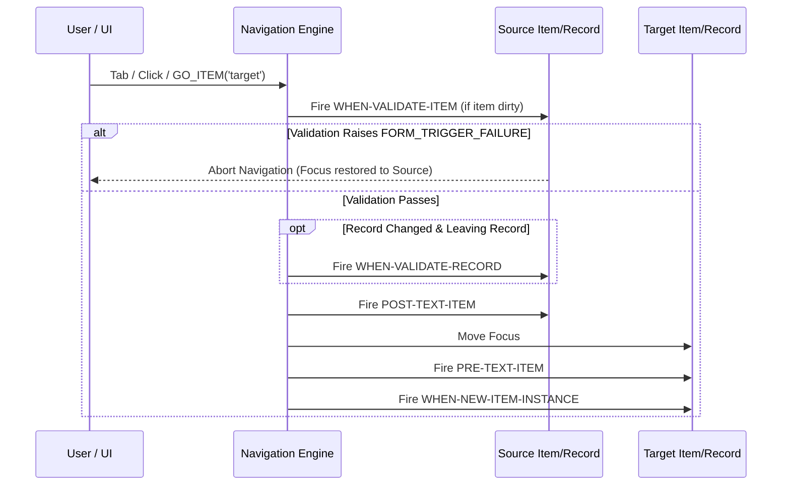

# 03: Runtime State Machine, Record Buffers & Event Dispatcher

---

## 1. The Block-Level Multi-Record Engine

The defining abstraction of Oracle Forms is its **Block-Level Multi-Record Buffer**. Every database block maintains an in-memory collection of records, each governed by standard Oracle Forms `RECORD_STATUS` and validation lifecycle states:



### 1.1 Forms Record Status & Validation State

In genuine Oracle Forms runtime, `:SYSTEM.RECORD_STATUS` has exactly four possible values:
- **`NEW`**: A blank record created by navigation or `CREATE_RECORD`. Not saved during commit.
- **`INSERT`**: A new record with user modifications; targeted for SQL `INSERT` during commit.
- **`QUERY`**: A record fetched from the database that has not been modified.
- **`CHANGED`**: A queried record modified by the user or code; targeted for SQL `UPDATE`.

*(Note: Records marked for deletion remain in the buffer with their underlying status and an internal `is_marked_for_delete = true` flag until transaction commit).*

```rust
use std::collections::HashMap;
use oracle_forms_core::model::ColumnValue;

#[derive(Debug, Clone, Copy, PartialEq, Eq)]
pub enum FormsRecordStatus {
    New,      // :SYSTEM.RECORD_STATUS = 'NEW'
    Insert,   // :SYSTEM.RECORD_STATUS = 'INSERT'
    Query,    // :SYSTEM.RECORD_STATUS = 'QUERY'
    Changed,  // :SYSTEM.RECORD_STATUS = 'CHANGED'
}

#[derive(Debug, Clone, Copy, PartialEq, Eq)]
pub enum ValidationStatus {
    New,      // Initial untouched state
    Changed,  // Dirty; requires validation before leaving item/record
    Valid,    // Validation succeeded
}

#[derive(Debug, Clone)]
pub struct FormRecord {
    pub status: FormsRecordStatus,
    pub validation_status: ValidationStatus,
    pub is_marked_for_delete: bool,
    pub values: HashMap<String, ColumnValue>,         // Item name -> Current value
    pub initial_values: HashMap<String, ColumnValue>, // Pristine DB values (for dirty checking & undo)
    pub row_id: Option<String>,                      // Oracle ROWID for locking & updates
}

#[derive(Debug, Clone)]
pub struct BlockBuffer {
    pub block_name: String,
    pub records: Vec<FormRecord>,
    pub current_record_index: usize,
    pub cursor_fetched_all: bool,
}
```

---

## 2. Navigation State Machine & Validation Cascade

Forms enforces strict hierarchy: focus moves **Form $\to$ Block $\to$ Record $\to$ Item**.

When focus moves from Item A to Item B:


---

## 3. Master-Detail Declarative Coordination

Master-detail relationships are declared in `oracle-forms-core` via `RelationInfo`:
- `master_block`: Name of the parent block (e.g., `ORDERS`).
- `detail_block`: Name of the child block (e.g., `ORDER_ITEMS`).
- `join_condition`: Equi-join expression (e.g., `ORDERS.ORDER_ID = ORDER_ITEMS.ORDER_ID`).
- `deferred_coordination`: Whether the detail query executes immediately on master row scroll, or waits until the user focuses the detail block.

The runtime evaluates `RelationInfo` declarative links automatically, populating detail blocks without requiring custom PL/SQL.

---

## 4. Trigger Execution & Event Architecture

> **Complete Specification**: For the complete PL/SQL front-end parser, symbol resolution, event model (`KEY-*`, `ON-*`, `WHEN-*`, `Execution Hierarchy`), resumable interpreter, and Tier-1 built-ins catalog, see:  
> 👉 **[08. PL/SQL Front-End, Event Engine & Interpreter Specification](08-PLSQL-AND-EVENT-EXECUTION.md)**.
