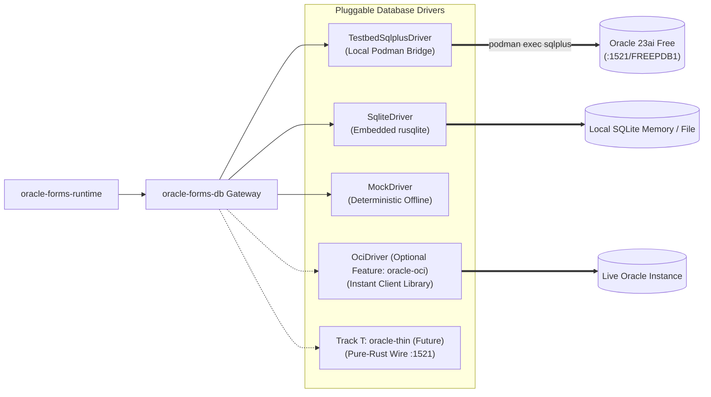

# 04: Database Integration, SQL Synthesis & CRUD Operations

---

## 1. Database Connectivity Architecture

In accordance with **[07: Oracle Database Connectivity ADR](07-ORACLE-CONNECTIVITY-ADR.md)**, `oracle-forms-db` isolates the database driver implementation behind an asynchronous `DatabaseDriver` trait utilizing strictly bound parameter structures (`BoundSql`):



---

## 2. Dynamic SQL Generation from Form Metadata

Oracle Forms dynamically generates all `SELECT`, `INSERT`, `UPDATE`, `DELETE`, and `LOCK` statements based on block metadata (`BlockInfo`), item properties (`ItemInfo`), and declarative relations (`RelationInfo`).

### 2.1 Generating the SELECT Query
For an active Data Block:
- **`query_data_source_name`**: Target Table or View name (e.g. `TEST_ITEMS` or `ORDERS`).
- **Items**: Only database items (`item.column_name` present and `item_dml.query_allowed = true`). If no database columns exist, return a typed error (never fall back to `SELECT *`).
- **Hidden `ROWID`**: For the Oracle dialect, `ROWID` is **always selected as the first column** to enable subsequent record locking and updates.
- **`where_clause`**: Scanned for `:BLOCK.ITEM`, `:GLOBAL.X`, and `:PARAMETER.X` references, which are replaced by dialect bind variables (`:b1`, `:b2` or `?`) with values passed via `BoundSql`.
- **`order_by_clause`**: Static sort order.
- **Pagination**: Dialect-specific limit (`FETCH FIRST N ROWS ONLY` for Oracle, `LIMIT N` for SQLite).

**Generated SQL**:
```sql
SELECT 
    ROWID,
    ITEM_ID,
    ITEM_NAME,
    AMOUNT,
    CREATED_AT
FROM TEST_ITEMS
WHERE (STATUS = 'ACTIVE' AND AMOUNT >= :b1)
ORDER BY ITEM_ID ASC
FETCH FIRST 50 ROWS ONLY;
```

### 2.2 Generating the INSERT Statement
Executed during the commit event pipeline for records with `status = FormsRecordStatus::Insert`:
```sql
INSERT INTO TEST_ITEMS (
    ITEM_ID,
    ITEM_NAME,
    AMOUNT
) VALUES (
    :b1,
    :b2,
    :b3
) RETURNING ROWID INTO :out_rowid;
```
*(Note: `RETURNING ROWID INTO` requires an OUT parameter bind in the driver).*

### 2.3 Genuine Forms Locking Semantics (`ON-LOCK`)

Forms does NOT perform a naive `UPDATE ... WHERE original_col = :val`. Instead, Forms implements a strict two-step locking sequence:

1. **Locking upon First Edit**: As soon as a user or trigger mutates any field of a queried record, the runtime initiates a row lock:
   ```sql
   SELECT 
       ITEM_NAME,
       AMOUNT
   FROM TEST_ITEMS
   WHERE ROWID = :row_id
   FOR UPDATE NOWAIT;
   ```
2. **Value Concurrency Re-Check**:
   - The runtime compares the column values returned by the `FOR UPDATE` query against the record's pristine `initial_values`.
   - If the row is currently locked by another database session, the driver returns an `ORA-00054: resource busy and acquire with NOWAIT specified`.
   - If another session committed changes to that row in the interim, the column values differ from `initial_values`.
   - In either failure case, the runtime aborts the edit and raises:
     `FRM-40501: ORACLE error: unable to reserve record for update or delete.`
3. **Lock Modes**:
   - `Immediate` (Default): Record is locked immediately upon first character typed.
   - `Delayed`: Record is locked only when the transaction commit pipeline executes.
   - `Automatic`: Determined by the database driver.

### 2.4 Generating the UPDATE Statement
Executed only after the record has been locked and verified:
```sql
UPDATE TEST_ITEMS SET
    ITEM_NAME = :b1,
    AMOUNT = :b2
WHERE ROWID = :row_id;
```

### 2.5 Generating the DELETE Statement
```sql
DELETE FROM TEST_ITEMS
WHERE ROWID = :row_id;
```

---

## 3. Parameterized Bind Variable Mapping (`BoundSql`)

To eliminate SQL injection risks and enforce safety across all drivers, SQL strings and parameter values are never concatenated as raw text. Statements are encapsulated in `BoundSql`:

```rust
#[derive(Debug, Clone, PartialEq)]
pub enum SqlValue {
    Null,
    Text(String),
    Number(String), // Preserves full 38-digit decimal precision
    Date(String),   // ISO-8601 representation
}

#[derive(Debug, Clone)]
pub struct BoundSql {
    pub sql: String,
    pub binds: Vec<(String, SqlValue)>,
}
```

The runtime extracts bind variables (`:ORDERS.CUSTOMER_ID`, `:GLOBAL.USER_ROLE`), populates `BoundSql`, and passes it to `DatabaseDriver::query(&self, stmt: &BoundSql)`.
