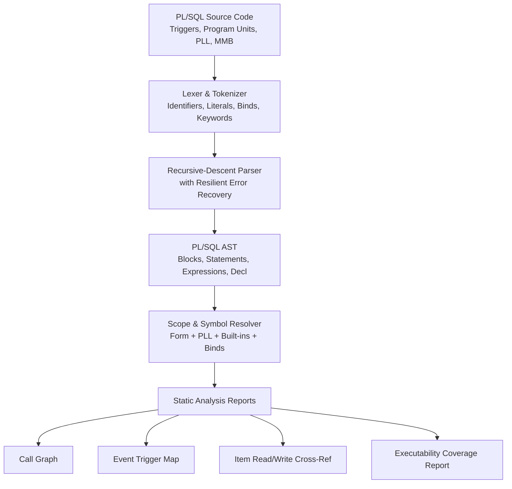

# 08: PL/SQL Front-End, Event Engine & Interpreter Specification

> **Component**: `oracle-forms-plsql` (Phase C) and `oracle-forms-runtime` (Phase D)  
> **Status**: Design Specification  
> **Target Personas**: Reviewer / Maintainer (Code Intelligence), Modernizer / Analyst (Interactive Event Flow), Developer (Behavioral Parity)

---

## 1. Context & The "PL/SQL in Forms" Reality

A legacy Oracle Form is not a passive data-entry screen; it is an **event-driven state machine** where business rules, navigation guards, validation cascades, and data mutations are implemented in PL/SQL.

Crucially:
1. **Forms PL/SQL runs on the Forms client/runtime**, NOT inside the database engine.
2. Forms PL/SQL invokes **Forms Built-ins** (`GO_ITEM`, `EXECUTE_QUERY`, `SET_ITEM_PROPERTY`, `SHOW_ALERT`, `CHECK_RECORD`) which do not exist in the database catalog.
3. Therefore, pushing trigger code to the database for execution fails immediately.
4. Conversely, building a full 100% database-compatible PL/SQL VM (with dynamic SQL, pipelined table functions, complex object types, and autonomous transactions) is unnecessary and out of scope.
5. The correct 80/20 target is: **A bounded Forms-side PL/SQL parser and tree-walking interpreter capable of executing the client-side event logic and delegating pure database queries/DML out to the database driver with resolved bind variables.**

---

## 2. Where Executable Logic Lives in Oracle Forms

In an Oracle Forms module, PL/SQL code is distributed across seven distinct architectural tiers:

| Source | AST Model Representation | Resolution & Inheritance Rules |
|---|---|---|
| **Triggers** | `TriggerInfo` (`level`, `block_name`, `item_name`) | Defined at **Form**, **Block**, or **Item** level. Bound to specific lifecycle events (`WHEN-VALIDATE-ITEM`, `PRE-QUERY`, `KEY-ENTER`). May be overridden or cascaded via *Execution Hierarchy*. |
| **Program Units** | `ProgramUnitInfo` | Procedures, functions, package specifications, and package bodies defined within the form module. Scoped globally across the module. Spec/body pairs must be unified. |
| **Attached Libraries (`.pll` / `.pld`)** | `AttachedLibraryInfo` | External shared libraries attached to the form. Resolved in strict attachment order. Identifiers in earlier libraries shadow identical identifiers in later libraries. |
| **Menu Modules (`.mmb`)** | `MenuInfo`, `MenuItemInfo` | Menu items contain PL/SQL commands that execute in the context of the active form (e.g., calling form procedures or `DO_KEY('COMMIT_FORM')`). |
| **Object Libraries (`.olb`) & Property Classes** | `PropertyClassInfo`, `ObjectLibraryEntry` | Triggers, items, and blocks can be inherited/subclassed. Inherited triggers must be resolved into the **effective module** before analysis or execution. |
| **Record Groups & LOVs** | `RecordGroupInfo`, `LovInfo` | Record group queries contain bind variables (`:BLOCK.ITEM`, `:GLOBAL.X`) and populate List-of-Values columns with return-item bindings. |
| **Declarative Block/Item Properties** | `BlockDml`, `ItemDml` | `WhereClause` and `OrderByClause` contain bind variables. Item `initial_value` can evaluate `:GLOBAL.X`, `$$DATE$$`, `$$TIME$$`, or `:SEQUENCE.X.NEXTVAL`. |

---

## 3. The Oracle Forms Event Model & Trigger Pipeline

### 3.1 Trigger Scopes & The Execution Hierarchy

Triggers fire based on an event occurring at an Item, Block, or Form level. When an event occurs (e.g., `WHEN-VALIDATE-ITEM`):
1. **Search Order**: The runtime looks for the trigger first at the **Item level**, then at the **Block level**, and finally at the **Form level**.
2. **Execution Hierarchy**:
   - `Override` (Default): The lowest-level trigger that matches fires; higher-level triggers are skipped.
   - `Before`: The higher-level trigger executes *before* the lower-level trigger.
   - `After`: The higher-level trigger executes *after* the lower-level trigger.

### 3.2 Trigger Categories & Behavioral Contracts

| Family | Key Triggers | Replaces Default Behavior? | Failure Impact |
|---|---|---|---|
| **Query Lifecycle** | `PRE-QUERY`, `POST-QUERY`, `ON-SELECT`, `ON-FETCH`, `ON-COUNT` | `ON-*` triggers **replace** default query and fetch SQL execution. | Aborts query; block remains in previous state. |
| **Navigation** | `PRE-BLOCK`, `POST-BLOCK`, `PRE-RECORD`, `POST-RECORD`, `PRE-TEXT-ITEM`, `POST-CHANGE` | No. Run during cursor movement. | Aborts navigation; cursor stays in starting field. |
| **Validation** | `WHEN-VALIDATE-ITEM`, `WHEN-VALIDATE-RECORD` | No. Validates dirty items and records. | Focus is forced back to invalid item/record; error displayed. |
| **Transactional / Commit** | `PRE-COMMIT`, `PRE-INSERT`, `ON-INSERT`, `POST-INSERT`, `PRE-UPDATE`, `ON-UPDATE`, `POST-UPDATE`, `PRE-DELETE`, `ON-DELETE`, `POST-DELETE`, `POST-FORMS-COMMIT` | `ON-*` triggers **replace** default database INSERT/UPDATE/DELETE. | Rolls back current transaction to savepoint. |
| **Key Triggers** | `KEY-ENTER`, `KEY-EXEQRY`, `KEY-ENTQRY`, `KEY-NEXT-ITEM`, `KEY-PREV-ITEM`, `KEY-COMMIT`, `KEY-CLRBLK`, `KEY-EXIT` | **Yes!** Completely replaces the built-in keyboard function. Built-in action must be explicitly called via `DO_KEY('...')` if desired. | Aborts key action. |
| **Interface & Actions** | `WHEN-BUTTON-PRESSED`, `WHEN-RADIO-CHANGED`, `WHEN-CHECKBOX-CHANGED`, `WHEN-LIST-CHANGED`, `WHEN-WINDOW-ACTIVATED`, `WHEN-TAB-PAGE-CHANGED` | No. Responds to direct user interaction. | Displays error; user interaction discarded. |
| **Error Handling** | `ON-ERROR`, `ON-MESSAGE` | **Yes.** Traps error/message codes; prevents default Forms alert popups. | Re-raises error if unhandled. |
| **Timers** | `WHEN-TIMER-EXPIRED` | No. Triggered by server-side elapsed timer. | Logged as runtime warning. |

### 3.3 Trigger Failure & Exception Semantics

- **`RAISE FORM_TRIGGER_FAILURE`**: The fundamental mechanism in Oracle Forms to signal an expected operational failure without an unhandled system crash.
  - In a navigation trigger: cancels navigation and restores cursor focus.
  - In a validation trigger: flags the item/record as invalid and halts processing.
  - In a commit trigger: halts the commit pipeline and executes an internal rollback to savepoint.
- **Unhandled Exceptions**: Any unhandled PL/SQL exception (`OTHERS`) invokes the `ON-ERROR` trigger or outputs standard Forms error codes (e.g., `FRM-40735: WHEN-BUTTON-PRESSED trigger raised unhandled exception`).

### 3.4 System Variables (`:SYSTEM.*`)

The runtime environment maintains an internal session state accessible via read-only (and occasionally read-write) `:SYSTEM.*` variables:

| Variable | Description |
|---|---|
| `:SYSTEM.CURSOR_ITEM` | Name of the block and item currently holding cursor focus (`BLOCK.ITEM`). |
| `:SYSTEM.CURSOR_BLOCK` | Name of the active block. |
| `:SYSTEM.CURSOR_RECORD` | Active record number (1-based index within query results). |
| `:SYSTEM.TRIGGER_ITEM` | Item that triggered the currently executing event. |
| `:SYSTEM.TRIGGER_BLOCK` | Block containing the trigger item. |
| `:SYSTEM.RECORD_STATUS` | Status of the active record: `'NEW'`, `'INSERT'`, `'QUERY'`, `'CHANGED'`. |
| `:SYSTEM.BLOCK_STATUS` | Status of the active block: `'NEW'`, `'QUERY'`, `'CHANGED'`. |
| `:SYSTEM.FORM_STATUS` | Aggregate status of the form: `'NEW'`, `'QUERY'`, `'CHANGED'`. |
| `:SYSTEM.MODE` | Operational mode: `'NORMAL'`, `'ENTER-QUERY'`, `'QUERY'`. |
| `:SYSTEM.LAST_QUERY` | Raw SQL string executed by the last block query. |
| `:SYSTEM.MESSAGE_LEVEL` | Minimum severity level of messages displayed to the user (`0`, `5`, `10`, `15`, `20`, `25`). |
| `:SYSTEM.SUPPRESS_WORKING` | Suppresses runtime "Working..." prompt when set to `'TRUE'`. |

---

## 4. Phase C: The PL/SQL Front-End Crate (`oracle-forms-plsql`)

The `oracle-forms-plsql` crate is a pure-native parser, AST model, and static analysis engine. It depends strictly on `oracle-forms-core` (zero database or network dependencies).



### 4.1 Parser Design & Error Resilience

1. **Error Recovery**: In legacy systems, individual triggers often contain syntax errors or non-standard syntax. The parser MUST use synchronization tokens (`END;`, `;`, `EXCEPTION`, `WHEN`) to recover from syntax errors so a single malformed trigger does not invalidate an entire form module.
2. **Grammar Scope**:
   - Declarations: primitive types (`NUMBER`, `VARCHAR2`, `DATE`, `BOOLEAN`), `%TYPE` bindings, `%ROWTYPE` bindings, PL/SQL record definitions, and associative arrays (index-by tables).
   - Control flow: `IF-ELSIF-ELSE`, `CASE`, simple `LOOP`, `WHILE` loop, numeric `FOR` loop, cursor `FOR` loop.
   - Exceptions: `BEGIN ... EXCEPTION WHEN ... THEN ... END;`, `RAISE`, `RAISE FORM_TRIGGER_FAILURE`.
   - Assignments: `:BLOCK.ITEM := expr;`, `var := expr;`.
   - Embedded SQL: Handled as **opaque SQL spans** with extracted bind expressions and `INTO` target variables.

### 4.2 Code Intelligence & Analysis Outputs

Phase C delivers immediate value to the **Reviewer** and **Modernizer** personas even before execution is enabled:
1. **Call Graph**: Mapping triggers $\to$ local procedures $\to$ attached `.pll` library functions $\to$ database stored packages.
2. **Event Map**: Chronological listing of triggers that fire for any given user action on an item or block.
3. **Item Cross-Reference**: Complete index of which triggers read (`:BLOCK.ITEM`) and which triggers mutate (`:BLOCK.ITEM := ...`) every field in the form.
4. **Executability Coverage Report**: Every statement in every trigger classified as:
   - `Supported` (can be executed by the Phase D interpreter).
   - `Delegated` (pure database SQL statement sent to database driver).
   - `Unsupported` (specific unsupported built-in, e.g., `HOST` or `OLE2`, with line numbers and reasons).

---

## 5. Phase D: The Runtime Engine & Interpreter (`oracle-forms-runtime`)

### 5.1 Architecture & Resumable Execution

Forms PL/SQL execution is inherently interactive. Consider `SHOW_ALERT`:
```plsql
v_button := SHOW_ALERT('CONFIRM_DELETE');
IF v_button = ALERT_BUTTON1 THEN
    DELETE_RECORD;
END IF;
```
When `SHOW_ALERT` executes, the interpreter CANNOT block the web server thread waiting for a human to click a button. The interpreter must **suspend** its execution state, return an interaction request to the client (REST or WebSocket), and **resume** execution from the exact statement when the user's choice is received.

**Implementation**: The interpreter is implemented as an async, resumable state machine using Tokio tasks and bidirectional communication channels (`mpsc::channel`).

### 5.2 Oracle Value Semantics

The runtime engine enforces accurate Oracle value semantics:
1. **Three-Valued NULL Logic**: `NULL = NULL` evaluates to `NULL` (unknown), not `TRUE`.
2. **VARCHAR2 Empty String**: `''` is strictly equivalent to `NULL`.
3. **Decimal Arithmetic**: Oracle `NUMBER` supports up to 38 decimal digits. Use `bigdecimal` or fixed-precision 128-bit decimal to avoid floating-point rounding errors in financial and claims forms.
4. **Dates**: `DATE` in Oracle includes hours, minutes, and seconds. Conversions obey session `NLS_DATE_FORMAT` (default `DD-MON-YYYY HH24:MI:SS`).

### 5.3 Built-ins Registry & Tiers

Built-in functions are implemented in Rust and registered in a typed catalog with execution constraints:

#### Tier 1: Core Navigation, Query & UI (Phase D Milestone)
- **Navigation**: `GO_ITEM`, `GO_BLOCK`, `NEXT_ITEM`, `PREVIOUS_ITEM`, `NEXT_RECORD`, `PREVIOUS_RECORD`, `FIRST_RECORD`, `LAST_RECORD`.
- **Query & Records**: `EXECUTE_QUERY`, `ENTER_QUERY`, `CLEAR_BLOCK`, `CLEAR_FORM`, `CREATE_RECORD`, `DELETE_RECORD`, `DO_KEY`.
- **Messages & Alerts**: `MESSAGE`, `SHOW_ALERT`, `SET_ALERT_PROPERTY`.
- **Properties**: `GET_ITEM_PROPERTY`, `SET_ITEM_PROPERTY`, `GET_BLOCK_PROPERTY`, `SET_BLOCK_PROPERTY`, `SET_ITEM_INSTANCE_PROPERTY`.
- **Dynamic Access**: `NAME_IN`, `COPY`, `DEFAULT_VALUE`, `ERASE`.
- **LOVs & Groups**: `SHOW_LOV`, `LIST_VALUES`, `FIND_GROUP`, `ID_NULL`, `POPULATE_GROUP`, `SYNCHRONIZE`.

#### Tier 2: Multi-Form, Timers & Windows (Phase D Polish)
- **Multi-Form**: `CALL_FORM`, `OPEN_FORM`, `NEW_FORM`, `EXIT_FORM`.
- **Timers**: `CREATE_TIMER`, `DELETE_TIMER`, `FIND_TIMER`.
- **Canvases & Windows**: `SHOW_VIEW`, `HIDE_VIEW`, `SET_WINDOW_PROPERTY`.
- **Menus**: `SET_MENU_ITEM_PROPERTY`.

#### Tier 3: Unsupported by Design (Mock Hooks & Diagnostics)
- **Legacy & Host Dependencies**: `HOST`, `OLE2.*`, `TEXT_IO`, `CLIENT_TEXT_IO`, `WEBUTIL_*`, `RUN_PRODUCT`, `D2KWUTIL`.
- **Behavior**: When encountered, the interpreter logs an explicit diagnostic and checks a per-project configuration file (`ofw_mocks.yaml`). If a mock return value is defined (e.g., `HOST` returns `0`), execution proceeds; otherwise, an `UnsupportedBuiltin` diagnostic is reported.

---

## 6. Safety & Operational Guardrails

To ensure safety when connected to real database environments:
1. **Execution Budget**: Every trigger execution has a maximum instruction budget (default 100,000 steps) to prevent infinite loops from hanging the runtime.
2. **Recursion Limit**: Call stack depth is limited to 64 frames.
3. **Read-Only Session Guard**: In Preview mode, a session-level flag intercepts all DML and transaction calls (`INSERT`, `UPDATE`, `DELETE`, `COMMIT`), guaranteeing that exploratory testing cannot mutate data in the target database.
