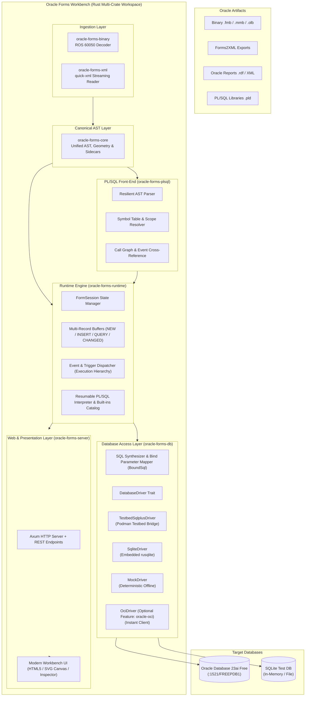

# Oracle Forms Workbench: Pure-Native Rust Toolchain & Engineering Blueprint

> **Architectural Plan & Engineering Blueprint**  
> *Transforming `oracle-forms-workbench` from a layout viewer into a comprehensive, multi-persona workbench for inspecting, visualizing, querying, analyzing, and modernizing legacy Oracle Forms & Reports applications.*

👉 **[Start Here: Feasibility Assessment & Executive Recommendations](FEASIBILITY-ASSESSMENT-AND-EXEC-SUMMARY.md)** (Calibrated 80/20 Analysis)  
👉 **[Review Feedback & Implementation Guide](00-PLAN-REVIEW-AND-REVISION-INSTRUCTIONS.md)** (Reviewer Instructions)

---

## 1. Product Vision & Personas

**Oracle Forms Workbench** is a standalone, cross-platform developer and analyst workbench for legacy Oracle Forms & Reports applications (`.fmb`, `.mmb`, `.olb`, Forms2XML exports, `.pld`, `.rdf`). It is designed around an **80/20 philosophy**: providing the inspection, querying, validation, and editing capabilities needed for maintenance and modernization, without attempting to replicate the entire proprietary enterprise application server stack.

### Personas & Entry Points

Every component and phase in this plan is designed to serve specific user personas:

| Persona | Primary Need | Workbench Component | Requires Oracle Software? |
|---|---|---|---|
| **Reviewer / Maintainer** | Read and audit code, triggers, program units, SQL queries, and dependencies without installing middleware. | Browser UI + PL/SQL code intelligence (`oracle-forms-plsql`) | **No.** Completely offline/standalone. |
| **Analyst / Modernizer** | Understand legacy form layout and runtime behavior, trace business events, inspect data blocks, generate inventories, export XML. | Visual Canvas + Runtime Spine (`oracle-forms-runtime`) + Analysis Reports | **No** (Database connectivity optional). |
| **Developer (Light Edits)** | Edit prompts, canvas coordinates, SQL where clauses, and triggers without opening Oracle Forms Builder. | Workbench Editor + XML round-trip, verified via testbed compilation. | **Only to compile `.fmx`**. |
| **Developer (Full Stack)** | Run and test genuine Oracle Forms 14c and Database 23ai locally in Podman/Docker. | `testbed/` container environment + APM skills. | **Yes** (Containerized testbed). |
| **Agent / Automation User** | Programmatic CLI and APM skills for automated headless conversion, compilation, health checks, and analysis. | APM skills (`plugins/oracle-forms`) + CLI (`oracle-forms-cli`). | Depends on the skill invoked. |

---

## 2. Blueprint Document Map

| Document | Topic | Key Contents |
| :--- | :--- | :--- |
| **[00. Plan Review & Revision Instructions](00-PLAN-REVIEW-AND-REVISION-INSTRUCTIONS.md)** | Reviewer Feedback & Checklist | Detailed audit findings, phased sequence corrections, and checklists. |
| **[01. Pain Points & Lessons from REA](01-PAIN-POINT-ANALYSIS-AND-LESSONS.md)** | Architectural Lessons & Domain Models | Analysis of Forms middleware complexity; lessons from `temp/repos/rea` (Domain-Driven Design, contracts, pluggable adapters, sandboxed execution). |
| **[02. Core Architecture & Multi-Crate Workspace](02-CORE-ARCHITECTURE-AND-CRATES.md)** | Rust Workspace Redesign | Modular crates: `oracle-forms-core`, `oracle-forms-xml`, `oracle-forms-binary`, `oracle-forms-db`, `oracle-forms-plsql`, `oracle-forms-runtime`, `oracle-forms-cli`, `oracle-forms-server`. |
| **[03. Runtime State Machine & Triggers](03-RUNTIME-STATE-MACHINE-AND-TRIGGERS.md)** | In-Memory Forms State Machine | Record status (`NEW`, `INSERT`, `QUERY`, `CHANGED`), item validation states, event dispatching, and master-detail coordination. |
| **[04. Database Integration & CRUD](04-DATABASE-INTEGRATION-AND-CRUD.md)** | Database Connectivity & CRUD | `BoundSql` and bind parameters; locking modes (`SELECT ... FOR UPDATE NOWAIT`); row-level optimistic checks; SQL generation. |
| **[05. Reports Engine Research Spike](05-REPORTS-ENGINE-SPECIFICATION.md)** | Oracle Reports Feasibility | Research spike for `.rdf` binary stream decoding vs Reports XML; printable layout generation. |
| **[06. Implementation Roadmap](06-IMPLEMENTATION-ROADMAP-AND-MILESTONES.md)** | Unified Milestone Breakdown | Single unified phase plan (Phase A through Phase G, Track T, Track K). |
| **[07. Oracle Connectivity ADR](07-ORACLE-CONNECTIVITY-ADR.md)** | Database Connectivity ADR | Staged architecture: Testbed Sqlplus (Option A), OCI driver via feature flag (Option B), and Pure-Rust thin driver (Option C). |
| **[08. PL/SQL & Event Execution](08-PLSQL-AND-EVENT-EXECUTION.md)** | PL/SQL Front-End & Interpreter | Forms PL/SQL scope, event model, AST parser, symbol resolution, and Tiered built-ins catalog. |
| **[09. Conformance Testing](09-CONFORMANCE-TESTING.md)** | Ground-Truth Oracle Testing | Autonomous trace logging (`ofw_trace`), scripted user scenarios, and Golden Trace validation against Forms 14c. |
| **[Target Architecture](TARGET-ARCHITECTURE.md)** | Complete System Specification | Invariants, crate contracts, wire protocol, and data flows. |
| **[Implementation Plan](IMPLEMENTATION-PLAN.md)** | Phased Engineering Roadmap | Deep-dive per phase with dependencies, personas, and verification gates. |

---

## 3. High-Level Target Architecture

---

## 4. Legal & Trademark Disclaimer

*Oracle, Java, WebLogic, and Oracle Forms are registered trademarks of Oracle Corporation and/or its affiliates. Oracle Forms Workbench is an independent open-source project and is not affiliated with, sponsored by, or endorsed by Oracle Corporation.*
