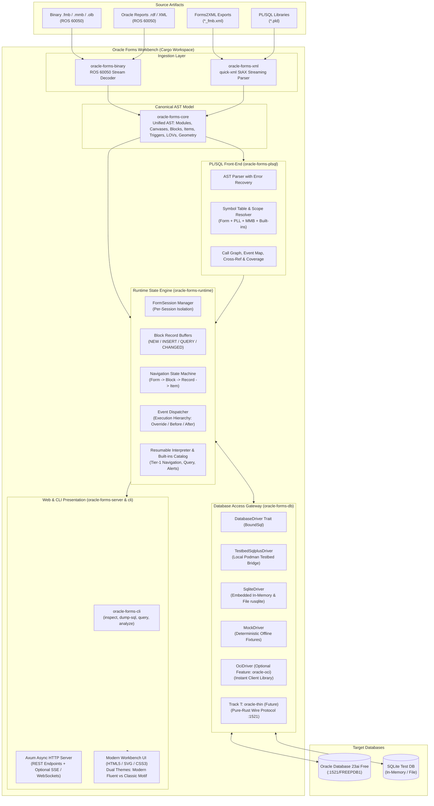
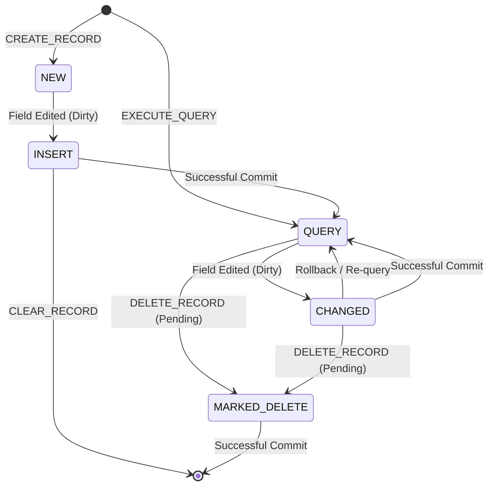

# Target Architecture: Oracle Forms Workbench

> **Document Status**: Revised Architecture Specification  
> **Location**: `temp/plan/TARGET-ARCHITECTURE.md`  
> **System Purpose**: Deliver an independent, high-performance developer and analyst workbench for legacy Oracle Forms and Reports, providing visual layout inspection, PL/SQL code intelligence, runtime simulation, direct database querying, and safe XML round-trip editing without requiring Oracle Fusion Middleware.

---

## 1. Architectural Invariants & Constraints

1. **Zero JVM / Zero WebLogic Runtime**: Under no circumstances will Java, OpenJDK, WebLogic Server, or Node.js be introduced into the Rust workbench runtime execution path.
2. **Oracle Client Decoupling**: Parser, AST model, PL/SQL front-end, and runtime engine crates must NEVER depend on Oracle software or Instant Client libraries. Database drivers that require Oracle client software (`oracle-oci`) MUST sit behind a non-default cargo feature flag and be explicitly named as such.
3. **Strict Crate Boundaries**: Core AST definitions (`oracle-forms-core`) remain strictly isolated from network, database, and presentation layers. Runtime session state remains isolated per form session.
4. **Portability & Measured Performance**: Single standalone binary compilation with zero-copy embedded frontend assets. Cold boot time and memory footprint are strictly measured and tracked in CI regression benchmarks.
5. **Validated Round-Trip Compatibility**: All form mutations and XML round-trips must be validated by headless batch compilation (`frmcmp_batch`) against the official Forms 14c container testbed (`testbed/`).
6. **Parameter Safety**: User-supplied values must NEVER be formatted as raw text into SQL strings. All database queries must enforce bound parameters via `BoundSql`.

---

## 2. Personas & Architectural Entry Points

| Persona | Primary Goal | Architectural Entry Point | Client Prerequisite |
|---|---|---|---|
| **Reviewer / Maintainer** | Audit PL/SQL triggers, program units, SQL queries, and attached library dependencies without running middleware. | Web UI (Object Navigator + PL/SQL Tab) + `oracle-forms-cli` | Web Browser / Terminal |
| **Analyst / Modernizer** | Inspect canvas layout coordinates, test runtime navigation cascades, observe event ordering, and export inventories. | Web UI Visual Canvas + `oracle-forms-runtime` Event Engine | Web Browser |
| **Developer (Light Edits)** | Modify prompts, coordinates, WHERE clauses, and triggers without opening Oracle Forms Builder. | Visual Canvas Editor + XML Round-Trip Importer/Exporter | Web Browser |
| **Developer (Full Stack)** | Run and verify genuine Oracle Forms 14c (`.fmx`) and Oracle 23ai Database live on desktop via FSAL. | Local Podman Testbed (`testbed/`) + APM Skills (`plugins/oracle-forms`) | Podman + Java 17 (for FSAL only) |
| **Agent / Automation** | Automated batch compilation, schema migration, link validation, and regression testing. | APM Skills + CLI (`oracle-forms-cli`) | Shell / CLI |

---

## 3. High-Level Target Architecture



---

## 4. Multi-Crate Architecture & Responsibilities

The workspace is organized into focused, single-responsibility crates:

```text
oracle-forms-workbench/
├── Cargo.toml                            # Virtual workspace root
├── crates/
│   ├── oracle-forms-core/                # Shared domain AST, geometry, and sidecars
│   ├── oracle-forms-xml/                 # Streaming quick-xml parser (Forms XML & PLD)
│   ├── oracle-forms-binary/              # ROS 60050 stream & heuristic binary extractor
│   ├── oracle-forms-db/                  # Database drivers & SQL generator (BoundSql)
│   ├── oracle-forms-plsql/               # PL/SQL parser, symbol table, and static analysis
│   ├── oracle-forms-runtime/             # FormSession, buffers, event dispatcher, interpreter
│   ├── oracle-forms-cli/                 # Command-line tools (inspect, dump-sql, query, analyze)
│   └── oracle-forms-server/              # Axum HTTP server with embedded UI assets
├── ui/                                   # Vanilla HTML5/CSS3/SVG web application
└── samples/                              # Curated redistributable test forms & conformance corpus
```

| Crate | Responsibility | Core Invariants |
|---|---|---|
| **`oracle-forms-core`** | Canonical AST structures (`ModuleIndex`, `BlockInfo`, `ItemInfo`, `CanvasInfo`, `TriggerInfo`, `ProgramUnitInfo`), Serde models, coordinate math, and PL/SQL sidecar filesystem writer. | Zero external IO, zero network, zero database dependencies. |
| **`oracle-forms-xml`** | High-performance streaming XML reader using `quick-xml`. Translates byte offsets to line ranges via newline index. Handles Forms2XML and `.pld` text libraries. | Streaming only; avoids loading massive DOMs into memory. |
| **`oracle-forms-binary`** | Direct ROS 60050 binary stream decoder. Dissects binary headers (`ROS.60050`), extracts PL/SQL triggers, program units, bind variable blocks/items, and computes layout flows. | Pure native Rust parser; no Oracle Forms Builder DLLs. |
| **`oracle-forms-db`** | Database access abstraction. Defines `DatabaseDriver` trait with `BoundSql`. Provides `TestbedSqlplusDriver`, `SqliteDriver`, and `MockDriver`. Feature-gated `OciDriver` behind `oracle-oci`. | User values must never be formatted as raw SQL text. |
| **`oracle-forms-plsql`** | PL/SQL recursive-descent parser with error recovery. Builds AST, symbol table across forms, attached `.pll` libraries, and `.mmb` menus. Generates call graphs and coverage reports. | No execution; pure static analysis and AST modeling. |
| **`oracle-forms-runtime`** | State management (`FormSession`), multi-record buffers (`NEW`, `INSERT`, `QUERY`, `CHANGED`), event dispatching (`Execution Hierarchy`), and resumable tree-walking PL/SQL interpreter with Tier-1 built-ins. | Interactive built-ins (`SHOW_ALERT`) suspend and resume asynchronously. |
| **`oracle-forms-cli`** | Developer CLI providing `inspect`, `dump-sql`, `query`, and `analyze` subcommands. | Stateless command execution; suitable for CI automation. |
| **`oracle-forms-server`** | Standalone web server built on `axum`. Embeds `ui/` assets via `rust-embed`. Provides REST endpoints and session state channels. | Listens on `127.0.0.1` by default; warns if bound to non-loopback. |

---

## 5. Multi-Record State Machine & Buffer Model

Forms blocks maintain a two-dimensional record buffer:



### Record Statuses
- **`NEW`**: A newly created record that has not been modified by the user or code. Ignored during commit processing.
- **`INSERT`**: A new record that has been edited. Targeted by the commit pipeline for `INSERT`.
- **`QUERY`**: A record fetched from the database that remains unmodified.
- **`CHANGED`**: A queried record that has been edited. Targeted by the commit pipeline for `UPDATE` with optimistic concurrency check.
- **Pending Delete**: A queried record marked for deletion (tracked via internal flag `is_marked_for_delete`). Targeted by the commit pipeline for `DELETE`.

---

## 6. Client-Server Communication & Wire Protocol

1. **Baseline Communication**: RESTful HTTP endpoints with unique `session_id` header or cookie.
   - `POST /api/sessions`: Launch form session, returns initial layout and state.
   - `POST /api/sessions/{id}/events`: Dispatch user action (click button, change item value, press navigation key).
   - `GET /api/sessions/{id}/state`: Retrieve current screen delta (active record, item values, cursor focus, alert prompts).
2. **Real-Time Push (SSE / WebSocket)**:
   - Reserved specifically for server-side asynchronous events: `CREATE_TIMER` $\to$ `WHEN-TIMER-EXPIRED` and background progress notifications.
