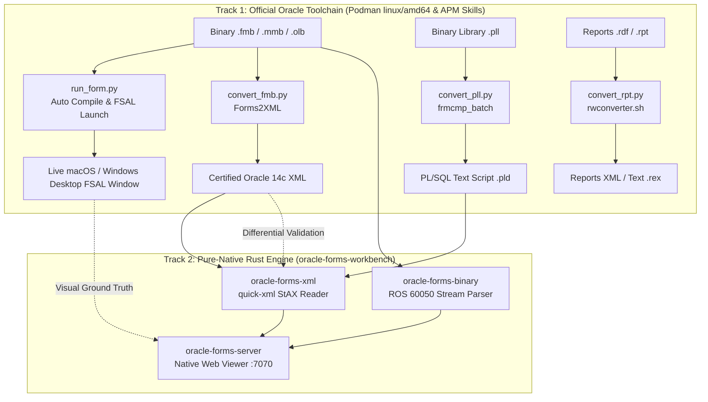

# Podman Oracle Forms Container Environment (12c & 14c + 23ai Database)

An on-demand, containerized environment hosting official **Oracle Forms 12c and 14c installations** alongside **Oracle Database 23ai Free** on **macOS Apple Silicon (ARM64)** and Linux using Podman.

> [!NOTE]
> All container scripts have been refactored and packaged into **APM Skills** under `plugins/oracle-forms/.apm/skills/`. They follow universal coding conventions (type hints, standardized headers, dual-layer docstrings) and can be invoked directly from the CLI or autonomously by AI agents.

This environment provides full developer and runtime capabilities without requiring a Windows virtual machine or remote server:
1. **Live Form Execution against Real Database (`run_form.py`)**: Runs working forms on WebLogic 14c (`formsapp` on port 7001) connected to Oracle Database 23ai Free using native desktop **Forms Standalone Launcher (FSAL)**.
2. **Forms/Menus/Object Libraries to XML (`convert_fmb.py`)**: Executes official Oracle `frmf2xml.sh` to generate vendor-standard XML ground truth.
3. **PL/SQL Libraries to Text & Compiler (`convert_pll.py`)**: Executes official Oracle `frmcmp_batch` to export `.pll` binaries into `.pld` ASCII text scripts and compile them back.
4. **Oracle Reports Converter (`convert_rpt.py`)**: Interface for converting Oracle Reports (`.rdf`, `.rpt`, `.rex`) using Oracle `rwconverter.sh`.
5. **Headless Batch Compiler (`compile_form.py`)**: Compiles `.fmb` into `.fmx` with SQL*Net database binding.

---

## 1. Architectural Role & Two-Track Strategy



---

## 2. Capability 1: Running Forms Live in WebLogic (`run_form.py`)

Run any `.fmb`, `.xml`, or `.fmx` form directly on your desktop via Forms Standalone Launcher (FSAL):

```bash
# Automatically converts (if XML), compiles (if FMB), and launches FSAL on desktop:
python3 plugins/oracle-forms/.apm/skills/compiling-and-running-oracle-forms/scripts/run_form.py samples/test_db.fmb

# Run directly from compiled FMX:
python3 plugins/oracle-forms/.apm/skills/compiling-and-running-oracle-forms/scripts/run_form.py samples/test_db.fmx

# Prompt for credentials via the native GUI Logon dialog:
python3 plugins/oracle-forms/.apm/skills/compiling-and-running-oracle-forms/scripts/run_form.py samples/test_db.fmx --interactive
```

---

## 3. Capability 2: Headless Batch Conversion Scripts

All scripts are located in `plugins/oracle-forms/.apm/skills/converting-oracle-artifacts/scripts/`:

### 1. Forms, Menus & Object Libraries to XML (`convert_fmb.py`)
Converts `.fmb`, `.mmb`, and `.olb` modules into certified XML representations (`*_fmb.xml`, `*_mmb.xml`, `*_olb.xml`):

```bash
# Verify environment readiness
python3 plugins/oracle-forms/.apm/skills/converting-oracle-artifacts/scripts/convert_fmb.py --check

# Convert a form (produces <stem>_fmb.xml beside original):
python3 plugins/oracle-forms/.apm/skills/converting-oracle-artifacts/scripts/convert_fmb.py samples/simple_module.fmb

# Convert with custom destination:
python3 plugins/oracle-forms/.apm/skills/converting-oracle-artifacts/scripts/convert_fmb.py samples/simple_module.fmb -o ./converted/simple_module.xml
```

### 2. PL/SQL Libraries to Text & Compiler (`convert_pll.py`)
Converts binary `.pll` libraries to human-readable `.pld` text scripts (and compiles `.pld` back into `.pll`):

```bash
# Verify environment readiness
python3 plugins/oracle-forms/.apm/skills/converting-oracle-artifacts/scripts/convert_pll.py --check

# Export binary .pll to text .pld:
python3 plugins/oracle-forms/.apm/skills/converting-oracle-artifacts/scripts/convert_pll.py samples/library.pll

# Compile text .pld back into binary .pll:
python3 plugins/oracle-forms/.apm/skills/converting-oracle-artifacts/scripts/convert_pll.py samples/library.pld --compile
```

### 3. Oracle Reports Converter (`convert_rpt.py`)
CLI interface for converting Oracle Reports definitions (`.rdf`, `.rpt`, `.rex`) into Reports XML or text definitions using `rwconverter.sh`:

```bash
# Verify environment readiness
python3 plugins/oracle-forms/.apm/skills/converting-oracle-artifacts/scripts/convert_rpt.py --check

# Convert report to XML (default, if rwconverter is available):
python3 plugins/oracle-forms/.apm/skills/converting-oracle-artifacts/scripts/convert_rpt.py samples/invoice.rdf

# Export report to ASCII text script (.rex):
python3 plugins/oracle-forms/.apm/skills/converting-oracle-artifacts/scripts/convert_rpt.py samples/invoice.rdf --format rex
```

> [!WARNING]
> **Container Installation Limitation**: The container's `oracle_home` was installed using Oracle's `Standalone Forms Builder` profile, which deliberately omits Oracle Reports (`rwconverter.sh`). In Oracle 12c, installing Reports requires a separate, full **Oracle Fusion Middleware Infrastructure (WebLogic Server 12c)** installation.
> 
> **Recommended Alternative (Track 2 Native Rust)**:
> Oracle Reports `.rdf` files use the exact same `ROS.60050` container format as Forms `.fmb` files! You can inspect and dump reports immediately using the native Rust toolchain with **zero Oracle or WebLogic dependencies**:
> ```bash
> cargo run -p oracle-forms-cli -- inspect /path/to/report.rdf
> cargo run -p oracle-forms-cli -- dump-sql /path/to/report.rdf -o ./extracted-sql
> ```

---

## 4. Architecture & Lifecycle

```text
[ Host Machine (macOS ARM64 / Linux x86_64 / Windows 11) ]
   │
   ├── plugins/oracle-forms/.apm/skills/
   │   ├── setting-up-oracle-testbed/
   │   │   └── scripts/health_check.py          ──► Verifies Podman containers & DB
   │   ├── converting-oracle-artifacts/
   │   │   ├── scripts/convert_fmb.py           ──► Headless Forms2XML / XML2Forms
   │   │   ├── scripts/convert_pll.py           ──► Headless PLL <-> PLD converter
   │   │   └── scripts/convert_rpt.py           ──► Reports rwconverter.sh
   │   └── compiling-and-running-oracle-forms/
   │       ├── scripts/run_form.py              ──► End-to-end convert, compile, & launch
   │       ├── scripts/compile_form.py          ──► Headless frmcmp_batch compiler
   │       └── scripts/launch_fsal.py           ──► Native desktop FSAL client (Java)
   │
   ▼  (Mounted workspace: /work:Z, AdminServer: 7001, Oracle 23ai: 1521)
[ Podman Containers ]
   ├── forms-server-14c (Oracle Linux 8 + JDK 17 + Forms 14c + WebLogic)
   └── oracle23ai-lite  (Oracle Database 23ai Free PDB FREEPDB1)
```
   ├── Runtime: OpenJDK 8, X11 & Motif libraries, glibc-devel
   ├── /work (Mounted workspace root)
   └── /oracle_home (Mounted Oracle Forms 12c installation)
```

- **Ephemeral Execution (`--rm`)**: Containers terminate immediately upon exit, consuming zero idle memory or background CPU.
- **Zero-Copy Host Mounts (`/work:Z`)**: Workspace directories are mounted directly so generated XML, PLD, and edited forms write straight to your local filesystem.

---

## 5. Tooling Directory Reference

| File / Folder | Purpose |
| :--- | :--- |
| `Containerfile` | Container definition building `forms-converter:latest` with OpenJDK 8, Motif, and X11 libraries for Forms 12c. |
| `Containerfile.14c` | Container definition building `forms-converter-14c:latest` with OpenJDK 17, Motif, and X11 libraries for Forms 14c. |
| `compose.yaml` | Multi-service Podman compose defining `oracle-db-23ai`, `forms-converter-12c`, and `forms-server-14c`. |
| `oracle_home/` | Installed Oracle Forms 12c standalone home containing binaries (`bin/frmbld`, `bin/frmcmp_batch`, `bin/frmf2xml.sh`, `lib/`, `jlib/`). |
| `oracle_home_14c/` | Installed Oracle Forms 14c enterprise home containing FMW Infrastructure, WebLogic, Forms, and Reports. |
| `installer/` | Staging directory for original Oracle installation archives and silent response files (`infra14c_silent.rsp`, `forms14c_silent.rsp`). |

> [!NOTE]
> All runner and conversion scripts have been packaged and organized into APM skills under `plugins/oracle-forms/.apm/skills/`.

---

## 6. Integration with Pure-Native Rust Workbench

The container environment connects directly with the pure-native Rust toolchain:
1. **Certified XML Generation**: `convert_fmb.py` generates certified `*_fmb.xml` files consumed by `oracle-forms-xml` and displayed in `oracle-forms-server` on port 7070.
2. **PL/SQL Text Ingestion**: `convert_pll.py` produces `.pld` files directly parseable by the native Rust PLD parser in `oracle-forms-xml`.
3. **Sibling Discovery**: When opening a `.fmb` in `oracle-forms-server`, the server automatically detects if a companion `*_fmb.xml` exists and renders the canonical layout.
4. **Visual Ground-Truth Audit**: Running `run_form.py` with FSAL allows side-by-side inspection against `oracle-forms-server` to confirm that our native SVG canvas renderer accurately reproduces authentic Oracle coordinate scaling and widget layouts.
5. **Differential Schema Validation**: Compare 12c Forms2XML exports with 14c Forms2XML exports to isolate Oracle syntax deprecations or modern additions.

---

## 7. Oracle Database 23ai Free & Forms 14c Runtime

### Running Oracle Database 23ai Free (Native ARM64)
Oracle Database 23ai Free runs as a native ARM64 container on Apple Silicon:

```bash
# Start 23ai Free Lite (runs on port 1521)
podman run -d \
  --name oracle23ai-lite \
  -p 1521:1521 \
  -e ORACLE_PWD=Welcome1 \
  container-registry.oracle.com/database/free:latest-lite

# Check startup logs
podman logs -f oracle23ai-lite
```

Connecting to the database:
- **Host**: `localhost` (or `host.containers.internal` inside containers)
- **Port**: `1521`
- **Service Name**: `FREEPDB1`
- **User**: `system` / **Password**: `Welcome1`

### Installing Oracle Forms 14c (Two-Stage Silent Install)

1. **Build the 14c container image**:
   ```bash
   podman build -t forms-converter-14c:latest -f oracle-reference-stack/Containerfile.14c oracle-reference-stack
   ```

2. **Stage the installers into `oracle-reference-stack/installer`**:
   - `fmw_14.1.2.0.0_infrastructure.jar` (from `V1045135-01.zip`)
   - `fmw_14.1.2.0.0_fr_linux64.bin` (from `V1045121-01.zip`)

3. **Run Stage 1: Fusion Middleware Infrastructure 14c**:
   ```bash
   podman compose -f oracle-reference-stack/compose.yaml run --rm infra-install-14c
   ```

4. **Run Stage 2: Forms and Reports 14c**:
   ```bash
   podman compose -f oracle-reference-stack/compose.yaml run --rm forms-install-14c
   ```

5. **Start WebLogic & Forms Server**:
   ```bash
   podman compose -f oracle-reference-stack/compose.yaml up -d forms-server-14c
   ```
