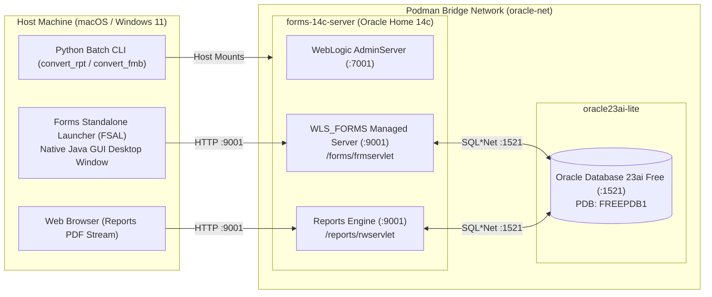

# Oracle Forms & Reports 14c: Testing & Verification Guide

This guide documents the complete verification blueprint for testing **Oracle Forms Server (`WLS_FORMS`)**, **Oracle Reports Server (`WLS_REPORTS`)**, and **Oracle Database 23ai Free** across macOS and Windows.

---

> **`$OH` below is the Oracle Home folder:** `export OH="${OFW_ORACLE_HOME:-$PWD/oracle-reference-stack/oracle_home_14c}"` (run it from the repo root, after loading `.env`). **On Windows, set `OFW_ORACLE_HOME` in `.env` to a folder on Ubuntu's own disk, for example `/home/<you>/oracle_home_14c`, BEFORE you install. Never install into the repo folder (`oracle-reference-stack/oracle_home_14c`): it is on the slow Windows drive and WebLogic takes 15 to 44 minutes to boot.** Why and how: [oracle-home-location.md](oracle-home-location.md).

## Contents

- [1. Environment Architecture](#1-environment-architecture)
- [2. Testing the Oracle Forms Server (Port 7001 Dev / Port 9001 Prod)](#2-testing-the-oracle-forms-server-port-7001-dev--port-9001-prod)
- [3. Testing the Oracle Reports Server (`WLS_REPORTS` on Port 9001)](#3-testing-the-oracle-reports-server-wls_reports-on-port-9001)
- [4. Cross-Platform GUI Configuration](#4-cross-platform-gui-configuration)

## 1. Environment Architecture

> **Oracle Home location.** The commands below use the container path `/oracle_home_14c`, which is the same wherever the folder sits on the host. On Windows the host folder defaults to `oracle-reference-stack/oracle_home_14c` on the slow Windows drive; it can instead live on Ubuntu's own disk via `OFW_ORACLE_HOME`. To test a moved or copied Oracle Home, run `provision_oracle_home.sh --verify --target PATH --against SOURCE`, then time the Forms server boot with `python3 start_testbed.py` and re-run this guide's Test 1 (servlet ping). See `plugins/oracle-forms/.apm/skills/setting-up-oracle-testbed/references/oracle-home-location.md`. **Not yet run.**



---

### Health check (run this first)

```bash
python3 plugins/oracle-forms/.apm/skills/setting-up-oracle-testbed/scripts/health_check.py
```

Expected output:

```text
=== Oracle Testbed Health Check ===
[1/3] Checking Podman containers...
  - Oracle Database 23ai: RUNNING (ok)
  - Oracle Forms 14c Server: RUNNING (ok)
[2/3] Checking Forms Listener Servlet (Port 7001)...
  - Forms Listener Servlet: UP AND RUNNING (ok)
[3/3] Checking Database Connection & Query (FREEPDB1)...
  - Database Query test_items: SUCCESS (ok)

All systems operational! Ready to compile and run Forms.
```

## 2. Testing the Oracle Forms Server (Port 7001 Dev / Port 9001 Prod)

The Forms Server runs on WebLogic under the servlet path `/forms/frmservlet`.
- **Development Mode (`forms_development_template.jar`)**: Targets `formsapp` directly to `AdminServer` on **Port 7001**.
- **Cluster/Production Mode**: Runs on separate managed server `WLS_FORMS` on **Port 9001**.

### Test 1: HTTP Diagnostic Ping & Listener Status
Verify that the Forms Servlet is alive and accepting incoming connections:

```bash
# Development Mode (AdminServer on Port 7001):
curl -I http://localhost:7001/forms/frmservlet

# View Forms Listener Servlet status:
curl -s http://localhost:7001/forms/frmservlet/admin

# (If using managed server WLS_FORMS on Port 9001):
curl -I http://localhost:9001/forms/frmservlet
```

> **Note on Browser Access**: Modern browsers (Chrome, Edge, Safari, Firefox) no longer support NPAPI Java applets. Navigating directly to `http://localhost:7001/forms/frmservlet` in a web browser will display:  
> *"Oracle Java is required to run this application. This web browser does not support Java Plugin or it is not enabled. Consider using Java Web Start or Standalone Launcher instead."*  
> This confirms the servlet is healthy. All interactive forms are run via the desktop launcher (FSAL).

> **Note on WebLogic 14.1.2 Administration (`/console`)**:  
> In WebLogic 14.1.2, Oracle completely removed the legacy in-browser WebLogic Administration Console (`/console`). Navigating to `http://localhost:7001/console` displays the welcome page directing administrators to download the desktop **WebLogic Remote Console** (or deploy the Hosted WebLogic Remote Console).  
> - **GitHub Releases**: [https://github.com/oracle/weblogic-remote-console/releases](https://github.com/oracle/weblogic-remote-console/releases)  
> - **macOS Installer**: Download the `.dmg` asset (e.g., `weblogic-remote-console-*.dmg` or `arm64.dmg` / `x64.dmg`), mount the DMG, drag to Applications, and connect to `http://localhost:7001` using credentials `weblogic` / `$WLS_ADMIN_PASSWORD`.

---

### Test 2: Oracle Built-in `test.fmx` via Forms Standalone Launcher (FSAL)
Oracle bundles an official diagnostic form (`test.fmx`) with every installation. Rather than needing a legacy browser plugin, you run it on your Mac, or on Windows from the Ubuntu WSL shell, with **Forms Standalone Launcher (FSAL)**:

```bash
# macOS / Linux (Port 7001 for Development Mode):
java -jar $OH/forms/java/frmsal.jar \
  -url "http://localhost:7001/forms/frmservlet?config=standaloneapp&form=test.fmx"

# Windows: run the macOS / Linux command above in the Ubuntu WSL shell (recommended). From Windows PowerShell it works only with Java 17 or 21 first on PATH; Windows Java 26 fails with java/applet/AppletStub:
java -jar $OH/forms/java/frmsal.jar `
  -url "http://localhost:7001/forms/frmservlet?config=standaloneapp&form=test.fmx"
```

* **What you see**: A native desktop Java window opens rendering Oracle's official "Forms Diagnostic Test Form", displaying server version, client OS, server time, and interactive widgets.

---

### Test 3: Live Form Connected to Our 23ai Database Container
Once `test.fmx` is verified, compile and run our own test form (`simple_module.fmb` $\rightarrow$ `simple_module.fmx`) connected directly to the `$DB_USER` schema in our 23ai database:

> [!IMPORTANT] Port Usage Note
> In development mode, Forms is hosted on AdminServer port **`7001`**. Attempting to connect to port `9001` when managed servers are not spun up will return `Unexpected end of file from server`. Always use port `7001` for the development container.

```bash
# macOS / Linux (Development Mode on Port 7001):
# Option A: Interactive GUI Logon Prompt
java -jar $OH/forms/java/frmsal.jar \
  -url "http://localhost:7001/forms/frmservlet?config=standaloneapp&form=simple_module.fmx"

# Option B: Pre-authenticated (Note: '#' in password MUST be URL-encoded as '%23'):
java -jar $OH/forms/java/frmsal.jar \
  -url "http://localhost:7001/forms/frmservlet?config=standaloneapp&form=simple_module.fmx&userid=$DB_USER/$DB_PASSWORD@FREEPDB1"

# Windows: run the macOS / Linux command above in the Ubuntu WSL shell (recommended). From Windows PowerShell it works only with Java 17 or 21 first on PATH; Windows Java 26 fails with java/applet/AppletStub:
java -jar $OH/forms/java/frmsal.jar `
  -url "http://localhost:7001/forms/frmservlet?config=standaloneapp&form=simple_module.fmx&userid=$DB_USER/$DB_PASSWORD@FREEPDB1"
```

* **What you see**:
  1. The Oracle Forms 14c splash banner: **"Version: 14.1.2.0.0 Successfully installed"**.
  2. If using Option A, the native Oracle Forms **Logon** dialog appears. Enter:
     * **Username**: `$DB_USER`
     * **Password**: `$DB_PASSWORD`
     * **Database**: `FREEPDB1`
  3. The form authenticates against Oracle Database 23ai Free and renders the live interactive UI canvas, including menus, action toolbar, text fields, rectangular frames, lines, ellipses, and skewed polygons!

(image: `docs/screenshots/forms-14c-live-mac-canvas.jpg` in the repo)

---

### Test 3.1: Live Form Querying Oracle 23ai Database (`test_db.fmx`)

We authored and compiled a dedicated database-backed test form (`samples/test_db.fmx`) containing live PL/SQL triggers wired to the `$DB_USER.test_items` table in 23ai:

* **Startup Trigger (`WHEN-NEW-FORM-INSTANCE`)**:
  Executes `SELECT item_name, TO_CHAR(amount) INTO :BLOCK5.TEXT_ITEM4, :BLOCK5.TEXT_ITEM284 FROM test_items WHERE item_id = 1;`
  Automatically populates **"Widget A"** and **"29.99"** into the canvas text fields on startup!
* **Button Trigger (`WHEN-BUTTON-PRESSED`)**:
  Clicking the **"Query Next Item (DB)"** button queries the next row from 23ai, cycling through `Gadget B` ($99.50) and `Super Gadget C` ($149.95).

#### Launch Live Database Form:
```bash
# macOS / Linux (Pre-authenticated to 23ai):
java -jar $OH/forms/java/frmsal.jar \
  -url "http://localhost:7001/forms/frmservlet?config=standaloneapp&form=test_db.fmx&userid=$DB_USER/$DB_PASSWORD@FREEPDB1"

# Windows: run the macOS / Linux command above in the Ubuntu WSL shell (recommended). From Windows PowerShell it works only with Java 17 or 21 first on PATH; Windows Java 26 fails with java/applet/AppletStub:
java -jar $OH/forms/java/frmsal.jar `
  -url "http://localhost:7001/forms/frmservlet?config=standaloneapp&form=test_db.fmx&userid=$DB_USER/$DB_PASSWORD@FREEPDB1"
```

---

### Test 4: Compiling Forms to FMX (`frmcmp_batch` & `XML2Forms`)

#### 1. Compile FMB into FMX Headlessly:
```bash
podman exec -u oracle forms-server-14c /bin/sh -c "\
  export ORACLE_HOME=/oracle_home_14c; \
  export LD_LIBRARY_PATH=/oracle_home_14c/lib; \
  export ORACLE_TERM=vt220; \
  export TERM=vt220; \
  export FORMS_PATH=/oracle_home_14c/forms:/work/samples; \
  /oracle_home_14c/bin/frmcmp_batch \
    module=/oracle_home_14c/forms/simple_module.fmb \
    module_type=form \
    logon=no \
    compile_all=yes"
```
* **Output**: `Created form file /oracle_home_14c/forms/simple_module.fmx`

#### 2. Convert Forms XML to FMB (`XML2Forms`):
```bash
podman exec forms-server-14c /bin/sh -c "\
  export ORACLE_HOME=/oracle_home_14c; \
  export FORMS_API_TK_BYPASS=TRUE; \
  export LD_LIBRARY_PATH=/oracle_home_14c/lib; \
  /usr/lib/jvm/jdk-17.0.12/bin/java \
    -Djava.library.path=/oracle_home_14c/lib \
    -classpath /oracle_home_14c/jlib/frmjdapi.jar:/oracle_home_14c/jlib/frmxmltools.jar:/oracle_home_14c/oracle_common/modules/oracle.xdk/xmlparserv2.jar \
    oracle.forms.util.xmltools.XML2Forms \
    OVERWRITE=YES \
    OUTPUTDIR=/oracle_home_14c/forms \
    /work/samples/simple_module_fmb.xml"
```

---

## 3. Testing the Oracle Reports Server (`WLS_REPORTS` on Port 9001)

The Reports engine runs under `/reports/rwservlet` and handles batch report compilation, PDF generation, and XML exports.

### Test 1: Reports Server Ping
```bash
# Returns XML confirming the in-process server is alive
curl http://localhost:9001/reports/rwservlet/ping

# Expected response:
# <server name="rep_server" status="ready"/>
```

---

### Test 2: Reports Environment & Job Queue Inspection
```bash
# View active REPORTS_PATH, font aliases, and environment variables
curl http://localhost:9001/reports/rwservlet/showenv

# View completed and running background report generation jobs
curl http://localhost:9001/reports/rwservlet/showjobs
```

---

### Test 3: Run a Live Test Report Directly to PDF in the Browser
Open this URL in your web browser:
```text
http://localhost:9001/reports/rwservlet?report=test.rdf&destype=cache&desformat=pdf&userid=$DB_USER/$DB_PASSWORD@oracle-db-23ai:1521/FREEPDB1
```

* **What happens**: The Reports Server queries the `test_items` table in 23ai DB, renders the tabular layout, compiles it to PDF in server memory, and streams the PDF document directly into your browser tab.

---

### Test 4: Headless Command-Line Reports Conversion (`rwconverter.sh`)
Test converting legacy binary reports to XML or text definitions using our Python wrapper:

```bash
# Export binary report to vendor XML definition
python3 plugins/oracle-forms/.apm/skills/converting-oracle-artifacts/scripts/convert_rpt.py samples/invoice.rdf

# Export binary report to human-readable ASCII text script (.rex)
python3 plugins/oracle-forms/.apm/skills/converting-oracle-artifacts/scripts/convert_rpt.py samples/invoice.rdf --format rex
```

---

## 4. Cross-Platform GUI Configuration

### macOS (Apple Silicon & Intel)
- Uses **XQuartz** for X11 display routing.
- Authorization: `xhost + 127.0.0.1 host.containers.internal`.
- Display environment variable: `-e DISPLAY="host.containers.internal:0"`.

### Windows 11 (everything inside WSL2)
- Run the containers, the Rust app, and the Forms client from the Ubuntu WSL shell, with the same commands as macOS and Linux. This is Podman inside WSL, not Podman Desktop.
- Windows 11 includes **WSLg**: the Forms window appears on the Windows desktop with no X-server setup (`DISPLAY=:0`).
- Volume mounts use the Linux syntax: `-v "$OH:/oracle_home_14c:Z"`.
- Run FSAL with Java 17 or 21. WSL has OpenJDK 21. Windows Java 26 fails with `NoClassDefFoundError: java/applet/AppletStub`.
- The full setup and troubleshooting are in `windows-podman-status-log.md` and `clean-clone-checklist.md`.
