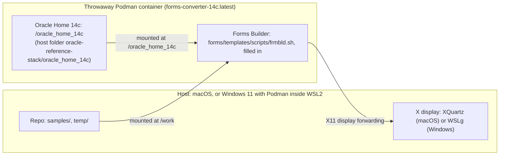

# Running the Oracle Forms Builder GUI (frmbld) and live forms

How to open the official, visual **Oracle Forms Builder (`frmbld`)** from the Forms 14c container, and how to run live forms against Oracle Database Free with the Forms Standalone Launcher (FSAL). Read `architecture.md` first for where everything runs: Fusion Middleware and the database are in Podman containers on both platforms, and on Windows Podman is inside WSL2.

**Verification status (be honest about it):**

| Platform | Forms Builder 14c | FSAL live form |
|---|---|---|
| Windows 11 (everything in WSL2, WSLg display) | **Verified 2026-11-14**: opened `ofw_sales.fmb` | **Verified** |
| macOS (XQuartz display) | **Not re-verified.** The 12c command (section 4) was the original Mac method; the 14c command in section 3 has not been run on a Mac | Verified earlier on the Mac setup |
| Linux | Not tested | Not tested |

---

> **`$OH` below is the Oracle Home folder:** `export OH="${OFW_ORACLE_HOME:-$PWD/oracle-reference-stack/oracle_home_14c}"` (run it from the repo root, after loading `.env`). **On Windows, set `OFW_ORACLE_HOME` in `.env` to a folder on Ubuntu's own disk, for example `/home/<you>/oracle_home_14c`, BEFORE you install. Never install into the repo folder (`oracle-reference-stack/oracle_home_14c`): it is on the slow Windows drive and WebLogic takes 15 to 44 minutes to boot.** Why and how: [oracle-home-location.md](oracle-home-location.md).

## Contents

- [1. Purpose](#1-purpose)
- [2. Display setup (once per host)](#2-display-setup-once-per-host)
- [3. Start the Forms Builder 14c (verified on Windows)](#3-start-the-forms-builder-14c-verified-on-windows)
- [4. Legacy: Forms Builder 12c (macOS, original method)](#4-legacy-forms-builder-12c-macos-original-method)
- [5. Using the Forms Builder](#5-using-the-forms-builder)
- [6. Run a live form with FSAL (verified on Windows)](#6-run-a-live-form-with-fsal-verified-on-windows)
- [7. Troubleshooting](#7-troubleshooting)
- [Workbench parity notes](#workbench-parity-notes)

## 1. Purpose

The containerized Oracle install in `oracle-reference-stack/` gives two things:

1. **Batch conversion** (see the `converting-oracle-artifacts` skill): headless conversion of `.fmb`, `.mmb`, and `.olb` files to XML and back.
2. **The interactive Forms Builder (`frmbld`)**: the full Oracle designer, to inspect forms, canvases, triggers, and properties exactly as Oracle shows them. It is the ground-truth reference when comparing layout and behavior with the Rust workbench.



---

## 2. Display setup (once per host)

### Windows 11 (everything inside WSL2): nothing to install

- Podman runs inside the Ubuntu WSL2 distro (not Podman Desktop). See [windows-podman-status-log.md](windows-podman-status-log.md).
- **No XQuartz.** **WSLg**, built into Windows 11, is the X server: Linux GUI programs appear on the Windows desktop. The display is `DISPLAY=:0`, and its socket is `/mnt/wslg/.X11-unix`, which you mount into the container as `/tmp/.X11-unix`.
- Java for FSAL must be 17 or 21: WSL's OpenJDK 21 works; Windows Java 26 does not (`java/applet/AppletStub`).
- Windows 10 would need a separate X server such as VcXsrv. **Not tested.**

### macOS: XQuartz

1. `brew install --cask xquartz`
2. Open XQuartz (`open -a XQuartz`), then **Settings > Security**, tick **"Allow connections from network clients"**, quit XQuartz completely (`Cmd + Q`) and reopen it.
3. Authorize the container: `xhost + 127.0.0.1` and `xhost + host.containers.internal`.

The container's display is then `DISPLAY=host.containers.internal:0`.

### Linux

`xhost +local:` on a native X11 session. Use `DISPLAY=${DISPLAY:-:0}`. **Not tested.**

---

## 3. Start the Forms Builder 14c (verified on Windows)

Run from the repo root in the Ubuntu WSL shell. Do not run the bare `/oracle_home_14c/bin/frmbld`: it exits at once with `FRM-10039: Unable to start up the Form Builder`, because it needs the environment Oracle's `frmbld.sh` sets (Java home, class path, instance, `TNS_ADMIN`). In this 14c install the instance scripts were never generated, so `frmbld.sh` exists only as a template with `%PLACEHOLDERS%` in `forms/templates/scripts/`. The command fills them in and runs it:

```bash
export XDG_RUNTIME_DIR=/run/user/$(id -u)
podman run --rm --name frmbld --platform linux/amd64 \
  -e DISPLAY=:0 -e ORACLE_TERM=vt220 -e TERM=vt220 -e JAVA_HOME=/usr/lib/jvm/jdk-17.0.12 \
  -e FORMS_PATH=/work/samples:/oracle_home_14c/forms \
  -v /mnt/wslg/.X11-unix:/tmp/.X11-unix \
  -v "$OH:/oracle_home_14c:Z" -v "$PWD:/work:Z" \
  forms-converter-14c:latest sh -c '
    D=/oracle_home_14c/user_projects/domains/base_domain
    sed -e "s#%ORACLE_HOME%#/oracle_home_14c#g" \
        -e "s#%CT_JAVA_HOME%#/usr/lib/jvm/jdk-17.0.12#g" \
        -e "s#%TNS_ADMIN%#$D/config/fmwconfig#g" \
        -e "s#%FORMS_INSTANCE%#$D/config/fmwconfig/components/FORMS/forms1#g" \
        -e "s#%DOMAIN_HOME%#$D#g" \
        /oracle_home_14c/forms/templates/scripts/frmbld.sh > /tmp/frmbld-run.sh
    sh /tmp/frmbld-run.sh'
```

It starts a short-lived container next to the running ones and removes it when you close the Builder.

**On macOS:** the same command should work with `-e DISPLAY=host.containers.internal:0` and without the `/mnt/wslg` mount (XQuartz instead of WSLg). **Not verified on a Mac.**

The same template folder has the other Oracle batch scripts: `frmcmp.sh`, `frmcmp_batch.sh`, `frmf2xml.sh` (FMB to XML), `frmxml2f.sh` (XML to FMB), `frmf2xlf.sh` (XLIFF), `frmxmlsg.sh`, and `frmxmlv.sh`. They are templates, not on the path. The skills call the Java classes and binaries directly instead; see the `converting-oracle-artifacts` skill.

---

## 4. Legacy: Forms Builder 12c (macOS, original method)

Valid only for the 12c image (`forms-converter:latest`, Oracle Home `oracle-reference-stack/oracle_home`, JRE 8). It is **not valid for the 14c install**.

```bash
xhost + 127.0.0.1 host.containers.internal
podman run --rm -it \
  --platform linux/amd64 \
  -e DISPLAY="host.containers.internal:0" \
  -e ORACLE_HOME="/oracle_home" \
  -e JAVA_HOME="/usr/lib/jvm/jre-1.8.0-openjdk" \
  -e LD_LIBRARY_PATH="/oracle_home/lib:/usr/lib/jvm/jre-1.8.0-openjdk/lib/amd64/server:/usr/lib/jvm/jre-1.8.0-openjdk/lib/amd64" \
  -e FORMS_BUILDER_CLASSPATH="/oracle_home/jlib/frmbld.jar:/oracle_home/jlib/importer.jar:/oracle_home/jlib/debugger.jar:/oracle_home/jlib/utj.jar:/oracle_home/oracle_common/jlib/ewt3.jar:/oracle_home/oracle_common/modules/oracle.bali.share/share.jar:/oracle_home/jlib/dfc.jar:/oracle_home/oracle_common/modules/oracle.help/ohj.jar:/oracle_home/oracle_common/modules/oracle.help/help-share.jar:/oracle_home/oracle_common/modules/oracle.help/oracle_ice.jar:/oracle_home/oracle_common/modules/oracle.bali.jewt/jewt4.jar:/oracle_home/forms/java/frmwebutil.jar:/oracle_home/forms/java/frmall.jar" \
  -e FORMS_PATH="/work:/work/samples:/work/temp/example-fmb:/work/temp/example-fmb/internal-testing" \
  -v "$(pwd)/oracle-reference-stack/oracle_home:/oracle_home:Z" \
  -v "$(pwd):/work:Z" \
  forms-converter:latest \
  /oracle_home/bin/frmbld
```

On Linux, replace `host.containers.internal:0` with `${DISPLAY:-:0}`.

---

## 5. Using the Forms Builder

- **Open a form:** `File > Open` (`Ctrl + O`), then the `work/` folder (the repo root). Test forms are in `work/samples/` (for example `ofw_sales.fmb`, `simple_module.fmb`, `object_library.olb`); internal modules you keep out of git are in `work/temp/example-fmb/`.
- **Canvas layout:** in the Object Navigator expand the module, then **Canvases**, and double-click a canvas (or right-click, **Layout Editor**, `F2`).
- **Triggers and PL/SQL:** expand **Triggers** (module, block, or item) or **Program Units**; double-click, or press `F11`, for the PL/SQL Editor.
- **Properties:** select an object and press `F4` (**Property Palette**): `X Position`, `Y Position`, `Width`, `Height`, `Canvas Name`, `Property Class`.

**Finding attached libraries and object libraries (`FORMS_PATH`).** When Builder opens a module it searches the folders in `FORMS_PATH` for attached `.pll` libraries, `.olb` object libraries, and subclassed property classes. The commands above set it to `/work/samples` and the Oracle `forms` folder (14c) or `/work`, `/work/samples`, and `/work/temp/example-fmb` (12c). For libraries in another folder, add it to `-e FORMS_PATH="...:other-folder"` in the `podman run` command.

---

## 6. Run a live form with FSAL (verified on Windows)

FSAL is the desktop Java client that opens a form through the Forms servlet and the database. It needs `forms-server-14c` and `oracle23ai-lite` running and the servlet answering on port 7001 (`python3 start_testbed.py --status`). Credentials come from the git-ignored `.env` (`DB_USER`, `DB_PASSWORD`, `DB_SERVICE`); never type them into docs or commands.

```bash
# Compile and run a form: converts XML if needed, compiles .fmb to .fmx, opens FSAL
python3 plugins/oracle-forms/.apm/skills/compiling-and-running-oracle-forms/scripts/run_form.py samples/test_db.fmb

# Open an already compiled form (the logon dialog opens in its own window)
python3 plugins/oracle-forms/.apm/skills/compiling-and-running-oracle-forms/scripts/launch_fsal.py ofw_demo_employees.fmx --interactive
```

Do not use **Save & launch in Oracle** in the app to test: each click rewrites the form's XML (see `AGENTS.md`). The manual FSAL steps are in `HOW-TO-RUN.md` section 7.

---

## 7. Troubleshooting

| Symptom | Cause | Fix |
|---|---|---|
| `FRM-10039: Unable to start up the Form Builder` | Ran the bare `bin/frmbld`; its environment script is an unfilled template | Use the command in section 3 |
| `FRM-91111: Internal Error: Cannot open display` (macOS) | XQuartz not running, or network clients disallowed | Open XQuartz; **Settings > Security**, allow network clients; quit and reopen; run the `xhost` lines in section 2 |
| Cannot open display (Windows) | WSLg not available | Check that `/mnt/wslg/.X11-unix` exists in Ubuntu and update WSL (`wsl --update` from PowerShell). **Not verified**, the cause was never hit |
| `RunRoot ... not writable`, `mkdir /run/user/1000: permission denied` | `/run/user/<uid>` missing after a reboot or `wsl --shutdown` | Run `python3 start_testbed.py` (recreates it, asks for the WSL sudo password), or the commands in `windows-podman-setup.md` section 3 |
| `podman: command not found` | Podman not installed | macOS: `brew install podman`; Windows: inside Ubuntu, `sudo apt-get install -y podman` |
| `cannot connect to the Podman socket` (macOS) | Podman machine not running | `podman machine start` |
| FSAL: `NoClassDefFoundError: java/applet/AppletStub` | Windows Java 26 | Use Java 17 or 21 (WSL's OpenJDK 21) |
| Fonts look small (macOS) | Retina scaling in XQuartz | XQuartz **Settings > Output**; adjust scaling |
| Missing attached library on open | The `.pll` or `.olb` is not in `FORMS_PATH` | Put it in `temp/example-fmb/` (12c) or add its folder to `FORMS_PATH` (section 5) |

---

## Workbench parity notes

The Rust workbench offers Builder-like capabilities in a browser UI: property palette, layout edit mode, wizard, menu module attach, PL/SQL split view, and a Reports preview and property sheet. It is not full Builder parity. Use this Builder to compare against it.
