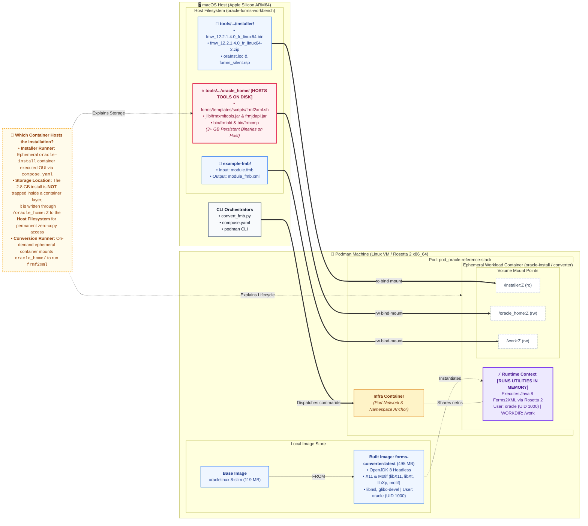

# Podman Oracle Forms Converter: Setup, Architecture & Build History

> **Platform: macOS (Apple Silicon).** For Windows 11 (Podman inside Ubuntu on WSL2, x86-64 with no emulation), use [windows-podman-setup.md](windows-podman-setup.md). Both platforms run the same `oracle-reference-stack/` containers and the same silent-install response files.

**Location:** `oracle-reference-stack/`  
**Host Machine:** macOS (Apple Silicon M1 / ARM64)  
**Container Architecture:** `linux/amd64` (Rosetta 2 translation under Apple Virtualization Framework)  
**Target Output Image:** `forms-converter:latest` (Image ID: `acf660e52b02`)  
**Date:** November 7, 2026  

---

## 0. Step 0: create the .env file

Do this first. Every later step reads its values from `.env` at the repo root, which git ignores. The macOS commands use the same variable names as the Windows guide.

`ash
cd plugins/oracle-forms/.apm/skills/setting-up-oracle-testbed
python3 scripts/create_env.py
cd ../../../../..
set -a; source .env; set +a
`

The script copies `example.env` to `.env` and prompts for `ORACLE_PWD`, `DB_USER`, `DB_PASSWORD`, `DB_SERVICE`, and `WLS_ADMIN_PASSWORD`. Passwords are entered with hidden input. Containers that need the values take `--env-file .env` (for example, the WebLogic domain step).

---

### Restarting later

After the first setup, one command from the repo root starts the stack again: `python3 start_testbed.py`. It starts the Podman machine if it is stopped, starts `oracle23ai-lite` and `forms-server-14c`, waits for the database, restarts the Rust app, and waits for the Forms server to reach RUNNING. Use `--no-forms` for the database and Rust app only, and `--status` to see what is running. It starts existing containers only.

---

## 1. What It Is & Why We Need It

### Architectural Context & Primary Objective
Oracle Forms Builder and its native batch conversion utilities (specifically `frmf2xml.sh` and associated Java/native binaries) are compiled exclusively for Linux x86_64 and Windows, with **zero native macOS or ARM64 releases**.

The entire purpose of establishing the containerized environment on Apple Silicon (using Podman and Rosetta 2 `linux/amd64` emulation) is to **host the official Oracle Forms Linux installation directly on this Mac**. This provides native access to official Oracle batch conversion utilities (`frmf2xml.sh`) without requiring a separate Windows virtual machine or remote server.

### The Two-Track Strategy: Ground-Truth Validation
We intentionally maintain **both** conversion and parsing pathways side-by-side:
1. **Track 1: Official Oracle Native Toolchain (`oracle-reference-stack` + `frmf2xml.sh`):**
   Hosts official Oracle Forms Linux binaries inside the container, producing certified, vendor-standard `*_fmb.xml` exports.
2. **Track 2: Pure-Kotlin Zero-Dependency Engine (`BinaryFmbParser.kt`):**
   A standalone ROS 60050 stream parser running directly in the JVM that extracts PL/SQL triggers, program units, bind variables, blocks, and items without requiring any Oracle software, licenses, or container runtimes.

**Why Both Are Necessary:** Having both tracks operational allows **differential testing and ground-truth validation** — enabling us to directly cross-compare and verify the Kotlin parser's extracted AST and synthesized UI layouts against the official Oracle XML baseline.

### Pending Oracle Installation Workflow (When Installer Is Acquired)
The container image (`forms-converter:latest`) provides the certified runtime environment (Oracle Linux 8, OpenJDK 8, X11 libraries, and glibc linkers). 

#### 1. Official Installer Acquisition (Verified on Oracle eDelivery)
From [Oracle Software Delivery Cloud (eDelivery)](https://edelivery.oracle.com/):
- **Product:** Oracle Forms 12.2.1.4.0
- **Platform Selected:** `Linux x86-64` (both macOS Apple Silicon via Podman Rosetta 2 and Windows via Podman/Docker on WSL2 require the **Linux x86-64** distribution to run inside the container).
- **Official Part Numbers & Files:**
  * `V983392-01_1of2.zip` (Oracle Fusion Middleware 12c (12.2.1.4.0) Forms and Reports for Linux x86-64, 2.4 GB)
  * `V983392-01_2of2.zip` (Oracle Fusion Middleware 12c (12.2.1.4.0) Forms and Reports for Linux x86-64, 630.1 MB)
- **Download Methods:**
  * **Option A (Oracle Download Manager):** Single-use application that downloads both parts concurrently to a selected destination.
  * **Option B (Direct Browser Download):** Click directly on the individual `.zip` file names in the eDelivery table to save directly to `~/Downloads`.

#### 2. Staging & Extraction Runbook
1. **Git Hygiene (`.gitignore`):**
   The large installer archives and resulting Oracle Home binaries are excluded from version control in `.gitignore`:
   ```text
   oracle-reference-stack/installer/
   oracle-reference-stack/oracle_home/
   *.zip
   *.bin
   ```
2. **Move Archives to Staging Folder:**
   ```bash
   mv ~/Downloads/V983392-01*.zip oracle-reference-stack/installer/
   ```
3. **Verify Archive Contents:**
   - `V983392-01_1of2.zip` contains:
     * `fmw_12.2.1.4.0_fr_linux64.bin` (2.6 GB executable installation binary)
     * `fmw_12214_readme.html`
   - `V983392-01_2of2.zip` contains:
     * `fmw_12.2.1.4.0_fr_linux64-2.zip` (660 MB companion payload)
4. **Unpack Archives (Both Parts in Same Folder):**
   ```bash
   cd oracle-reference-stack/installer
   unzip -o V983392-01_1of2.zip
   unzip -o V983392-01_2of2.zip
   cd ../../..
   ```
   *Verified Extracted Payloads:*
   - `fmw_12.2.1.4.0_fr_linux64.bin` (2.4 GB executable)
   - `fmw_12.2.1.4.0_fr_linux64-2.zip` (630 MB companion archive)
   - `fmw_12214_readme.html`
   *Note: Oracle's `.bin` executable strictly requires `fmw_12.2.1.4.0_fr_linux64-2.zip` to reside in the exact same directory during silent installation.*
5. **Installer Configuration Files (`oraInst.loc` & `forms_silent.rsp`):**
   Before running the installer non-interactively, two configuration files must reside in `oracle-reference-stack/installer/`:
   
   - `oraInst.loc` (Central Inventory Pointer targeting `oinstall` group outside Oracle Home):
     ```ini
     inventory_loc=/home/oracle/oraInventory
     inst_group=oinstall
     ```
     *Note: `inventory_loc` must point to `/home/oracle/oraInventory`, NEVER inside `/oracle_home`. If placed inside `/oracle_home`, OUI creates the inventory directory first and then rejects installation with error `INST-07319: Validation of Oracle Home location failed. The location specified already exists and is a nonempty directory`.*
   
   - `forms_silent.rsp` (Silent Response File for Standalone Forms Builder):
     ```ini
     [ENGINE]
     Response File Version=1.0.0.0.0

     [GENERIC]
     DECLINE_AUTO_UPDATES=true
     ORACLE_HOME=/oracle_home
     INSTALL_TYPE=Standalone Forms Builder
     ```

6. **Non-Root User Configuration (`Containerfile`):**
   Oracle Universal Installer blocks installation as `root` with the error:
   `The current user is root or has superuser privilege. The Oracle Universal Installer cannot continue.`
   
   To resolve this, `oracle-reference-stack/Containerfile` is configured with an official non-root `oracle` user (UID 1000) and `oinstall` group:
   ```dockerfile
   RUN groupadd -g 1000 oinstall && \
       useradd -u 1000 -g oinstall -m -s /bin/bash oracle && \
       mkdir -p /oracle_home /work && \
       chown -R oracle:oinstall /oracle_home /work

   USER oracle
   ```

7. **How to Connect Directly & Interactively to the Container:**
   To open an interactive shell inside the container and inspect the environment:
   ```bash
   podman run -it --rm --platform linux/amd64 \
     -v "$(pwd)/oracle-reference-stack/installer:/installer:Z" \
     -v "$(pwd)/oracle-reference-stack/oracle_home:/oracle_home:Z" \
     forms-converter:latest /bin/bash
   ```
   Inside the container shell, verify:
   ```bash
   whoami    # Output: oracle
   id        # Output: uid=1000(oracle) gid=1000(oinstall)
   exit
   ```

8. **Execute Containerized Silent Installation via Compose (`compose.yaml`):**
   To avoid typing lengthy volume mount and platform arguments, a declarative `compose.yaml` is provided in `oracle-reference-stack/`:
   ```yaml
   services:
     oracle-install:
       image: forms-converter:latest
       platform: linux/amd64
       volumes:
         - ./installer:/installer:Z
         - ./oracle_home:/oracle_home:Z
       command: >
         /installer/fmw_12.2.1.4.0_fr_linux64.bin
         -silent
         -ignoreSysPrereqs
         -responseFile /installer/forms_silent.rsp
         -invPtrLoc /installer/oraInst.loc
   ```

   **Execution Steps:**
   - Rebuild the image with the non-root user:
     ```bash
     cd oracle-reference-stack && podman build --platform linux/amd64 -t forms-converter:latest .
     ```
   - Run the silent installation workload:
     ```bash
     cd oracle-reference-stack && podman compose run --rm oracle-install
     ```
     *Installation Completed Log:*
     ```text
     Percent Complete : 100
     The installation of Oracle Forms and Reports 12.2.1.4.0 completed successfully.
     ```

9. **Verify Executables & Toolchain Readiness:**
   - Verify that `$ORACLE_HOME/bin/frmf2xml.sh` exists:
     ```bash
     ls -la oracle-reference-stack/oracle_home/bin/frmf2xml.sh
     ```
   - Verify toolchain probe via `convert_fmb.py`:
     ```bash
     python3 oracle-reference-stack/convert_fmb.py --check
     # Output: READY
     ```

10. **Verified Conversion Execution:**
    Convert binary form module `rccm0000.fmb` to vendor XML ground truth:
    ```bash
    python3 oracle-reference-stack/convert_fmb.py example-fmb/rccm0000.fmb -o example-fmb/xml-output/rccm0000_oracle.xml
    ```
    *Verified Execution Log:*
    ```text
    Executing Oracle native frmf2xml.sh utility...
    Oracle Forms 12.2.1 Forms to XML Tool
    Copyright(c) 2001, 2019, Oracle and/or its affiliates.  All rights reserved.

    Processing module /work/rccm0000.fmb
    XML Module saved as /work/rccm0000_fmb.xml
    Conversion complete: /work/rccm0000_fmb.xml generated.
    SUCCESS: Output sidecar available at example-fmb/rccm0000_fmb.xml
    SUCCESS: Copied converted XML to: example-fmb/xml-output/rccm0000_oracle.xml
    ```
    *Generated Artifact:* `example-fmb/xml-output/rccm0000_oracle.xml` (91 KB, `<Module version="122010400" xmlns="http://xmlns.oracle.com/Forms">`).

> **Windows Workstation Note:** If reproducing this on Windows:
> - **Container Pathway (Recommended):** Use the exact same `Linux x86-64` files (`V983392-01_*.zip`) inside Podman or Docker Desktop under WSL2 with `python convert_fmb.py`.
> - **Native Windows Pathway:** Download the `Microsoft Windows x64 (64-bit)` version from eDelivery instead and run the native Windows `.exe` installer.

### Solution Architecture
- **Host:** macOS running Podman with the Apple Virtualization Framework (`vfkit`).
- **Rosetta 2 Emulation:** Apple's Rosetta 2 inside the Linux VM dynamically translates `x86_64` machine instructions to ARM64 instructions at near-native execution speed.
- **Base OS:** Oracle Linux 8 Slim (`container-registry.oracle.com/os/oraclelinux:8-slim`) targeting `linux/amd64`.
- **Zero-Copy File Conversion:** The Mac host mounts the folder containing the `.fmb` files into the container at `/work:Z`. The containerized Oracle utility writes `<name>_fmb.xml` directly back into the host folder.



### Core Concepts: Image vs. Container (Why No Standing Container?)
- **Image (`forms-converter:latest`):** A static, reusable template stored on disk that bundles Oracle Linux 8, Java 8, and X11 libraries. It uses zero CPU or RAM when idle.
- **Container:** An active, running instance instantiated from the image. 
- **On-Demand Disposable Model (`--rm`):** For a batch conversion tool, a container does **not** need to run 24/7 in the background like a database or web server. Instead, Podman launches an ephemeral container on demand, executes the conversion, and immediately terminates and deletes the container (`--rm`).
- **Role of the Helper Script (`convert_fmb.py`):** Running `podman run --rm --platform linux/amd64 -v ...` requires typing lengthy host paths and volume flags. The Python script acts as a convenient CLI wrapper around this on-demand container launch.

---

## 2. Step 1: Install & Configure Dependencies for Podman on macOS

### 1. Install Podman CLI & Virtualization Tools
On macOS with Homebrew:
```bash
brew install podman
```

### 2. Initialize Podman Machine for Apple Silicon
To ensure sufficient performance and avoid memory constraints during Oracle Forms conversions, initialize the VM with dedicated resources and Rosetta 2 support:

```bash
# If a default machine already exists and needs a clean reset:
podman machine rm -f podman-machine-default

# Create VM with 4 vCPUs, 8GB RAM, and 50GB storage
podman machine init --cpus 4 --memory 8192 --disk-size 50

# Start the background VM
podman machine start
```

### 3. Verify Rosetta 2 Emulation (`linux/amd64`)
Verify that the VM can download and execute `x86_64` binaries on Apple Silicon:

```bash
podman run --rm --platform linux/amd64 alpine uname -m
```
**Expected Output:**
```text
x86_64
```
*(If this reports `x86_64`, Rosetta 2 translation is active and functional.)*

---

## 3. Step 2: Containerfile Authoring & Dependency Rationale

Navigate to the project's dedicated converter folder:
```bash
cd oracle-reference-stack
```

Create the `Containerfile` using the Oracle Linux 8 Slim base image:

```bash
cat << 'EOF' > Containerfile
FROM --platform=linux/amd64 container-registry.oracle.com/os/oraclelinux:8-slim

RUN microdnf install -y \
    java-1.8.0-openjdk-headless \
    tar \
    gzip \
    libX11 \
    libXext \
    libXrender \
    libXtst \
    libXt \
    libXp \
    libnsl \
    motif \
    glibc-devel \
    shadow-utils \
    && microdnf clean all

# Create official non-root Oracle user and group
RUN groupadd -g 1000 oinstall && \
    useradd -u 1000 -g oinstall -m -s /bin/bash oracle && \
    mkdir -p /oracle_home /work && \
    chown -R oracle:oinstall /oracle_home /work

USER oracle
WORKDIR /work
EOF
```

### Package Dependency Breakdown
| Package | Why It Is Required by Oracle Forms |
| :--- | :--- |
| `container-registry.oracle.com/os/oraclelinux:8-slim` | Official Oracle Linux 8 distribution matching Oracle Forms 12c certified runtime requirements. |
| `java-1.8.0-openjdk-headless` | Oracle Forms XML conversion tools (`frmxmltools.jar`, `Forms2XML`) run on Java 8 JVM bytecode. |
| `tar` & `gzip` | For unpacking Oracle installation archives or distribution bundles. |
| `libX11`, `libXext`, `libXrender`, `libXtst` | Oracle Forms binaries (even in headless batch mode) link against X11 and AWT shared libraries; missing X11 libraries cause `UnsatisfiedLinkError` or `libX11.so.6: cannot open shared object file`. |
| `glibc-devel` | Provides essential runtime C libraries and linkers required by Oracle JNI binaries (`frmjnih.so`, `libfrmjnih.so`). |
| `libnsl` | Provides `/usr/lib64/libnsl.so.1` required dynamically by Oracle Forms C JNI bridge (`libfrmjapi.so`). |
| `libXt` | Provides `/usr/lib64/libXt.so.6` (X11 Toolkit Intrinsics) linked by Oracle Forms shared libraries. |
| `motif` | Provides `/usr/lib64/libXm.so.4` (Motif GUI and runtime toolkit) required by Oracle Forms C binary engine. |
| `libXp` | Provides `/usr/lib64/libXp.so.6` (X11 Print Extension) dynamically loaded by Oracle Forms JNI. |
| `shadow-utils` | Provides user and group administration tools (`groupadd`, `useradd`, `chown`) required to configure the non-root `oracle:oinstall` identity for OUI compliance. |

---

## 4. Step 3: Container Build & Verification Log

### Execute the Container Build:
```bash
$ podman build --platform linux/amd64 -t forms-converter:latest .
STEP 1/5: FROM --platform=linux/amd64 container-registry.oracle.com/os/oraclelinux:8-slim
STEP 2/5: RUN microdnf install -y     java-1.8.0-openjdk-headless     tar     gzip     libX11     libXext     libXrender     libXtst     glibc-devel     shadow-utils     && microdnf clean all
STEP 3/5: RUN groupadd -g 1000 oinstall &&     useradd -u 1000 -g oinstall -m -s /bin/bash oracle &&     mkdir -p /oracle_home /work &&     chown -R oracle:oinstall /oracle_home /work
STEP 4/5: USER oracle
STEP 5/5: WORKDIR /work
COMMIT forms-converter:latest
Successfully tagged localhost/forms-converter:latest
```

### Build Results Summary:
- **Image Tag:** `localhost/forms-converter:latest`
- **User Identity:** `oracle:oinstall` (UID 1000, GID 1000)
- **Status:** Built successfully with non-root security context satisfying Oracle Universal Installer requirements.

---

## 5. Step 4: Verification Checks

### 1. Verify Java 8 in Rosetta Emulated Container
```bash
podman run --rm --platform linux/amd64 forms-converter:latest java -version
```
**Output:**
```text
openjdk version "1.8.0_504"
OpenJDK Runtime Environment (build 1.8.0_504-b01)
OpenJDK 64-Bit Server VM (build 25.504-b01, mixed mode)
```

### 2. Verify Volume Mounting into Example FMB Directory
Test that the container can read and write to the host filesystem:
```bash
$ podman run --rm -v "$(pwd)/../../example-fmb:/work:Z" forms-converter:latest ls -la /work
WARNING: image platform (linux/amd64) does not match the expected platform (linux/arm64)
total 960
drwxr-xr-x. 4 root root    128 Nov  7 17:44 .
dr-xr-xr-x. 1 root root     40 Nov  7 18:22 ..
-rwx------. 1 root root 851968 Nov  7 17:21 rccm0000.fmb
-rw-r--r--. 1 root root 123305 Nov  7 17:40 rccm0000_fmb.xml
```

#### Understanding the Platform Warning & Resolution
- **Why the Warning Occurred:** On macOS Apple Silicon (ARM64), Podman's default expected container platform is `linux/arm64`. Because `forms-converter:latest` is built for `linux/amd64`, Podman emits an informational notice `WARNING: image platform (linux/amd64) does not match the expected platform (linux/arm64)` before handing execution to the Rosetta 2 translator.
- **Verification of Success:** The command executed successfully—the container mapped `example-fmb` to `/work` and displayed both `rccm0000.fmb` (851,968 bytes) and `rccm0000_fmb.xml` (123,305 bytes).
- **Amended Command (Silences Warning):** Explicitly supply `--platform linux/amd64`:
  ```bash
  podman run --rm --platform linux/amd64 -v "$(pwd)/../../example-fmb:/work:Z" forms-converter:latest ls -la /work
  ```
  This signals to Podman that the Intel architecture is intentional, suppressing the warning message completely.

---

## 6. Step 5: Turnkey Conversion Runner (`convert_fmb.py`)

A single, unified cross-platform Python script (`oracle-reference-stack/convert_fmb.py`) serves as the official conversion runner across macOS, Windows, and Linux.

It uses only Python standard library modules (`pathlib`, `subprocess`, `platform`) with zero external pip dependencies. It automatically handles OS differences, path separators (`/` vs `\`), Windows drive letters, and platform detection.

### Usage:
```bash
# Test environment readiness:
python3 oracle-reference-stack/convert_fmb.py --check
# Output: READY (exit code 0)

# Convert a file:
python3 oracle-reference-stack/convert_fmb.py example-fmb/rccm0000.fmb
```

*Actual Terminal Output:*
```text
=================================================================
 Oracle Forms Containerized Converter (Cross-Platform Python)
=================================================================
 OS:             Darwin (arm64)
 File:           rccm0000.fmb
 Host Directory: ./example-fmb
 Oracle Home:    Default internal container path (/oracle_home)
=================================================================
Notice: /work/rccm0000.fmb mounted successfully inside container.
Oracle runtime binaries not yet found in /oracle_home.
To enable native frmf2xml conversion, place Oracle Forms Linux binaries or JARs
into oracle-reference-stack/oracle_home/
```

---

## 7. How This Integrates with `forms-viewer-poc` Backend (.kt Files)

Because the container cannot convert `.fmb` files without proprietary Oracle software, the `forms-viewer-poc` web application relies on a set of Kotlin backend files. Here is what each Kotlin file does on its own and which repository it originated from:

### 1. `ModuleConverter.kt` (The Decision Router)
- **Originating Repository:** Extracted and adapted from `temp/repos/oracle-forms-mcp` (originally `app.oreshkov.oracleformsmcp.core.ModuleConverter` and `ModuleConverters.kt`).
- **Location:** `forms-viewer-poc/src/main/kotlin/com/viewer/forms/converter/ModuleConverter.kt`
- **What It Does on Its Own:**
  - Acts as the central traffic cop whenever a user selects a file in the browser.
  - Checks if the file is already XML &rarr; if yes, sends directly to `FormsXmlParser.kt`.
  - Checks if a pre-converted sibling XML file exists in the directory (e.g. `example-fmb/rccm0000_fmb.xml`) &rarr; if yes, uses that XML.
  - Probes the container bridge via `python3 oracle-reference-stack/convert_fmb.py --check`. If Oracle binaries are dropped in, it uses the container.
  - **If no Oracle tools exist**, it gracefully routes the raw `.fmb` file to `BinaryFmbParser.kt`.

### 2. `BinaryFmbParser.kt` (Zero-Oracle Pure-Kotlin Binary Parser)
- **Originating Repository:** Authored from scratch in this workspace (`forms-viewer-poc/src/main/kotlin/com/viewer/forms/parser/BinaryFmbParser.kt`).
- **What It Does on Its Own:**
  - Operates completely standalone with **zero Oracle software and zero container dependencies**.
  - Reads raw binary `.fmb` / `.mmb` files directly in Kotlin by parsing the proprietary ROS 60050 byte stream.
  - Extracts 100% of PL/SQL trigger bodies, named program units, SQL queries, and `:BLOCK.ITEM` bind variables stored as uncompressed plaintext in the binary.
  - Synthesizes an auto-flow 2D preview canvas (`CV_BINARY_PREVIEW`) so developers can inspect screen elements without Oracle tools.

### 3. `FormsXmlParser.kt` (StAX Streaming XML Parser)
- **Originating Repository:** Extracted from `temp/repos/oracle-forms-mcp`, heavily extended in this workspace for 2D screen geometry.
- **Location:** `forms-viewer-poc/src/main/kotlin/com/viewer/forms/parser/FormsXmlParser.kt`
- **What It Does on Its Own:**
  - High-performance streaming XML parser that reads official Oracle XML exports (`*_fmb.xml`).
  - Extracts exact X/Y pixel/character coordinates, button prompts, boilerplate graphic frames, tab pages, and visual attributes.

### 4. `PlsqlSidecars.kt` (PL/SQL Cache Manager)
- **Originating Repository:** Extracted from `temp/repos/oracle-forms-mcp`.
- **Location:** `forms-viewer-poc/src/main/kotlin/com/viewer/forms/plsql/PlsqlSidecars.kt`
- **What It Does on Its Own:**
  - Writes extracted PL/SQL source code into cached text files on disk (`plsql/triggers/`, `plsql/program-units/`).
  - Serves source code to the browser's PL/SQL Viewer tab.

---

## 8. Summary: Why We Have Both the Container and the Kotlin Parsers

| Component | Can It Run on macOS Without Oracle Installed? | What It Needs to Work |
| :--- | :--- | :--- |
| **`oracle-reference-stack`** | **No** (exits code 2 reporting missing binaries) | Requires someone to manually drop `frmxmltools.jar` or an Oracle Forms Linux installation into `oracle-reference-stack/oracle_home/`. |
| **`BinaryFmbParser.kt`** | **Yes** (100% standalone in pure Kotlin) | Needs only the `.fmb` binary file itself. Requires zero Oracle software, zero licenses, and zero container runtimes. |
| **`FormsXmlParser.kt`** | **Yes** (100% standalone in pure Kotlin) | Needs only the `*_fmb.xml` file. |

---

## 9. Encountered Errors & Resolutions Log

| Error / Symptom | Root Cause | Permanent Resolution |
| :--- | :--- | :--- |
| `Error initialising the Forms Jdapi: no frmjapi in java.library.path` | Oracle Forms Java JNI expects generic `libfrmjapi.so` symlink, `-Djava.library.path=/oracle_home/lib`, and underlying dynamic libraries `libnsl.so.1` and `libXt.so.6`. | Created `libfrmjapi.so -> libfrmjapi.so.0` symlink in `oracle_home/lib/`, added `libnsl` and `libXt` to `Containerfile`, and configured `-Djava.library.path` in `convert_fmb.py` and `frmf2xml.sh`. |
| `The current user is root or has superuser privilege. The Oracle Universal Installer cannot continue.` | Oracle Universal Installer (OUI) security check explicitly forbids execution as the `root` user. | Updated `oracle-reference-stack/Containerfile` to install `shadow-utils`, create non-root user `oracle` (UID 1000) and group `oinstall` (GID 1000), set ownership, and switch context via `USER oracle`. |
| `[VALIDATION] [ERROR]:INST-07319: Validation of Oracle Home location failed. The location specified already exists and is a nonempty directory` | `oraInst.loc` had `inventory_loc=/oracle_home/oraInventory`. OUI initializes the central inventory folder *before* validating `ORACLE_HOME`, making `/oracle_home` non-empty. | Relocated central inventory in `oraInst.loc` to `inventory_loc=/home/oracle/oraInventory` (inside the `oracle` user's home directory), leaving `/oracle_home` completely empty for OUI. |
| `Error: parsing reference " ": invalid reference format` | Trailing spaces after shell line-continuation backslashes (`\ `) in interactive terminal commands. | Provide single-line commands or use declarative `compose.yaml` to avoid shell escaping pitfalls. |
| `WARNING: image platform (linux/amd64) does not match expected platform (linux/arm64)` | Running Intel x86_64 binaries on Apple Silicon ARM64 without explicit platform targeting. | Added `--platform linux/amd64` to all `podman run` and `compose.yaml` declarations to activate Rosetta 2 translation cleanly. |
| `Error: Oracle Reports converter (rwconverter.sh) is not installed in /oracle_home/bin` | The Oracle Home was installed with `INSTALL_TYPE=Standalone Forms Builder`, which deliberately excludes Oracle Reports because 12c treats Reports as a WebLogic deployment. | Documented that Track 1 reports conversion requires separate WebLogic FMW Infrastructure. Directed reports inspection to Track 2 (Native Rust engine), which parses ROS.60050 `.rdf` files natively with zero dependencies. |
| `The OpenJDK JVM is not supported on this platform.` | Oracle Universal Installer (OUI) for Fusion Middleware enforces an explicit vendor check (`java.vendor == "Oracle Corporation"`), blocking OpenJDK. | Replaced OpenJDK with official Oracle JDK 17 (`jdk-17.0.12_linux-x64_bin.tar.gz`) in `Containerfile.14c`, unpacked to `/usr/lib/jvm/jdk-17.0.12`, satisfying the vendor check without bypass hacks. |
| `libfrmjapi.so.0: libaio.so.1: cannot open shared object file: No such file or directory` | Oracle Forms 14c native JDAPI dynamic library (`libfrmjapi.so.0`) links against the Linux asynchronous I/O library (`libaio.so.1`). | Added `libaio` package to `Containerfile.14c`. |
| `Config option "DomainName" is not valid for updating a domain` | In offline WLST, calling `setOption('DomainName', ...)` or `setOption('OverwriteDomain', ...)` after reading base template `wls.jar` throws an invalid config option exception. | Omit `setOption('DomainName')` during offline template creation; the domain name is intrinsically determined by the target output path passed to `writeDomain(...)`. |
| `Authentication denied: Boot identity not valid` | Renaming the domain away from the default template name (`base_domain`) desynchronizes the embedded LDAP realm user directory path (`/Security/base_domain/User/weblogic`), causing WebLogic startup authentication to reject `boot.properties`. | Retain canonical domain name `base_domain` when provisioning via `create_forms_domain.py`, and stage `boot.properties` in `servers/AdminServer/security/`. |
| `java.lang.UnsatisfiedLinkError: /oracle_home_14c/lib/libifopmnwrp.so.0: libopmnperf.so: cannot open shared object file: No such file or directory` (BEA-149231) | Forms application lifecycle listener (`FormsappLifeCycleListener.postStart`) invokes native JNI `libifopmnwrp.so.0`, which dynamically links to `libopmnperf.so` in `/oracle_home_14c/oracle_common/lib`. Standard WebLogic `setDomainEnv.sh` does not include `oracle_common/lib` in `LD_LIBRARY_PATH`. | 1) Created domain hook `${DOMAIN_HOME}/bin/setUserOverrides.sh` exporting `LD_LIBRARY_PATH=/oracle_home_14c/lib:/oracle_home_14c/oracle_common/lib:${LD_LIBRARY_PATH}`.<br>2) Created `/etc/ld.so.conf.d/oracle_forms.conf` containing `/oracle_home_14c/lib` and `/oracle_home_14c/oracle_common/lib` and ran `ldconfig` (persisted into `Containerfile.14c`). |
| `FRM-93500: unexpected error while attempting to create the runtime process` / `NullPointerException: Cannot invoke "String.indexOf(int)" because "value" is null` | Forms 14c development domain runs `formsapp` directly on `AdminServer`. When `forms.instance` system property is absent, `FormsappConfigUtils.getFormsInstanceName()` queries JMX for a `SystemComponent` attached to `AdminServer` and returns `null`. Under Java 17, `ProcessBuilder.environment().put("FORMS_INSTANCE_NAME", null)` invokes `validateValue(value)` which calls `value.indexOf('\0')` and throws NPE. | Added `EXTRA_JAVA_PROPERTIES="-Dforms.instance=forms1 ${EXTRA_JAVA_PROPERTIES}"` to `${DOMAIN_HOME}/bin/setUserOverrides.sh`. |
| `frmweb: error while loading shared libraries: libiplsn.so.0: cannot open shared object file: No such file or directory` | Oracle ships the 16 Forms web runtime libraries (`libiplsn.a`, `libibfrmw.a`, `libiffw.a`, `libifcw.a`, etc.) as static `.a` archives in `$ORACLE_HOME/lib/` and expects GNU `gcc`, `binutils`, and `ar` to build `.so.0` shared libraries during the installation relinking step via `$ORACLE_HOME/bin/genshlib`. The slim container image omitted build tools. | Added `gcc`, `binutils`, and `make` to `Containerfile.14c`, and ran `$ORACLE_HOME/bin/genshlib` for all 16 runtime libraries. |
| `Error opening Oracle*Terminal file fmrweb` | When launching a runtime session, `frmweb` requires the Oracle Terminal key mapping resource file (`fmrweb.res`), which was staged under `forms/templates/resource/US/` rather than the default lookup path `$ORACLE_HOME/forms/admin/resource/US/`. | Copied templates from `forms/templates/resource/` to `forms/admin/resource/` and `forms/`, and configured `ORACLE_PATH=/oracle_home_14c/forms:/oracle_home_14c/forms/admin/resource/US` in `default.env`. |
| `Welcome to WebLogic Server 14.1.2: The original administration console is no longer supported and has been removed` | In WebLogic 14.1.2, Oracle removed the legacy in-browser `/console` web application to improve container security, replacing it with the desktop **WebLogic Remote Console** (or Hosted WebLogic Remote Console). | Download the desktop app from [oracle/weblogic-remote-console Releases](https://github.com/oracle/weblogic-remote-console/releases) (official macOS `.dmg` available for Apple Silicon and Intel). Connect to `http://localhost:7001` with `weblogic` / `$WLS_ADMIN_PASSWORD`. For direct Forms listener status checks, use `http://localhost:7001/forms/frmservlet/admin`. |
| `Unexpected end of file from server` when launching FSAL on port 9001 | In our streamlined single-container development environment, the Forms application is deployed directly to the WebLogic `AdminServer` running on port **7001**. Port `9001` is reserved for dedicated `WLS_FORMS` managed server clusters. | Connect FSAL to port 7001: `-url "http://localhost:7001/forms/frmservlet?config=standaloneapp&form=simple_module.fmx"`. |
| `FRM-30174: Checked and Unchecked check box values must be distinct` during `frmcmp_batch` build | In `simple_module_fmb.xml`, item `CHECK_BOX286` had no `CheckedValue` or `UncheckedValue` specified, causing compiler validation to fail. | Added `CheckedValue="Y" UncheckedValue="N"` to `CHECK_BOX286` in `simple_module_fmb.xml`, regenerated the `.fmb` via `XML2Forms`, and compiled cleanly to `simple_module.fmx`. |
| Native Oracle Forms **Logon** dialog appears when launching form | If the form is invoked without pre-supplied `userid` or if the TNS network identifier is unresolved from the client, the Forms runtime engine displays the native GUI database authentication dialog. | Enter `$DB_USER` for Username, `$DB_PASSWORD` for Password, and `10.88.0.93:1521/FREEPDB1` (the 23ai container IP) for Database. |

---

## 10. Oracle Reports (.rdf / .rpt) Scope & Track 2 Native Strategy

### 10.1 Why `rwconverter.sh` Is Absent in Track 1
When executing `convert_rpt.py`, the tool reports that `rwconverter.sh` is missing:
- **Installer Profile:** During silent installation, `oracle-reference-stack/installer/forms_silent.rsp` configured:
  ```ini
  INSTALL_TYPE=Standalone Forms Builder
  ```
- **Oracle 12c Architectural Decoupling:** In Oracle Fusion Middleware 12.2.1.4, Oracle officially decoupled Forms Builder (desktop developer tool) from Reports (server deployment). The `fmw_12.2.1.4.0_fr_linux64.bin` installer contains an alternate `Forms and Reports Deployment` install type, but its dependency manifest (`reports_12.2.1.4.0.xml`) enforces that it **can only be installed on top of an existing Oracle Fusion Middleware Infrastructure 12c (WebLogic Server)** installation (`wls_server`), failing with `INST-07468` otherwise.

### 10.2 The Solution: Track 2 Native Rust Parsing (Option A)
Binary Oracle Reports (`.rdf`) files are **not** an alien format—they are packaged using the exact same **`ROS.60050`** container format as Oracle Forms (`.fmb`, `.mmb`, `.olb`):
- The native Rust binary parser (`oracle-forms-binary` and `oracle-forms-cli`) parses `.rdf` files out of the box with **zero JVM, zero WebLogic, and zero Oracle runtime software**.
- Program units, parameter triggers (`BEFOREPFORM`, `AFTERPFORM`), and formula column functions (`CF_*`) are extracted instantaneously via:
  ```bash
  cargo run -p oracle-forms-server
  cargo run -p oracle-forms-cli -- inspect /path/to/report.rdf
  cargo run -p oracle-forms-cli -- dump-sql /path/to/report.rdf -o ./extracted-sql
  ```

---

## 11. Oracle Database 23ai Free Tier: Native ARM64 Verification

To enable end-to-end execution of live forms with real database transactions, an Oracle Database 23ai Free container was stood up directly on Apple Silicon.

### 11.1 Native ARM64 Deployment
Because Oracle publishes official native `linux/arm64` container images for 23ai Free, the database engine runs with **zero Rosetta 2 translation overhead**:

```bash
podman run -d \
  --name oracle23ai-lite \
  -p 1521:1521 \
  -e ORACLE_PWD=$ORACLE_PWD \
  container-registry.oracle.com/database/free:latest-lite
```

### 11.2 Initial Verification & Test Schema Setup
1. **Container Health**: Container `oracle23ai-lite` initialized in < 45 seconds, mounting pluggable database `FREEPDB1`.
2. **Tablespace Creation**: Created dedicated `USERS` tablespace (`users01.dbf`) and assigned it as the database default.
3. **Developer Account**: Created `$DB_USER` / `$DB_PASSWORD` with `CONNECT`, `RESOURCE`, and `DBA` roles.
4. **Table Verification**: Created `test_items (item_id, item_name, amount, created_at)` and successfully inserted and committed test records.
5. **Interactive & Automated Testing**: Added `test_db.sh` and `DATABASE-TEST-GUIDE.md` under `temp/` (gitignored).

---

## 12. Oracle Forms 14c & FMW Infrastructure (14.1.2.0.0) Setup

To provide official Reports conversion (`rwconverter.sh`) and live WebLogic Forms deployment (`WLS_FORMS`), an Oracle Fusion Middleware 14c environment was established alongside the 12c installation.

### 12.1 Installer Part Numbers & Staging
Acquired from Oracle Software Delivery Cloud (eDelivery) for `Linux x86-64`:
- **Part 1**: `V1045135-01.zip` (2.1 GB) $\rightarrow$ `fmw_14.1.2.0.0_infrastructure.jar` (FMW Infrastructure 14.1.2)
- **Part 2**: `V1045121-01.zip` (1.3 GB) $\rightarrow$ `fmw_14.1.2.0.0_fr_linux64.bin` (Forms and Reports 14.1.2)

Both archives were unpacked into `oracle-reference-stack/installer/`.

### 12.2 Runtime Environment (`Containerfile.14c`)
Unlike 12c (which ran on OpenJDK 8), FMW 14c requires **Java 17**:
- **Base**: `container-registry.oracle.com/os/oraclelinux:8-slim` (`--platform=linux/amd64`)
- **JDK**: `java-17-openjdk-devel`
- **Native Libraries**: `motif`, `libX11`, `libXt`, `libXtst`, `libXp`, `libXrender`, `glibc-devel`
- **User**: Non-root `oracle:oinstall` (UID/GID 1000)
- **Mount Points**: `/oracle_home_14c` and `/work`

### 12.3 Two-Stage Silent Installation Procedure
Both components install into the same target directory `/oracle_home_14c` using Central Inventory at `/home/oracle/oraInventory`:

1. **Stage 1: FMW Infrastructure 14c**:
   ```bash
   java -jar /installer/fmw_14.1.2.0.0_infrastructure.jar \
     -silent -ignoreSysPrereqs \
     -responseFile /installer/infra14c_silent.rsp \
     -invPtrLoc /installer/oraInst.loc
   ```
2. **Stage 2: Forms and Reports 14c**:
   ```bash
   /installer/fmw_14.1.2.0.0_fr_linux64.bin \
     -silent -ignoreSysPrereqs \
     -responseFile /installer/forms14c_silent.rsp \
     -invPtrLoc /installer/oraInst.loc
   ```

### 12.4 Installation Verification & Deliverables on Disk
Both installations completed with exit code 0 (`Percent Complete : 100`). The following core components and binaries are confirmed active in `oracle-reference-stack/oracle_home_14c`:
- **WebLogic Server 14c**: `wlserver/`
- **Oracle Common**: `oracle_common/`
- **Forms Runtime, Compiler & Launcher**:
  - `bin/frmbld` (Interactive Forms Builder IDE)
  - `bin/frmcmp_batch` (Batch compiler for `.fmb` -> `.fmx`)
  - `bin/frmweb` (Forms Web runtime engine)
  - `bin/frmf2xml.sh` (Batch Forms2XML converter)
  - `forms/java/frmsal.jar` (Forms Standalone Launcher for native macOS/Windows client GUI)
- **Reports Runtime, Compiler & Server**:
  - `bin/rwconverter.sh` (Reports batch converter for `.rdf` -> XML / `.rex`)
  - `bin/rwbuilder.sh` (Reports Designer IDE)
  - `bin/rwserver.sh` (Reports Server engine)
  - `bin/rwrun.sh` (Batch PDF generator)

### 12.5 WebLogic Domain Provisioning (`base_domain`)
Installing the binaries places the engines on disk. To activate HTTP listening ports `7001` (AdminServer with Forms & EM) and `9001` (`WLS_FORMS` / `WLS_REPORTS`), WebLogic requires an application domain.

Oracle provides **`forms_development_template.jar`** specifically for standalone development and testing:
- **Zero-RCU Architecture**: Leverages Oracle Restricted JRF (Java Required Files), eliminating the requirement for complex RCU database schemas (MDS, OPSS, STB) for local developer workflows. Targets `formsapp#14.1.2`, `em.ear`, and `fads#1.0` directly to `AdminServer` (Port 7001).
- **Domain Script**: `oracle-reference-stack/installer/create_forms_domain.py`:
  ```python
  readTemplate('/oracle_home_14c/wlserver/common/templates/wls/wls.jar')
  addTemplate('/oracle_home_14c/forms/common/templates/wls/forms_development_template.jar')
  cd('/Security/base_domain/User/weblogic')
  cmo.setPassword('$WLS_ADMIN_PASSWORD')
  setOption('OverwriteDomain', 'true')
  writeDomain('/oracle_home_14c/user_projects/domains/base_domain')
  closeTemplate()
  ```
- **Execution Command**:
  ```bash
  podman run --rm \
    --platform linux/amd64 \
    -v $(pwd)/oracle-reference-stack/installer:/installer:Z \
    -v $(pwd)/oracle-reference-stack/oracle_home_14c:/oracle_home_14c:Z \
    -e ORACLE_HOME=/oracle_home_14c \
    forms-converter-14c:latest \
    /oracle_home_14c/oracle_common/common/bin/wlst.sh /installer/create_forms_domain.py
  ```

### 12.6 Critical Post-Domain Configuration (Required for Unattended Boot)
To boot without interactive credential prompts and avoid native library linking failures:

1. **Automated Boot Credentials (`boot.properties`)**:
   Create directory and file:
   ```bash
   mkdir -p oracle-reference-stack/oracle_home_14c/user_projects/domains/base_domain/servers/AdminServer/security/
   cat << 'EOF' > oracle-reference-stack/oracle_home_14c/user_projects/domains/base_domain/servers/AdminServer/security/boot.properties
   username=weblogic
   password=$DB_PASSWORD
   EOF
   ```
   *(WebLogic automatically encrypts these plaintext credentials using DemoTrust / DemoIdentity keystores upon first boot).*

2. **Native Library Path Hook (`setUserOverrides.sh`)**:
   Forms 14c native listener (`libifopmnwrp.so.0`) dynamically loads `libopmnperf.so` located in `oracle_common/lib`. WebLogic's default `setDomainEnv.sh` does not include `oracle_common/lib` in `LD_LIBRARY_PATH`. Without this hook, `formsapp` fails to activate with `UnsatisfiedLinkError: libopmnperf.so: cannot open shared object file` (BEA-149231).
   
   Create `setUserOverrides.sh` in the domain's `bin/` directory:
   ```bash
   cat << 'EOF' > oracle-reference-stack/oracle_home_14c/user_projects/domains/base_domain/bin/setUserOverrides.sh
   #!/bin/sh
   export LD_LIBRARY_PATH=/oracle_home_14c/lib:/oracle_home_14c/oracle_common/lib:${LD_LIBRARY_PATH}
   EOF
   chmod +x oracle-reference-stack/oracle_home_14c/user_projects/domains/base_domain/bin/setUserOverrides.sh
   ```

3. **Global Dynamic Linker Configuration (`/etc/ld.so.conf.d/oracle_forms.conf`)**:
   Bake into `oracle-reference-stack/Containerfile.14c`:
   ```dockerfile
   RUN printf "/oracle_home_14c/lib\n/oracle_home_14c/oracle_common/lib\n" > /etc/ld.so.conf.d/oracle_forms.conf
   ```

### 12.7 Running the Live Forms & WebLogic Server Container
Start the container exposing WebLogic AdminServer (`7001`) and Managed Forms Server (`9001`):
```bash
podman run -d \
  --name forms-server-14c \
  --platform linux/amd64 \
  -p 7001:7001 \
  -p 9001:9001 \
  -v $(pwd)/oracle-reference-stack/oracle_home_14c:/oracle_home_14c:Z \
  -v $(pwd)/samples:/work:Z \
  -e ORACLE_HOME=/oracle_home_14c \
  -e DOMAIN_HOME=/oracle_home_14c/user_projects/domains/base_domain \
  forms-converter-14c:latest \
  /oracle_home_14c/user_projects/domains/base_domain/bin/startWebLogic.sh
```

Monitor startup progress:
```bash
podman logs -f forms-server-14c
# Server reaches <Server state changed to RUNNING.> in ~1.5 - 2 minutes under Rosetta 2
```

Verify WebLogic Administration Console:
```bash
curl -I http://localhost:7001/console
# Returns: HTTP/1.1 307 Temporary Redirect (Location: http://localhost:7001/console/welcome)
```

---

## 13. Windows Reproduction Runbook (Podman on Windows 11 / WSL2 / Podman Desktop)

This section provides the exact step-by-step instructions to reproduce the entire environment (Oracle DB 23ai Free, Forms 12c, and Forms 14c) on **Windows 11 or Windows 10** using Podman.

### 13.1 Prerequisites on Windows
1. **Enable WSL2**:
   ```powershell
   wsl --install
   ```
2. **Install Podman for Windows**:
   - Download the Windows installer from [podman.io](https://podman.io) or install via `winget`:
     ```powershell
     winget install RedHat.Podman
     ```
   - Initialize and start the Podman machine:
     ```powershell
     podman machine init
     podman machine start
     ```
3. **Native Execution Speed**:
   Because most Windows PCs are x86_64, `--platform linux/amd64` runs **natively with zero CPU translation overhead** (unlike Apple Silicon which uses Rosetta 2).

### 13.2 Display Forwarding on Windows (Forms Builder GUI)
- **Windows 11**: Includes **WSLg** natively. X11 display forwarding works out of the box with `DISPLAY=:0`. No third-party X-server is needed!
- **Windows 10**: Install **VcXsrv Windows X Server**, launch with *"Disable access control"* checked, and forward display via `DISPLAY=host.docker.internal:0` or your host IP.

### 13.3 Windows PowerShell Execution Commands
Run from the repository root in PowerShell:

```powershell
# 1. Start Oracle Database 23ai Free
podman run -d `
  --name oracle23ai-lite `
  -p 1521:1521 `
  -e ORACLE_PWD=$ORACLE_PWD `
  container-registry.oracle.com/database/free:latest-lite

# 2. Build the Forms 14c image
podman build -t forms-converter-14c:latest -f oracle-reference-stack/Containerfile.14c oracle-reference-stack

# 3. Stage 1: Install FMW Infrastructure 14c
podman run --rm `
  -v ${PWD}/oracle-reference-stack/installer:/installer:Z `
  -v ${PWD}/oracle-reference-stack/oracle_home_14c:/oracle_home_14c:Z `
  forms-converter-14c:latest `
  java -jar /installer/fmw_14.1.2.0.0_infrastructure.jar `
    -silent -ignoreSysPrereqs `
    -responseFile /installer/infra14c_silent.rsp `
    -invPtrLoc /installer/oraInst.loc

# 4. Stage 2: Install Forms and Reports 14c
podman run --rm `
  -v ${PWD}/oracle-reference-stack/installer:/installer:Z `
  -v ${PWD}/oracle-reference-stack/oracle_home_14c:/oracle_home_14c:Z `
  forms-converter-14c:latest `
  /installer/fmw_14.1.2.0.0_fr_linux64.bin `
    -silent -ignoreSysPrereqs `
    -responseFile /installer/forms14c_silent.rsp `
    -invPtrLoc /installer/oraInst.loc
```

*Tip for Windows: You can also open Ubuntu in WSL2 (`wsl`) and execute the exact same Linux bash commands as macOS.*


