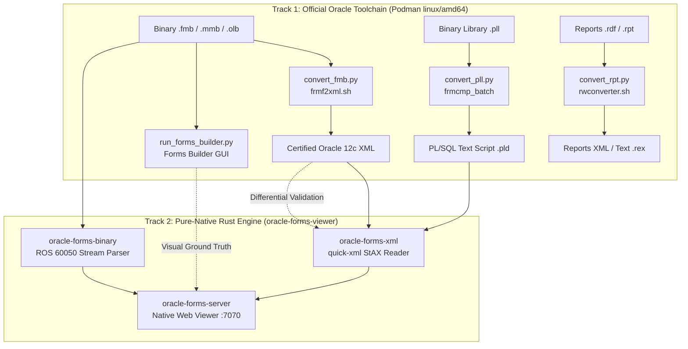

# Podman Oracle Forms 12c Container Environment

An on-demand, containerized environment hosting the official **Oracle Forms 12c Linux installation** on **macOS Apple Silicon (ARM64)** and Linux using Podman and Rosetta 2 (`linux/amd64`) emulation.

This provides full developer capabilities without requiring a Windows virtual machine or remote server:
1. **Interactive Visual Forms Builder GUI (`run_forms_builder.py`)**: Runs the full official Oracle Forms Builder IDE (`frmbld`) on macOS/Linux via X11 forwarding.
2. **Forms/Menus/Object Libraries to XML (`convert_fmb.py`)**: Executes official Oracle `frmf2xml.sh` to generate vendor-standard XML ground truth.
3. **PL/SQL Libraries to Text & Compiler (`convert_pll.py`)**: Executes official Oracle `frmcmp_batch` to export `.pll` binaries into `.pld` ASCII text scripts and compile them back.
4. **Oracle Reports Converter (`convert_rpt.py`)**: Interface for converting Oracle Reports (`.rdf`, `.rpt`, `.rex`) using Oracle `rwconverter.sh`.

---

## 1. Architectural Role & Two-Track Strategy



---

## 2. Capability 1: Running Forms Builder GUI (`run_forms_builder.py`)

Launch the visual Oracle Forms Builder IDE on macOS or Linux:

```bash
python3 tools/podman-converter/run_forms_builder.py
```

Or open a specific module directly:
```bash
python3 tools/podman-converter/run_forms_builder.py /work/samples/simple_module.fmb
```

### macOS Prerequisites (XQuartz)
1. Install XQuartz: `brew install --cask xquartz`
2. In **XQuartz > Settings > Security**, enable **"Allow connections from network clients"**.
3. Restart XQuartz (`Cmd + Q` and reopen).
4. Run `python3 tools/podman-converter/run_forms_builder.py`. The Python script automatically configures `xhost`, exports required paths, mounts your repository to `/work`, sets up `FORMS_BUILDER_CLASSPATH`, and starts `frmbld`.

Inside Forms Builder, navigate to `/work` in the File dialog to open forms from `samples/` or internal test folders.

For complete details on navigating Forms Builder, editing canvases, and inspecting triggers, see **[ORACLE-FORMS-BUILDER-GUI.md](../../ORACLE-FORMS-BUILDER-GUI.md)**.

---

## 3. Capability 2: Headless Batch Conversion Scripts

All scripts are written in Python 3, follow the repository's coding conventions, and require zero local Oracle runtime installations.

### 1. Forms, Menus & Object Libraries to XML (`convert_fmb.py`)
Converts `.fmb`, `.mmb`, and `.olb` modules into certified XML representations (`*_fmb.xml`, `*_mmb.xml`, `*_olb.xml`):

```bash
# Verify environment readiness
python3 tools/podman-converter/convert_fmb.py --check

# Convert a form (produces <stem>_fmb.xml beside original):
python3 tools/podman-converter/convert_fmb.py samples/simple_module.fmb

# Convert with custom destination:
python3 tools/podman-converter/convert_fmb.py samples/simple_module.fmb -o ./converted/simple_module.xml
```

### 2. PL/SQL Libraries to Text & Compiler (`convert_pll.py`)
Converts binary `.pll` libraries to human-readable `.pld` text scripts (and compiles `.pld` back into `.pll`):

```bash
# Verify environment readiness
python3 tools/podman-converter/convert_pll.py --check

# Export binary .pll to text .pld:
python3 tools/podman-converter/convert_pll.py samples/library.pll

# Compile text .pld back into binary .pll:
python3 tools/podman-converter/convert_pll.py samples/library.pld --compile
```

### 3. Oracle Reports Converter (`convert_rpt.py`)
CLI interface for converting Oracle Reports definitions (`.rdf`, `.rpt`, `.rex`) into Reports XML or text definitions using `rwconverter.sh`:

> [!WARNING]
> **Container Installation Limitation**: The container's `oracle_home` was installed using Oracle's `Standalone Forms Builder` profile, which deliberately omits Oracle Reports (`rwconverter.sh`). In Oracle 12c, installing Reports requires a separate, full **Oracle Fusion Middleware Infrastructure (WebLogic Server 12c)** installation.
> 
> **Recommended Alternative (Track 2 Native Rust)**:
> Oracle Reports `.rdf` files use the exact same `ROS.60050` container format as Forms `.fmb` files! You can inspect and dump reports immediately using the native Rust toolchain with **zero Oracle or WebLogic dependencies**:
> ```bash
> cd oracle-forms-viewer
> cargo run -p oracle-forms-cli -- inspect /path/to/report.rdf
> cargo run -p oracle-forms-cli -- dump-sql /path/to/report.rdf -o ./extracted-sql
> ```

```bash
# Verify environment readiness
python3 tools/podman-converter/convert_rpt.py --check

# Convert report to XML (default, if rwconverter is available):
python3 tools/podman-converter/convert_rpt.py samples/invoice.rdf

# Export report to ASCII text script (.rex):
python3 tools/podman-converter/convert_rpt.py samples/invoice.rdf --format rex
```

---

## 4. Architecture & Lifecycle

```text
[ Host Machine (macOS ARM64 / Linux x86_64) ]
   │
   ├── run_forms_builder.py  ──► Launches GUI via X11 / XQuartz
   ├── convert_fmb.py        ──► Runs headless frmf2xml.sh batch conversion
   ├── convert_pll.py        ──► Runs headless frmcmp_batch for PL/SQL libraries
   └── convert_rpt.py        ──► Dispatches rwconverter.sh for Oracle Reports
          │
          ▼  (podman run --rm --platform linux/amd64 -v host_dir:/work:Z)
[ Podman Container (linux/amd64) ]
   ├── OS: Oracle Linux 8 Slim
   ├── Runtime: OpenJDK 8, X11 & Motif libraries, glibc-devel
   ├── /work (Mounted workspace root)
   └── /oracle_home (Mounted Oracle Forms 12c installation)
```

- **Ephemeral Execution (`--rm`)**: Containers terminate immediately upon exit, consuming zero idle memory or background CPU.
- **Zero-Copy Host Mounts (`/work:Z`)**: Workspace directories are mounted directly so generated XML, PLD, and edited forms write straight to your local filesystem.

---

## 5. Tooling Directory Reference

| File / Folder | Purpose |
| :--- | :--- |
| `Containerfile` | Container definition building `forms-converter:latest` with OpenJDK 8, Motif, and X11 libraries. |
| `run_forms_builder.py` | Python GUI launcher configuring XQuartz, display forwarding, `FORMS_BUILDER_CLASSPATH`, and starting `frmbld`. |
| `convert_fmb.py` | Python CLI runner for headless `frmf2xml.sh` conversion (`.fmb`, `.mmb`, `.olb` to XML). |
| `convert_pll.py` | Python CLI runner for headless `frmcmp_batch` conversion (`.pll` <-> `.pld`). |
| `convert_rpt.py` | Python CLI runner for headless `rwconverter.sh` conversion (`.rdf`, `.rpt` to XML / `.rex`). |
| `oracle_home/` | Installed Oracle Forms 12c standalone home containing binaries (`bin/frmbld`, `bin/frmcmp_batch`, `bin/frmf2xml.sh`, `lib/`, `jlib/`). |
| `installer/` | Staging directory for original Oracle installation archives (excluded from Git). |

---

## 6. Integration with `oracle-forms-viewer`

The container environment connects directly with the pure-native Rust toolchain:
1. **Certified XML Generation**: `convert_fmb.py` generates certified `*_fmb.xml` files consumed by `oracle-forms-xml` and displayed in `oracle-forms-server` on port 7070.
2. **PL/SQL Text Ingestion**: `convert_pll.py` produces `.pld` files directly parseable by the native Rust PLD parser in `oracle-forms-xml`.
3. **Sibling Discovery**: When opening a `.fmb` in `oracle-forms-server`, the server automatically detects if a companion `*_fmb.xml` exists and renders the canonical layout.
4. **Visual Ground-Truth Audit**: Running `run_forms_builder.py` allows side-by-side inspection to confirm that our native SVG canvas renderer reproduces authentic Oracle coordinate scaling and widget layouts.
